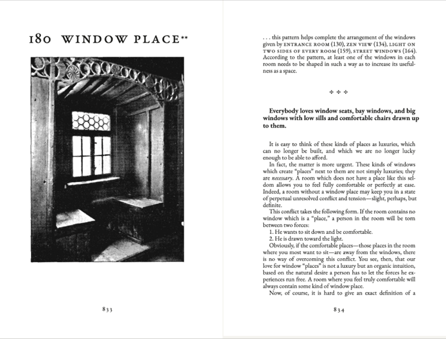
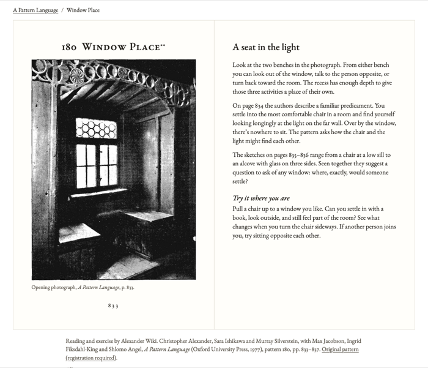

We set the wiki's type by putting a spread of *A Pattern Language* beside our own reading of the same pattern and adjusting until they felt alike. This page keeps that comparison so later changes can be checked against it.

## The book

*A Pattern Language* (Oxford University Press, 1977), pattern 180, pp. 833–834.

## The wiki

[Window Place](/patterns/window-place) on this site.

## What we took from it

- **One Garamond family.** EB Garamond for text, small capitals for titles and oldstyle figures, as in the book.
- **Body size.** Text is set at 1.15–1.3rem, scaling with the screen. This is the size of the pattern commentary above, and every reading page now uses it.
- **Paragraphs.** A space between paragraphs, with no first-line indent.
- **Plate and commentary.** On wide screens a pattern opens as a two-page spread, with the plate on the left and our commentary on the right. On phones the two stack.
- **Titles.** Pattern titles are set in spaced full capitals, flush left, as on p. 833. The pattern number sits above them on a small line of its own.
- **Two voices.** Everything you read is set in EB Garamond. A small monospaced face (DM Mono) is used only for the working parts: the navbar, pattern numbers, page references and years. We took this from the Co–Star app, which pairs a serif for its words with a mono for its labels.
- **Quiet frame.** White paper, near-black ink and hairline rules. Colour comes from the pictures. The yellow of the Oxford jacket appears in one place only, the shelf of books on the [Works](/works) page.
