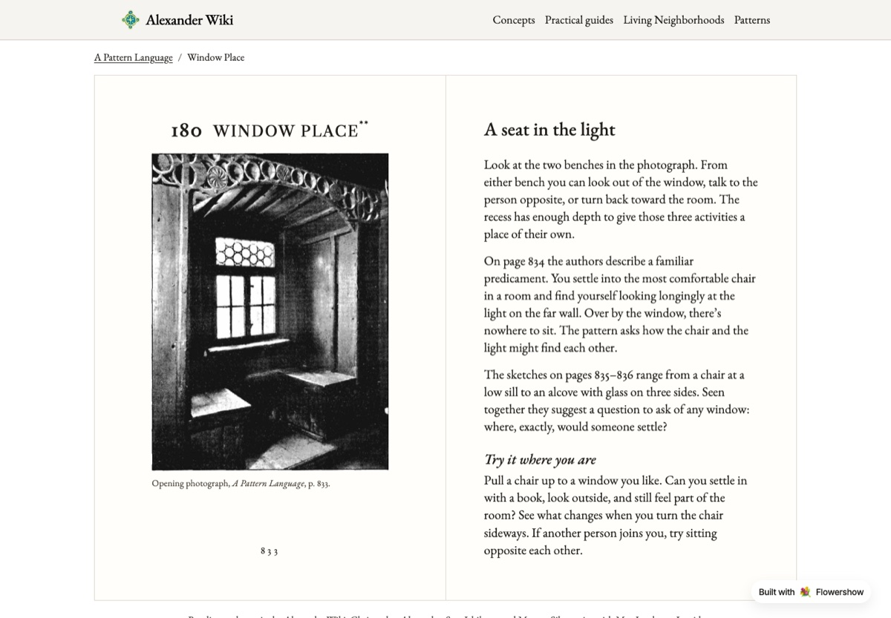

Open [Window Place](https://alexander-wiki-preview-rufuspollock.flowershow.me/patterns/window-place) to study the window seat pictured in the book. [Positive Outdoor Space](https://alexander-wiki-preview-rufuspollock.flowershow.me/patterns/positive-outdoor-space) offers a second way into the pattern index. On a desktop, each illustration faces its reading. On a phone, the illustration comes first.

