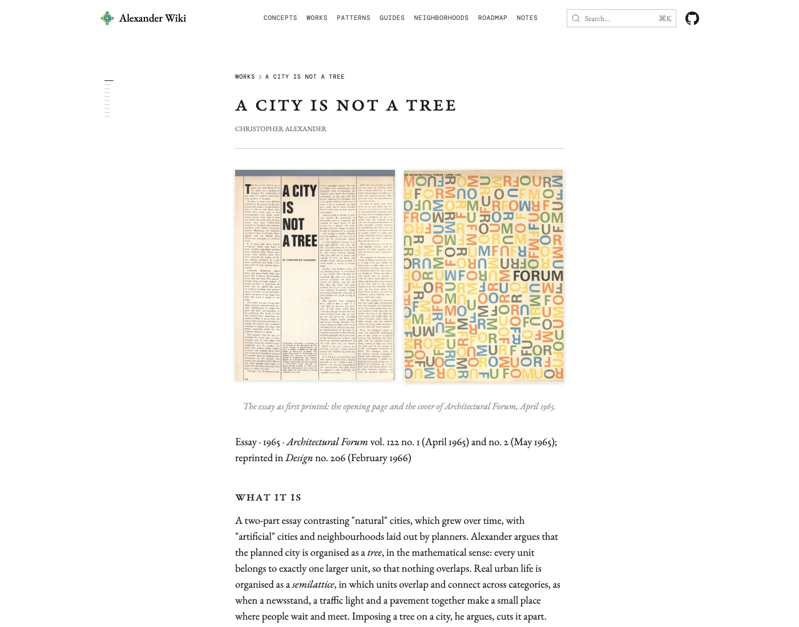

Christopher Alexander's 1965 essay [A City is Not a Tree](https://alexander.wiki/works/1965-a-city-is-not-a-tree) is now on the site in full, both parts as first printed in *Architectural Forum*, with all 31 of the original figures. The page opens with the magazine's opening page and the April 1965 cover.

