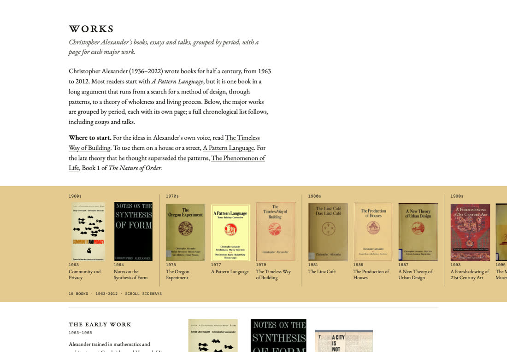

The [Works](https://alexander.wiki/works) page opens with a timeline of all fifteen of Alexander's books, from 1963 to 2012. Scroll it sideways. Below it, each period's books sit beside a short account of that period, and a full chronology follows.

Across the site, reading pages have a quieter layout. The text is in one column, with a contents rail on the left and notes beside the line they refer to. Pattern titles follow the book, and the front page now introduces Alexander, names the people he worked with, and ends with three pictures from his books.

