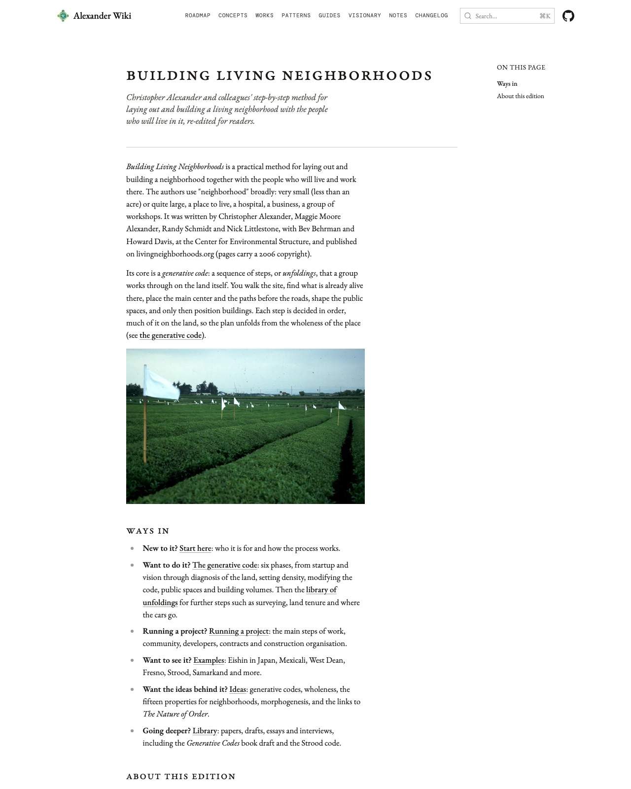
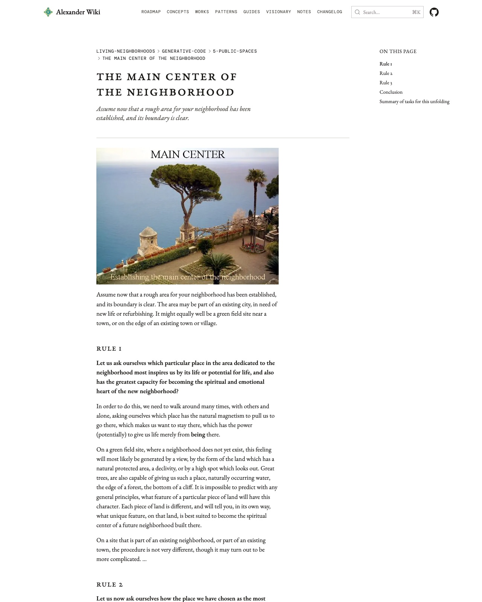

[Living Neighborhoods](https://alexander.wiki/living-neighborhoods) is now a reader's edition of *Building Living Neighborhoods*, the step-by-step method Christopher Alexander, Maggie Moore Alexander, Randy Schmidt and Nick Littlestone (with Bev Behrman and Howard Davis) published at livingneighborhoods.org. The first ten pages are live: the entry page, the authors' welcome, the six phases of the generative code, phase 5 (public spaces) with its steps, the Eishin campus, and how the edition was made. The rest follow once these have been checked.



**Why.** The original site holds some of the most practical material Alexander's circle produced, but it was very hard to use: frames, a JavaScript menu, two overlapping versions of many pages, and navigation that followed the authors' working folders (`ht-0/`, `actions/`, `packets/`…). Of its 209 HTML files, about 100 hold distinct content; the rest are copies, older versions, menus or notices.

**What changed.** Every one of the 209 original pages was accounted for: 99 became pages, 44 were merged into another page, 47 were duplicates and 19 held no reader content. The pages were cleaned of old web markup, with the authors' words and images (at full size) kept. Instead of the old folders, the material is arranged in reading order: do it, then understand it, then see it.

```
living-neighborhoods/
├── start-here           the authors' welcome and how the process works
├── generative-code/     the method: six phases, each with its steps
│   ├── 1-startup-and-vision/
│   ├── 2-diagnosis/
│   ├── 3-density/
│   ├── 4-modifying-the-code/
│   ├── 5-public-spaces/
│   └── 6-building-volumes/
├── unfoldings/          further steps (surveying, land tenure, cars…)
├── running-a-project/   main steps of work, contracts, developers
├── examples/            Eishin, Mexicali, West Dean, Fresno, Strood…
├── ideas/               the theory, Nature of Order references
├── library/             papers, essays, interviews
├── tools/               workbook, drawing pad
└── about/               how it was made; old URL → new page table
```

Each step now reads like a page of a manual, with its rules, a summary of tasks, and links to the previous and next step in its phase.



Every page links back to its original, and [About this edition](https://alexander.wiki/living-neighborhoods/about) maps each old address to its new page. Works also gains an entry for [Building Living Neighborhoods](https://alexander.wiki/works/2006-building-living-neighborhoods). The full crawl of the original site is preserved in [natureoforder/livingneighborhoods](https://github.com/natureoforder/livingneighborhoods).
