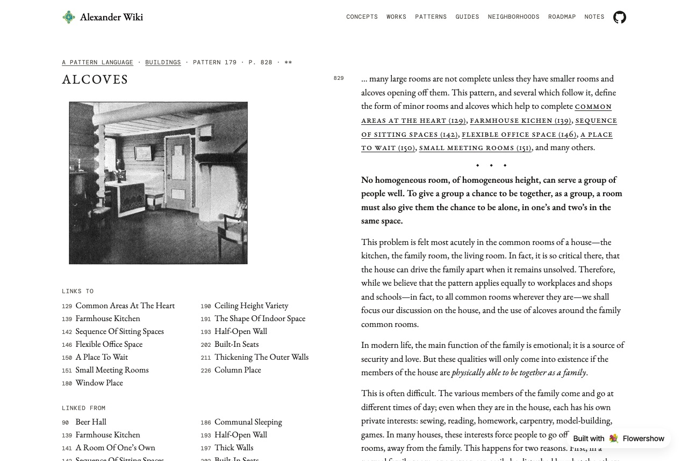

The whole of *A Pattern Language* (1977) is now on the wiki, as printed: every pattern's full text, stars, opening photograph and drawings, with the printed page numbers in the margin and the problem and "Therefore" solution in bold, as in the book. Every pattern reference links to its page, and each pattern lists the patterns it leads to and the patterns that lead to it. The authors' "Using This Book", the Summary of the Language and the introductions to Towns, Buildings and Construction are here too, and the index has a box to find a pattern by name or number. [Browse the 253 patterns](https://alexander.wiki/patterns)

