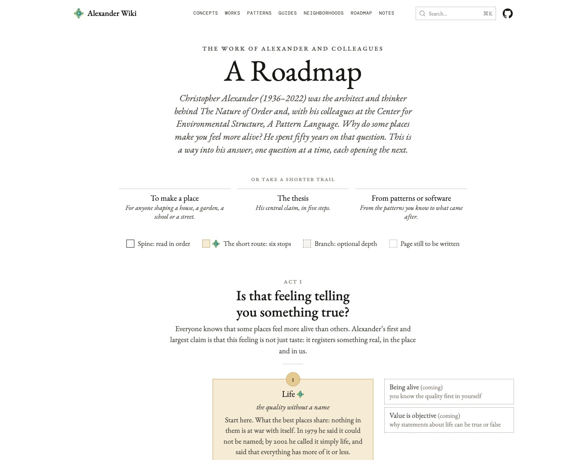

The new [roadmap](https://alexander.wiki/roadmap) is a way into Christopher Alexander in five acts. It starts from the question of why some places make you feel more alive and follows it to centers, the fifteen properties, how living structure is made, who makes it, and what he thought lay underneath. Six starred stops make a short route, and three shorter trails, each on its own page, serve readers who want to make a place, want the thesis, or know patterns from software.

