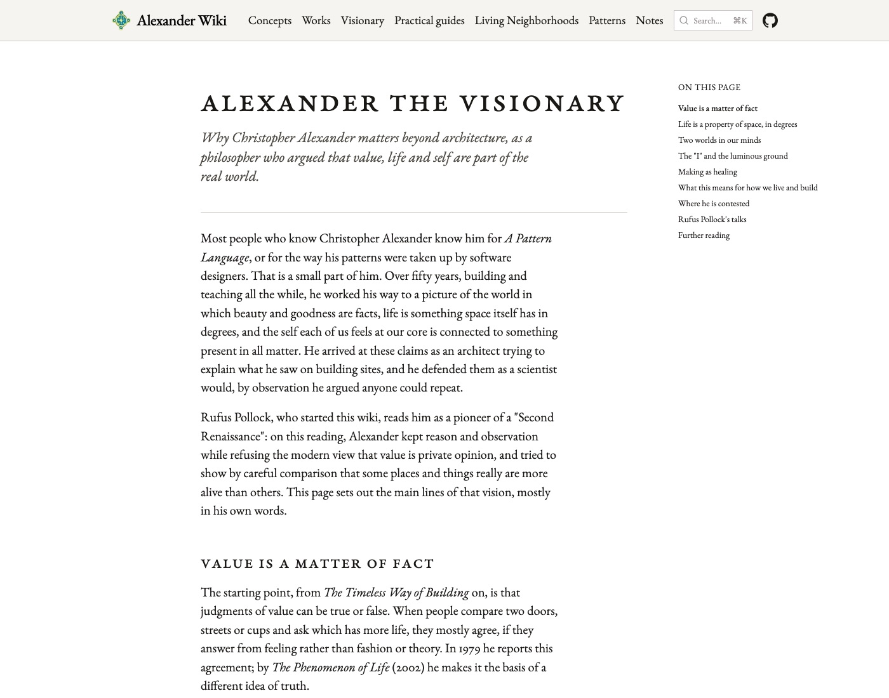

A new page sets out why Christopher Alexander matters beyond architecture: his argument that value is a matter of fact, that life is a property of space in degrees, and that each living center opens onto a shared ground he called the "I". It is told mostly through eleven passages from *The Timeless Way of Building* and *The Nature of Order*, with Rufus Pollock's two talks on Alexander as a Second Renaissance pioneer. [Read Alexander the visionary](https://alexander.wiki/notes/alexander-as-philosopher)

It now lives in Notes as [Alexander as philosopher](https://alexander.wiki/notes/alexander-as-philosopher), with Rufus Pollock's 2026 talk near the top.
