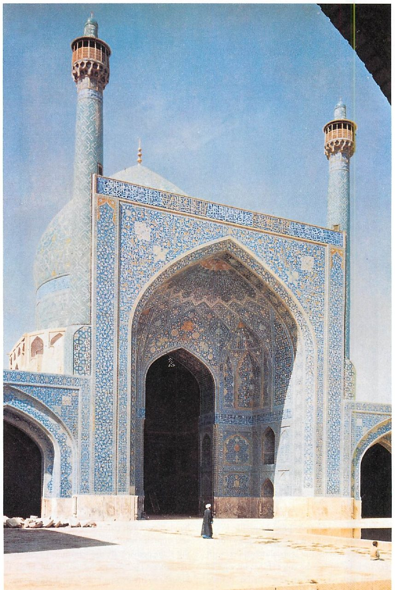

A new quick way into *The Nature of Order*: Christopher Alexander's four books in eight questions, from why some places feel alive to the ground he believed lies under everything, told through some sixty of his own pictures and book pages, from the Shah Mosque in Isfahan to Matisse painting step by step and the Eishin campus. [See The Nature of Order in pictures](https://alexander.wiki/nature-of-order)

