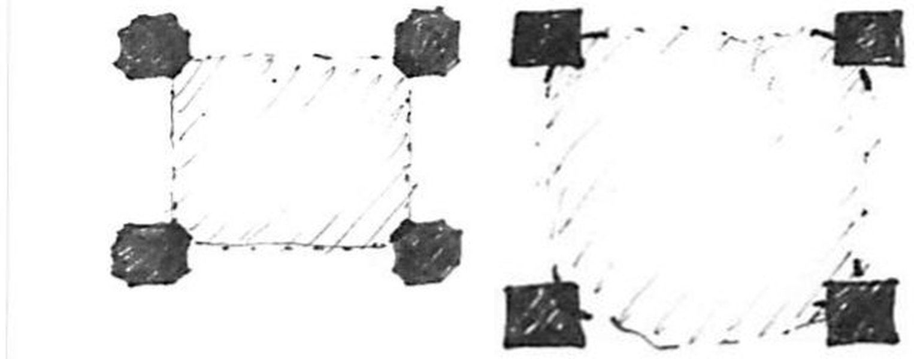
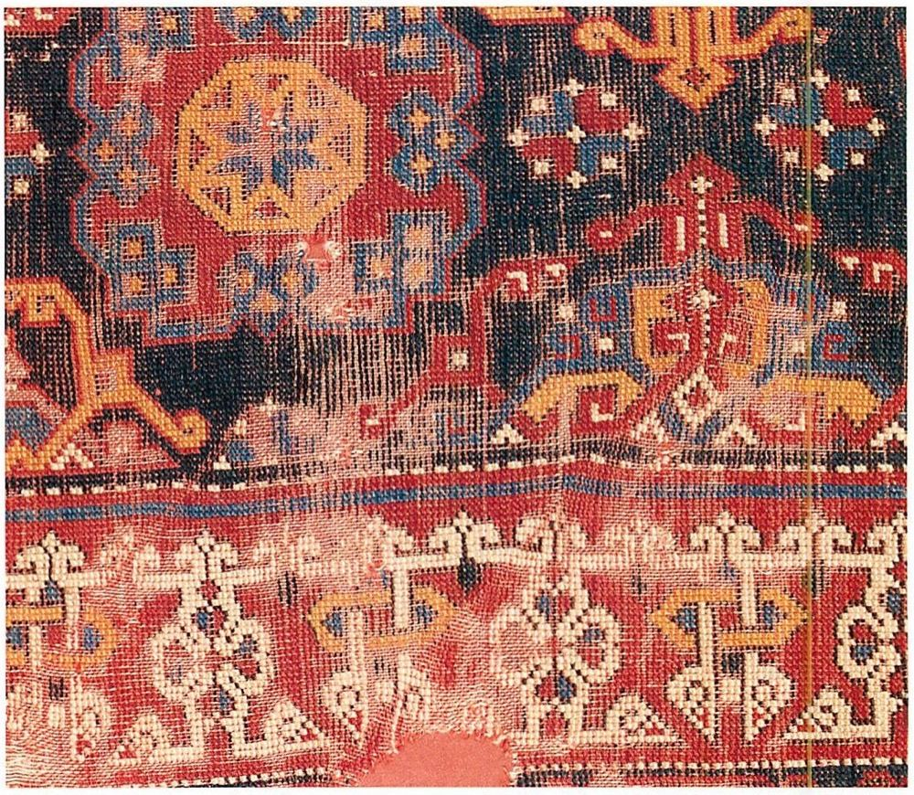
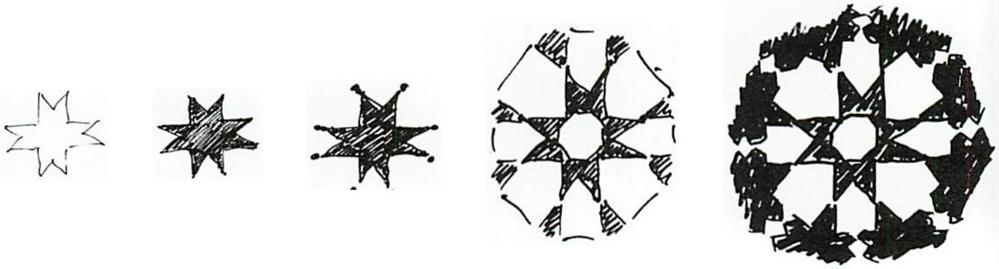

# Centers

## Alexander's view

A center is Alexander's word for any zone of space that holds together and stands out: a pond, a window, a patch of sunlight, the space under a tree, a tile, a room. Every place is full of them, at every size, nested and overlapping, and the whole system of them is what he calls the place's [wholeness](wholeness.md). He chose "center" rather than "part" or "whole" for two reasons. A center has no sharp edge, so you need not decide where a pond stops. And the word points outward to relationships, where "whole" draws a skin around a thing and cuts it off.

Three ideas carry the theory, set out in *The Phenomenon of Life*, chapters 3 and 4.

- **Centers are made by the whole, not assembled from parts.** A single dot on a sheet of paper changes which regions of the sheet stand out. The strength of any center depends on the configuration around it.
- **Centers are made of other centers, and of nothing else.** Try to say why a leaf is a center and you can only name more centers: its tip, its spine, its ribs, the flesh between them. Alexander calls this recursive and treats the circularity as the key to the subject, not a flaw in it.
- **Centers come to life by helping each other.** A center has more life when the centers around it and within it intensify it, and a structure has more life the denser and more intense this mutual helping is. The test for helping is practical: look at A with B and without B, and ask which has more life.

So the field of centers, not any list of features, is primary for him. The [fifteen properties](fifteen-properties.md) are, in his later words, "the fifteen ways in which centers can help each other come to life". He admits that a mathematical definition of the field is still missing, and leaves it to "the work of other investigators".

## In *The Phenomenon of Life*

From Book One of *The Nature of Order*, [*The Phenomenon of Life*](../works/2002-the-phenomenon-of-life.md), chapter 3, "Wholeness and the Theory of Centers", chapter 4, "How Life Comes from Wholeness", and the close of chapter 5. The headings and lead-ins are ours.

### What a center is

He has just shown how a single dot on a blank sheet of paper makes new regions of the sheet stand out (see [Wholeness and centers](wholeness-and-centers.md) for the demonstration).

> We may think of these entities as parts (as they may sometimes seem to us) or as local wholes or sub-wholes. But, as I have illustrated in the case of the sheet of paper and the dot, these parts and entities are rarely pre-existing. They are more often themselves *created* by the wholeness. This apparent paradox (seeming paradoxical only because of the simple-minded way in which it is expressed) is a fundamental issue in the nature of wholeness: the wholeness is made of parts; the parts are created by the wholeness.
>
> — *The Phenomenon of Life*, ch. 3, "Wholeness and the Theory of Centers", pp. 83–84

> In using the word center in this way, I am not referring at all to a point center like a center of gravity. I use the word center to identify an organized zone of space — that is to say, a distinct set of points in space, which, because of its organization, because of its internal coherence, and because of its relation to its context, *exhibits centeredness*, forms a local zone of relative centeredness with respect to the other parts of space.
>
> — *The Phenomenon of Life*, ch. 3, "Wholeness and the Theory of Centers", p. 84

### Why "center" and not "whole"

> Suppose, for example, I am talking about a fishpond, and want to call it a whole. To be accurate about it in a mathematical theory, I want be able to draw a precise boundary around this whole, and say for each point in space whether it is part of this set of points or not. But this is very hard to do. Obviously the water is part of the fishpond. What about the concrete it is made of, or the clay under the ground? Is this part of the whole we call "the pond"? How deep does it go? Do I include the air which is just above the pond? Is that part of the pond? What about the pipes bringing in the water?
>
> ...
>
> When I call the pond a center, the situation changes. I can then recognize the fact that the pond does have existence as a local center of activity: a living system. It is a focused entity. But the fuzziness of its edges becomes less problematic. The reason is that the pond, as an entity, is focused towards its center. It creates a field of centeredness.
>
> — *The Phenomenon of Life*, ch. 3, "Wholeness and the Theory of Centers", p. 84

> If I call it a whole, it then exists in my mind as an isolated object. But if I call it a center, it already tells me something extra; it creates a sense, in my mind, of the way the sink is going to work in the kitchen. It makes me aware of the larger pattern of things, and the way this particular element — the kitchen sink — fits into that pattern, plays its role in that pattern.
>
> — *The Phenomenon of Life*, ch. 3, "Wholeness and the Theory of Centers", p. 85

> The same is true of all the entities which appear in the world. When I think of them as wholes, or entities, I focus on their boundedness, their separation. When I think of them as centers, I become more aware of their relatedness; I see them as focal points in a larger unbroken whole and I see the world as whole.
>
> — *The Phenomenon of Life*, ch. 3, "Wholeness and the Theory of Centers", p. 85

### Centers depend on the whole configuration

> Thus the strength of any given center is not merely a function of the internal shape which creates that center in itself, but comes about as a result of the influence of many other factors which extend outward in the given region of ... space, always as a result of the configuration *as a whole*. ... The centers which make up any given wholeness do not exist independently, but appear as elements which are generated *by* the configuration as a whole.
>
> — *The Phenomenon of Life*, ch. 3, "Wholeness and the Theory of Centers", pp. 85–86

### Centers help each other

His first worked example is the terrace of the Hotel Palumbo at Ravello: thirteen-foot bays between columns, and on the corners of each column a small chamfer.

> It comes about in a very definite way because of the centers in the wholeness and their relation to one another. *In particular, it comes about because the different centers help each other.*
>
> It is this mutual helping among the centers which causes the life and is the crux of the whole thing.
>
> ...
>
> These chamfers, which are only two or three inches across, strengthen and intensify the structural bay which is created by the columns, and is some 13 feet across. At the same time, the chamfer also helps and intensifies the column itself.
>
> — *The Phenomenon of Life*, ch. 4, "How Life Comes from Wholeness", p. 112

*Left: "Helping: when the bay has octagonal chamfered columns, the chamfers form a subtly shaped octagonal bay. The column helps the bay, and the bay becomes more coherent." Right: "Not helping: when the bay has square columns, the columns eat into the space of the bay; the bay is less coherent." Alexander's captions, p. 113.*

> Suppose we have two centers A and B, and we want to know if B is helping A or not. We simply ... look at A *with* B, and *without* B, and go back and forth between the two, using the criterion of life to decide which of the two, A with B or A without B, has more life. If, of the two, A with B has more life, then B is helping A.
>
> — *The Phenomenon of Life*, ch. 4, "How Life Comes from Wholeness", pp. 114–115

### Centers are made of centers

> *The crux of the matter is this: a center is a kind of entity which can only be defined in terms of other centers.* The idea of a center cannot be defined in terms of any other primitive entities *except centers*.
>
> — *The Phenomenon of Life*, ch. 4, "How Life Comes from Wholeness", p. 116

> *Centers are always made of other centers.* A center is *not* a point, *not* a perceived center of gravity. It is rather a field of organized force in an object or part of an object which makes that object or part exhibit centrality. This field-like centrality is fundamental to the idea of wholeness.
>
> — *The Phenomenon of Life*, ch. 4, "How Life Comes from Wholeness", p. 118

> So there is a fundamental circularity which we cannot escape. This circularity is not a mistake, or an indication of something logically vicious in the argument. *On the contrary, it is the essential feature of the situation.*
>
> — *The Phenomenon of Life*, ch. 4, "How Life Comes from Wholeness", p. 118

### Each center is a field of centers

*"15th-century Anatolian carpet with a complex and beautiful border: the so-called Ghirlandaio design." Alexander's caption, p. 120. In the book he then draws out one ornament from the border as a field of smaller centers (p. 121).*

> We may summarize the action of this field by means of a definition which is explicitly recursive: *Each center is a field of other centers.* By this definition, each of these other centers must then also be a field of centers. Thus a center is a field of centers, and within that field each center is a field of yet other centers. There are no ultimate elementary components of the field, except the centers themselves.
>
> — *The Phenomenon of Life*, ch. 4, "How Life Comes from Wholeness", pp. 120–121

> The mathematical definition of such a field awaits the work of other investigators. But no matter what the mathematical results, I believe it is true to say this much: *there is no way of defining the field in terms of ultimate elements that are essentially different from centers.*
>
> — *The Phenomenon of Life*, ch. 4, "How Life Comes from Wholeness", p. 121

### How a center gains life

He builds up one star from a tile fragment in the Alhambra in five steps: the outline, then coloured black, then with tips, then with white pentagons between its rays, then with the dark hand-shaped figures around it.

*The black star from the Alhambra tilework, steps 1 to 5. Drawings from p. 124.*

> In this progression, the star obtains progressively more and more life. Even if you are not sure *why* the stars in the five illustrations have progressively more and more life, I think you will agree that they do have it.
>
> — *The Phenomenon of Life*, ch. 4, "How Life Comes from Wholeness", p. 124

> All in all we have a bootstrap relation, in which no one center is the origin of the structure or its life — but the various different centers all support each other mutually. Their life arises mutually as a result of the way the centers prop each other up. No one of them comes first; each helps to support the others. Together they all raise themselves to life.
>
> — *The Phenomenon of Life*, ch. 4, "How Life Comes from Wholeness", p. 126

### The field comes before the properties

Of the fifteen properties, which he had observed for years before he understood them:

> And finally, I came to understand that all of them are, in effect, just the fifteen ways in which centers can help each other come to life. I came to understand that they work, they make things have life, *because* they are the ways in which centers can help each other in space.
>
> — *The Phenomenon of Life*, ch. 5, "Fifteen Fundamental Properties", p. 145

> I finally recognized that it is the field of centers which is primary, not these fifteen properties, and that the properties are simply aspects of the field which help us to understand concretely how the field works.
>
> — *The Phenomenon of Life*, ch. 5, "Fifteen Fundamental Properties", p. 238

## See also

- [Wholeness and centers](wholeness-and-centers.md): the dot-on-paper demonstration and the cyclist under the tree, the two examples the theory starts from.
- [Wholeness](wholeness.md): the whole system of centers in a place, and why the whole comes before its parts.
- [Life (the quality without a name)](quality-without-a-name.md): what the helping between centers produces, and the yardstick for the A-with-B test.
- [The fifteen properties](fifteen-properties.md): the fifteen ways centers help each other.
- [Levels of scale](levels-of-scale.md): the first of them, where a center is helped by centers a half or a quarter of its size.
- [Strong centers](strong-centers.md): the property that names a center's own field-like strength.
- [Living structure](living-structure.md): a wholeness in which centers help each other densely.
- [Structure-preserving transformations](structure-preserving-transformations.md): how a new center is made by strengthening one already latent in the whole.
- [Patterns](patterns.md): Book Two later redefines a pattern as a rule for making a kind of center.
