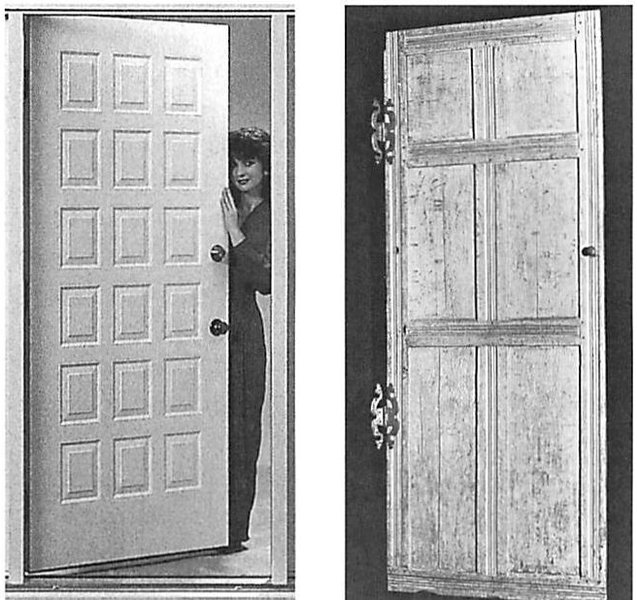
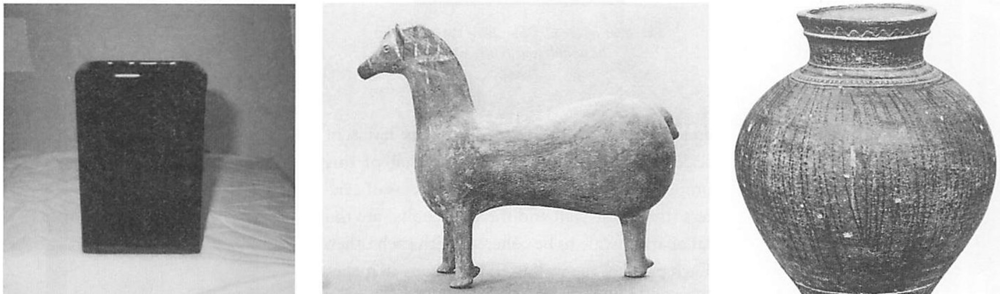
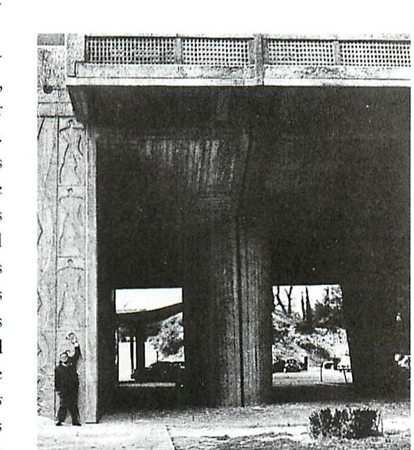
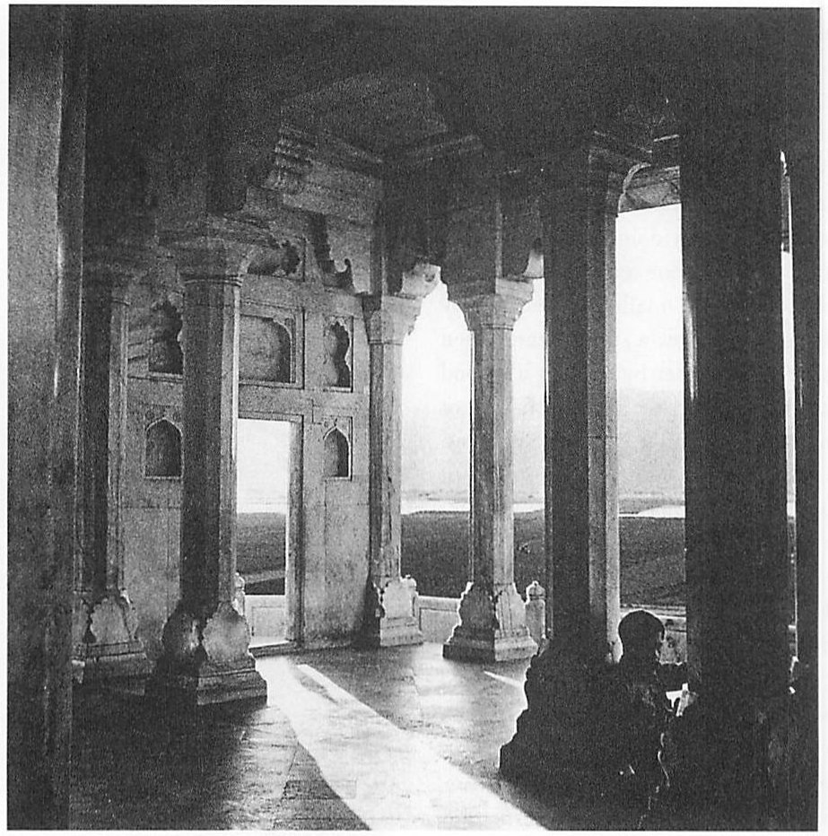
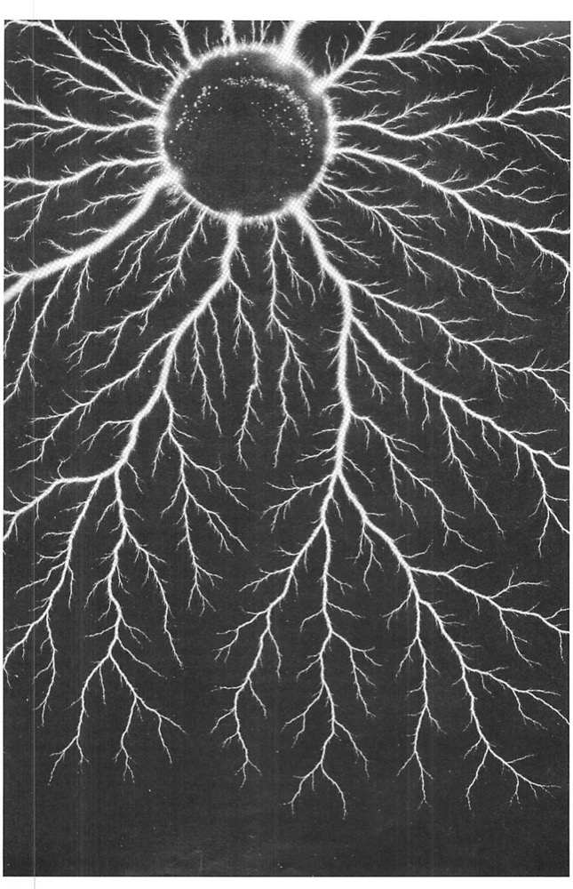
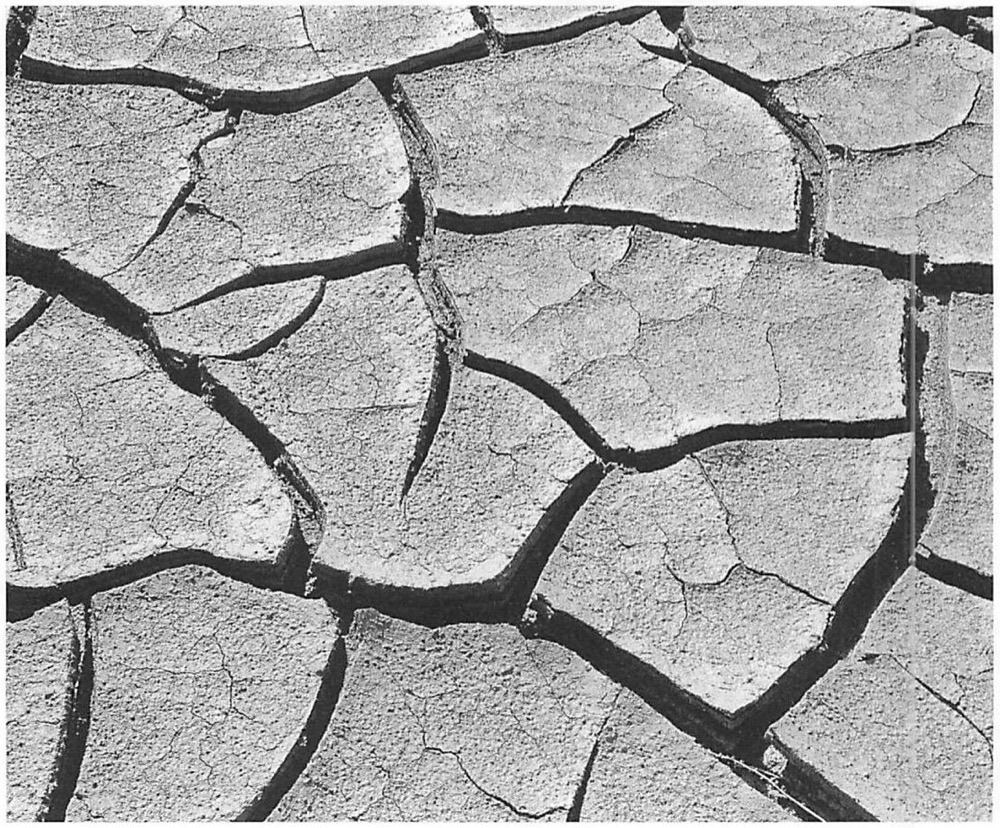
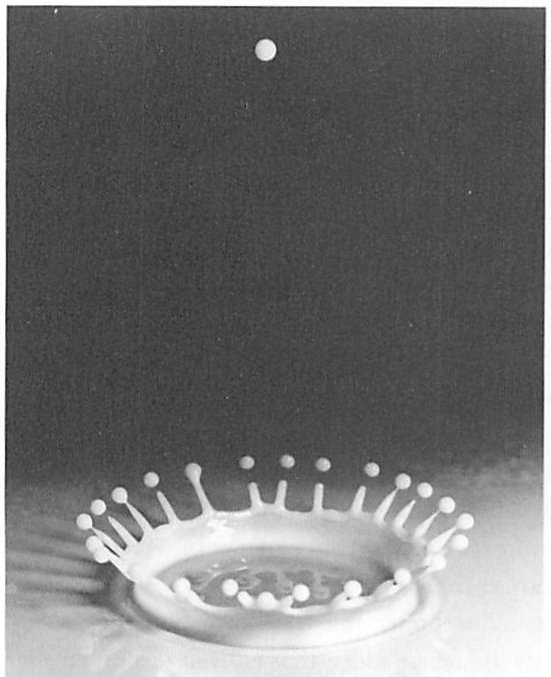

# Levels of scale

## Alexander's view

Levels of scale is the first of the [fifteen properties](fifteen-properties.md), and the first thing Alexander says he noticed when he began comparing things with more life against things with less. Something alive is made of [centers](centers.md) of many sizes: big, middle-sized, small and very small, with clear steps between them.

He adds two conditions straight away, and they are what make the property more than "lots of detail". The steps must not be too big: a center is helped most by another center perhaps a half or a quarter of its size, and hardly at all by one a tenth of its size or less. And the sizes must actually help one another. The machine-made door shown below, with eighteen equal panels, has many sizes but no levels, because nothing in it was made to help anything else. Help runs both ways: small centers intensify large ones, and large ones intensify small ones.

In *The Phenomenon of Life* the property is taught by pairs of pictures: two doors, a painting and a drawing, three vessels, a mosque and an apartment block. He then argues that it is not a matter of taste or culture, because nature is full of it: lightning, trees, rivers, mud cracks. In *The Process of Creating Life* it becomes something you do: a transformation that adds intermediate centers to a structure that is already there.

The figures here are the book's, and the comparisons are Alexander's. His ratios (3:1, 20:1, 2000:1) are rough estimates, and he says himself that no general theory yet explains why levels form in nature.

## In *The Phenomenon of Life*

From Book One of *The Nature of Order*, [*The Phenomenon of Life*](../works/2002-the-phenomenon-of-life.md), chapter 5, "Fifteen Fundamental Properties", and chapter 6, "The Fifteen Properties in Nature". The headings are ours; the captions in quotation marks are his.

### What he noticed first

> The first thing I noticed, when I began to study objects which have life, was that they all contain different scales. In my new language, I would now say that the centers these objects are made of tend to have a beautiful range of sizes, and that these sizes exist at a series of well-marked levels, with definite jumps between them. In short, there are big centers, middle-sized centers, small centers, and very small centers.
>
> — *The Phenomenon of Life*, ch. 5, "Fifteen Fundamental Properties", p. 145

> This observation may seem obvious — almost tautological. But it is not obvious at all. As we shall see, many things which have been made in our period of history do *not* have this feature.
>
> — *The Phenomenon of Life*, ch. 5, "Fifteen Fundamental Properties", p. 145

### Two doors

> If you compare any two things, one with more life and one with less, it is very likely that the one with more life will have better levels of scale in it. The idea is far more subtle than it seems. To understand its subtlety, consider the following pair of doors. Both doors have parts of different sizes in them: panels, jamb, moldings, handle, and so on. But the old Irish door on the right has a variety of sizes which is more dramatically differentiated, more "extended" ... along the range of scale than the door on the left. It has three sizes of panels; it has a gradation of scale from the bottom to the top.
>
> — *The Phenomenon of Life*, ch. 5, "Fifteen Fundamental Properties", p. 146

*Left: "This door seems to have levels of scale, but they don't really work." Right: "Excellent levels of scale: here the levels are beautiful, and really work." Alexander's captions, p. 147.*

> In the left-hand door the detail is there — but the detail isn't *doing* anything to create life in the larger centers, and is therefore almost meaningless. Superficially, the left-hand door has many panels, hence many levels of scale. But although there are indeed many panels forming an *impression* of scale in the door, these panels are cut in on a machine jig, automatically, as they often are in a door trying to be like an old-fashioned door. So, the centers in the panels have no *real* life. And this comes about because the centers are not really made to help each other.
>
> ...
>
> Thus the property of having levels of scale is not a mechanical thing, which merely requires a wide range of different sizes. It arises properly only when each center gives life to the next one.
>
> — *The Phenomenon of Life*, ch. 5, "Fifteen Fundamental Properties", p. 146

### The size of the jumps

> It is also extremely important that to have levels of scale within a structure, the jumps between different scales must not be *too* great.
>
> — *The Phenomenon of Life*, ch. 5, "Fifteen Fundamental Properties", p. 147

His example is a concrete wall whose formwork bolts are a two-thousandth of the area of its panels: "far too great to form levels of scale" (p. 148). Then three vessels.

*Left to right: "Nearly homogeneous vase. There is just one jump in scale, between lip and body, and this jump is about 1:20." "A most beautiful chain of levels in a pottery horse." "Beautifully shaped vase with excellent levels: the body is three times the lip, and the lip is three times the ornament." Alexander's captions, p. 148; the three are stacked on the page.*

> Much better, and beautifully proportioned, are the levels of scale in the pottery horse. It has simple, strongly executed levels of scale. The body is about twice the size of the head; the head about twice the size of the legs; the legs about twice the size of the feet and hooves.
>
> — *The Phenomenon of Life*, ch. 5, "Fifteen Fundamental Properties", p. 148

> Throughout these examples we see that a center becomes most intense in its life when other centers near it have a definite size relation to it at a scale which is perhaps half its size, or twice its size — but not *enormously* bigger, or *enormously* smaller. To intensify a given center, we need to make another center perhaps half or quarter the size of the first. If the smaller one is less than one-tenth of the larger one it is less likely to help it in its intensity.
>
> — *The Phenomenon of Life*, ch. 5, "Fifteen Fundamental Properties", p. 148

### What the property does

> Let us understand clearly, then, what this levels of scale is actually doing in an object. It provides a way in which one center can be helped in its intensity by other smaller centers. If I try to make a certain window a strong center, then I can intensify this center by making a second smaller center to support the first, at the sill, or ... at the jamb, or in the wall next to the window. This second center will tend to be most helpful in intensifying the first one (the window itself) if it is not *too* different in its size. For instance, a window can be intensified by a windowsill, but it is unlikely to be intensified by a nail.
>
> — *The Phenomenon of Life*, ch. 5, "Fifteen Fundamental Properties", p. 149

*"Profound hierarchy of scale in tilework at Meshed." Alexander's caption, p. 149.*

*"Poorly developed levels of scale in Le Corbusier's Marseilles block of apartments." Alexander's caption, p. 149.*

> In the tilework at Meshed, we see this principle carried from the giant tower-like structures through many intermediate levels, all the way down to the tiles themselves. There are distinct wholes, or centers, visible at every level in between the two.
>
> — *The Phenomenon of Life*, ch. 5, "Fifteen Fundamental Properties", p. 149

> But in the good examples, like the porch on the next page, the levels of scale create a field effect which *creates* centers: it is not only true that the small centers intensify the large ones, but the large centers also intensify the small ones. The property creates life by helping centers to intensify each other.
>
> — *The Phenomenon of Life*, ch. 5, "Fifteen Fundamental Properties", p. 149

*"Magnificent levels of scale in a porch near Isfahan." Alexander's caption, p. 150.*

### In rooms and towns

The chapter's functional notes carry the property into rooms, windows and the structure of a city, with references to *A Pattern Language* (Alexander, Ishikawa, Silverstein and others, 1977).

> Even a tiny house in which there is one dramatically large room, two small rooms, and two tiny alcoves, will work very much better than one in which there are four equal-sized small rooms ...
>
> — *The Phenomenon of Life*, ch. 5, "Fifteen Fundamental Properties", p. 150

Later in the chapter he puts the property in one line:

> LEVELS OF SCALE is the way that a strong center is made stronger partly by smaller strong centers contained in it, and partly by its larger strong centers which contain it.
>
> — *The Phenomenon of Life*, ch. 5, "Fifteen Fundamental Properties", p. 239

### In nature

Chapter 6 answers the objection that the properties are only habits of human perception, by finding each of them in nature.

*"Electric discharge in an electric field." Alexander's caption, p. 247.*

> Why does the electrical discharge in the photograph opposite have levels of scale in it? The massive build-up of charge dissipates in a rush, leaving zones which have a remaining charge that are by definition much smaller than the original charge. These small zones discharge, once again leaving still smaller ones, which then discharge in a kind of mopping-up operation. The levels of scale follow naturally from the way this system brings itself to order.
>
> In related fashion, the appearance of levels of scale is widespread throughout natural systems. The tree: trunk, limbs, branches, twigs. The cell: cell wall, organelles, nucleus, chromosomes. A river: bends in the river, tributaries, eddies, pools at the edge.
>
> — *The Phenomenon of Life*, ch. 6, "The Fifteen Properties in Nature", p. 246

> Few natural systems lack the structure of levels because, in nature, scale plays such an important role. When we double or triple the size of a given thing, there are already different forces at work, a different interplay of phenomena, and therefore new kinds of wholes are born, for purely physical reasons.
>
> ...
>
> But, to my knowledge, no general mathematical explanation has been given which predicts the formation of these levels or the size of jumps between levels. ... Explained or not, the property itself is pervasive throughout nature.
>
> — *The Phenomenon of Life*, ch. 6, "The Fifteen Properties in Nature", p. 248

*"Mud cracks in the surface of the Borro desert show how large coherent pieces, have, within them, less well-defined smaller pieces, which in turn have cracks next to them as a next level down." Alexander's caption, p. 250.*

## In *The Process of Creating Life*

From Book Two, [*The Process of Creating Life*](../works/2002-the-process-of-creating-life.md), chapter 2. Here the property is explained as something a structure-preserving process produces, and then turned round into a step you can take.

### As a result of unfolding

> 1. LEVELS OF SCALE. For example, within a given center A or directly near it, we shall find smaller centers, B, one level of scale smaller. That happens because any perturbation or irregularity which develops near A causes the start of a latent center B. As this latent center gets stronger, the strengthening will then cause a nucleation near the first center. The nucleation *must* be at a jump in scale, since if too similar in size it would not preserve the structure.
>
> — *The Process of Creating Life*, ch. 2, "Structure-Preserving Transformations", p. 66

*"LEVELS OF SCALE forming in a milk-drop splash." Alexander's caption, p. 66.*

> The process is quite general. If a large center is developing, and within it, somewhere, a small dot occurs (randomly), then to intensify this small center under structure-preserving transformations without disturbing the larger center, the small center must be kept *substantially* smaller than the first; yet if it is *too* small, it does nothing to enhance the larger one.
>
> — *The Process of Creating Life*, ch. 2, "Structure-Preserving Transformations", p. 66

### As a transformation

> Take, for example, LEVELS OF SCALE. We have seen in the previous section that levels of scale (viewed as a geometric property) will arise in a system naturally, as a result of structure-preserving transformations. We may, alternatively, think of LEVELS OF SCALE as a *transformation itself* which *introduces* levels of scale into a given structure. Thus, for any given structure, this transformation may be thought of as injecting into it, new centers which provide more beautifully articulated intermediate LEVELS OF SCALE.
>
> — *The Process of Creating Life*, ch. 2, "Structure-Preserving Transformations", p. 77

> The LEVELS-OF-SCALE transformation introduces intermediate-sized centers to fill out the hierarchy of scales that exist in a given wholeness. In this case, some zone that has been loosely distinguished, is differentiated further into smaller parts. This can happen so that these new parts are similar in size to one another, but one level smaller than the center which is being differentiated. In another application of this transformation, a large center is made more coherent and distinct by the introduction of smaller parts, which then act together with the large center to form a recognizable and distinctive hierarchy.
>
> — *The Process of Creating Life*, ch. 2, "Structure-Preserving Transformations", p. 77

## See also

- [Centers](centers.md): levels of scale is one of the ways centers help each other; that page explains what a center is.
- [The fifteen properties](fifteen-properties.md): the other fourteen, and why Alexander came to treat the field of centers, not the list, as primary.
- [Strong centers](strong-centers.md): his one-line summary defines levels of scale through strong centers.
- [Boundaries](boundaries.md): a boundary works best when it is of the same order of size as what it bounds, the same rule about jumps.
- [Gradients](gradients.md): the old Irish door also has "a gradation of scale from the bottom to the top".
- [Structure-preserving transformations](structure-preserving-transformations.md): where the property becomes a step in a process.
- [Life (the quality without a name)](quality-without-a-name.md): what the comparisons on this page are judging.
