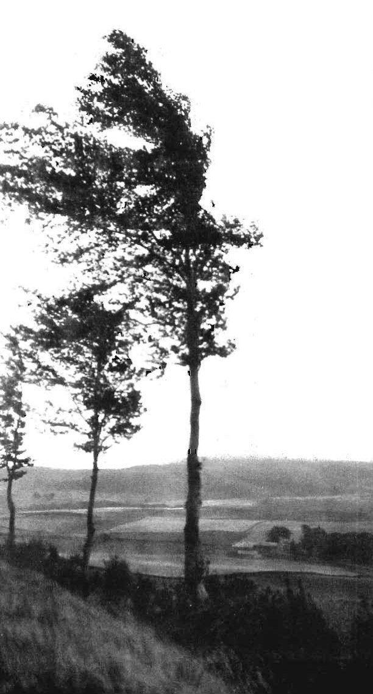
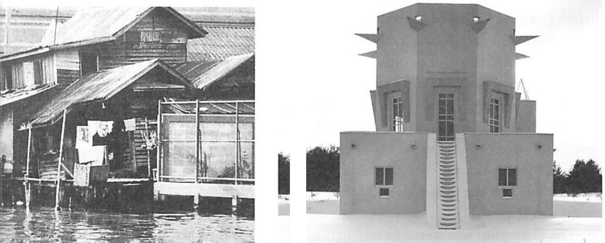

# Life (the quality without a name)

## Alexander's view

All of Alexander's work starts from one observation: some places, buildings and things have a quality that others lack, and we can feel the difference. In *The Timeless Way of Building* (1979) he calls it "the quality without a name". He claims it is objective and precise, the root criterion of life and spirit, and that the difference between a good building and a bad one is as real as the difference between health and sickness. He offers a working definition, freedom from inner contradictions, and then tries seven words for it: alive, whole, comfortable, free, exact, egoless, eternal. Each catches part of it and each misleads, so he leaves it unnamed.

Twenty-three years later, in *The Phenomenon of Life*, he gives it a name after all: life. He points back to *The Timeless Way* for the "very ordinary but intensely living quality" he means, then makes a larger claim. Life in this sense is not confined to organisms. It is present to some degree in every part of space, in a wave, a brick, a doorknob, the space between a chair and a wall, and that degree is "well defined, objectively existing, and measurable". Chapter 1 argues by example. The evidence chapter 2 offers is agreement: shown pairs of things, most people, asked to answer from feeling rather than opinion, choose the same one as having more life.

This is the claim the rest of his work depends on, and the one most often disputed. Many readers take it as taste dressed up as fact. Alexander expected that, and in *The Phenomenon of Life* he says the hypothesis is "certainly not something we can consider established" and asks only that the reader consider it might be true. The later books try to show what the quality is made of ([wholeness](wholeness.md) and [centers](centers.md)) and how it is made ([living process](living-process.md)).

## In *The Timeless Way of Building*

From [*The Timeless Way of Building*](../works/1979-the-timeless-way-of-building.md), chapter 2, "The quality without a name". The italic sentences are Alexander's own headline sentences, which carry the chapter's argument. The headings and the short lead-ins are ours.

### A quality that is objective but has no name

> *There is a central quality which is the root criterion of life and spirit in a man, a town, a building, or a wilderness. This quality is objective and precise, but it cannot be named.*
>
> — *The Timeless Way of Building*, ch. 2, "The quality without a name", p. 19

*One of the photographs that open the chapter, p. 20. The book gives these plates no captions.*

> *The fact is that the difference between a good building and a bad building, between a good town and a bad town, is an objective matter. It is the difference between health and sickness, wholeness and dividedness, self-maintenance and self-destruction. ...*
>
> — *The Timeless Way of Building*, ch. 2, "The quality without a name", p. 25

> The first place I think of, when I try to tell someone about this quality, is a corner of an English country garden, where a peach tree grows against a wall.
>
> The wall runs east to west; the peach tree grows flat against its southern side. The sun shines on the tree and as it warms the bricks behind the tree, the warm bricks themselves warm the peaches on the tree. It has a slightly dozy quality. The tree, carefully tied to grow flat against the wall; warming the bricks; the peaches growing in the sun; the wild grass growing around the roots of the tree, in the angle where the earth and roots and wall all meet.
>
> This quality is the most fundamental quality there is in anything.
>
> — *The Timeless Way of Building*, ch. 2, "The quality without a name", pp. 25–26

### Freedom from inner contradictions

> *It is a subtle kind of freedom from inner contradictions.*
>
> A system has this quality when it is at one with itself; it lacks it when it is divided.
>
> It has it when it is true to its own inner forces; lacks it when it is untrue to its own inner forces.
>
> It has it when it is at peace with itself; and lacks it when it is at war with itself.
>
> You already know this quality. The feeling for it is the most primitive feeling which an animal or a man can have.
>
> — *The Timeless Way of Building*, ch. 2, "The quality without a name", p. 26

> This oneness, or the lack of it, is the fundamental quality for any thing. Whether it is in a poem, or a man, or in a building full of people, or in a forest, or a city, everything that matters stems from it. It embodies everything.
>
> — *The Timeless Way of Building*, ch. 2, "The quality without a name", p. 28

### Why it cannot be named

> The fact that this quality cannot be named does not mean that it is vague or imprecise. It is impossible to name because it is unerringly precise. Words fail to capture it because it is much more precise than any word. The quality itself is sharp, exact, with no looseness in it whatsoever. But each word you choose to capture it has fuzzy edges and extensions which blur the central meaning of the quality.
>
> — *The Timeless Way of Building*, ch. 2, "The quality without a name", p. 29

He then circles it with seven words. Three of his examples:

> A well-made fire is alive. There is a world of difference between a fire which is a pile of burning logs, and a fire which is made by someone who really understands a fire. He places each log exactly to make the air between the logs just right. He doesn't stir the logs with a poker, but while they are burning, grasps each one, and places it again, perhaps only an inch from where it was before.
>
> — *The Timeless Way of Building*, ch. 2, "The quality without a name", p. 29

> Imagine yourself on a winter afternoon with a pot of tea, a book, a reading light, and two or three huge pillows to lean back against. Now make yourself comfortable. Not in some way which you can show to other people, and say how much you like it. I mean so that you *really* like it, for *yourself*.
>
> You put the tea where you can reach it: but in a place where you can't possibly knock it over. You pull the light down, to shine on the book, but not too brightly, and so that you can't see the naked bulb. You put the cushions behind you, and place them, carefully, one by one, just where you want them, to support your back, your neck, your arm: so that you are supported just comfortably, just as you want to sip your tea, and read, and dream.
>
> When you take the trouble to do all that, and you do it carefully, with much attention, then it may begin to have the quality which has no name.
>
> — *The Timeless Way of Building*, ch. 2, "The quality without a name", pp. 32–33

> *I once saw a simple fish pond in a Japanese village which was perhaps eternal.*
>
> A farmer made it for his farm. The pond was a simple rectangle, about 6 feet wide, and 8 feet long; opening off a little irrigation stream. At one end, a bush of flowers hung over the water. At the other end, under the water, was a circle of wood, its top perhaps 12 inches below the surface of the water. In the pond there were eight great ancient carp, each maybe 18 inches long, orange, gold, purple, and black: the oldest one had been there eighty years. The eight fish swam, slowly, slowly, in circles—often within the wooden circle. The whole world was in that pond. Every day the farmer sat by it for a few minutes. I was there only one day and I sat by it all afternoon. Even now, I cannot think of it without tears. Those ancient fish had been swimming, slowly, in that pond for eighty years. It was so true to the nature of the fish, and flowers, and the water, and the farmers, that it had sustained itself for all that time, endlessly repeating, always different. There is no degree of wholeness or reality which can be reached beyond that simple pond.
>
> — *The Timeless Way of Building*, ch. 2, "The quality without a name", p. 38

Of the word "eternal":

> It hints at a religious quality. The hint is accurate. And yet it makes it seem as though the quality which that pond has is a mysterious one. It is not mysterious. It is above all ordinary. What makes it eternal is its ordinariness.
>
> — *The Timeless Way of Building*, ch. 2, "The quality without a name", p. 39

> Imagine the quality without a name as a point, and each of the words which we have tried as an ellipse. Each ellipse includes this point. But each ellipse also covers many other meanings, which are distant from this point.
>
> — *The Timeless Way of Building*, ch. 2, "The quality without a name", p. 39

The chapter ends:

> *It is not only simple beauty of form and color. Man can make that without making nature. It is not only fitness to purpose. Man can make that too, without making nature. And it is not only the spiritual quality of beautiful music or of a quiet mosque, that comes from faith. Man can make that too, without making nature.*
>
> *The quality which has no name includes these simpler sweeter qualities. But it is so ordinary as well, that it somehow reminds us of the passing of our life.*
>
> *It is a slightly bitter quality.*
>
> — *The Timeless Way of Building*, ch. 2, "The quality without a name", pp. 39–40

## In *The Phenomenon of Life*

From Book One of *The Nature of Order*, [*The Phenomenon of Life*](../works/2002-the-phenomenon-of-life.md), chapters 1 and 2. Here the quality gets its name and becomes a hypothesis about all of space. The headings are ours.

### Life beyond organisms

> If I say to her that this breaking wave does have some life, the biologist will admonish me and say, "I suppose you mean that the wave contains many micro-organisms, and perhaps a couple of crabs, and that therefore it is a living system." But that is not what I mean at all. What I mean is that the wave *itself* — the system which in present-day science we have considered as a purely mechanical hydrodynamical system of moving water — *has some degree of life*. And what I mean, in general, is that every single part of the matter-space continuum has life in some degree, with some parts having very much less, and others having very much more.
>
> — *The Phenomenon of Life*, ch. 1, "The Phenomenon of Life", p. 31

### The same quality as *The Timeless Way*

> The "life" which I am talking about also includes the living essence of ordinary events in our everyday worlds — the fact that a back-street Japanese restaurant has life in the ordinary sense; the fact that an Italian town square comes to life in the ordinary sense; the life of an amusement park like Coney Island; the life of a bunch of cushions thrown into a corner window-seat — any building where we feel alive; a place where wildflowers grow comfortably; a place where people are free to talk and eat and drink and be themselves. I have described this very ordinary but intensely living quality of buildings and places in the first few chapters of THE TIMELESS WAY OF BUILDING. This quality includes an overall sense of functional liberation and free inner spirit. It makes us feel comfortable. Above all it makes us feel alive when we experience it.
>
> — *The Phenomenon of Life*, ch. 1, "The Phenomenon of Life", p. 36

At the end of the chapter, of the "rusty beauty" shared by all its examples, from a Japanese restaurant to van Gogh's almond blossom:

> These things are all beautiful, but they are all damaged. Life itself is damaged, and nothing which is perfect can be truly alive.
>
> — *The Phenomenon of Life*, ch. 1, "The Phenomenon of Life", p. 60

### Degrees of life

> The quality I have identified in chapter 1, the general beyond-biological quality of life as an attribute of all material systems, exists, I believe, to varying degrees in every part of space. It exists, for instance, in the ink and paper of the period at the end of this sentence, and it exists in the ink and paper of the letter q printed here. Of course it exists only very weakly in both, but in a slightly greater degree in the letter q than in the period.
>
> — *The Phenomenon of Life*, ch. 2, "Degrees of Life", p. 64

> In this chapter, I want to persuade the reader that almost all of us perceive this quality, and feel it as it occurs in varying degrees in different parts of space. And I want to lay the groundwork for a larger task: to persuade the reader that this quality is *real*. What I mean is that the different degree of life we observe in every different part of space is not merely an artifact of our cognition but is an objectively real physical phenomenon in space which our cognition detects.
>
> — *The Phenomenon of Life*, ch. 2, "Degrees of Life", p. 64

The chapter is a sequence of paired photographs, more life on the left. The sharpest pair is a house in a Bangkok slum and a postmodern house in Massachusetts.

*"Bangkok slum house" and "The postmodern house". Alexander's captions, p. 73.*

> In 1992 I was lecturing to 110 architecture students at the University of California, and put on the screen the Bangkok slum house and the postmodern octagonal tower which are shown again here. I asked the students to choose which of the two, for them, seemed to have more life.
>
> ...
>
> To repeat, out of those 110 people, *not a single one of them wanted to say (or was willing to say) that the postmodern building had more life than the Bangkok house.*
>
> — *The Phenomenon of Life*, ch. 2, "Degrees of Life", p. 73

Eighty-nine chose the Bangkok house; twenty-one said the question made no sense to them or declined to answer. The chapter ends with his fundamental hypothesis:

> I state this by means of the following hypothesis: *What we call "life" is a general condition which exists, to some degree or other, in every part of space: brick, stone, grass, river, painting, building, daffodil, human being, forest, city. And further: The key to this idea is that every part of space — every connected region of space, small or large — has some degree of life, and that this degree of life is well defined, objectively existing, and measurable.*
>
> — *The Phenomenon of Life*, ch. 2, "Degrees of Life", p. 77

> The hypothesis is simple. But it is certainly not something we can consider established.
>
> — *The Phenomenon of Life*, ch. 2, "Degrees of Life", p. 77

## See also

- [Wholeness](wholeness.md): what Book One says life is made of, the structure already present in a place.
- [Centers](centers.md): the units of that structure; life is the degree to which centers help each other.
- [Levels of scale](levels-of-scale.md): one of the fifteen properties found in things with more life, shown through his paired comparisons.
- [The fifteen properties](fifteen-properties.md): the recurring features he found by comparing thousands of pairs for more and less life.
- [The mirror of the self](mirror-of-the-self.md): his later, sharper test for which of two things has more life.
- [Being alive](being-alive.md): *The Timeless Way*'s next chapter, on the quality in our own lives.
- [Value is objective](value-is-objective.md): the wider claim that judgements of relative life can be true or false.
