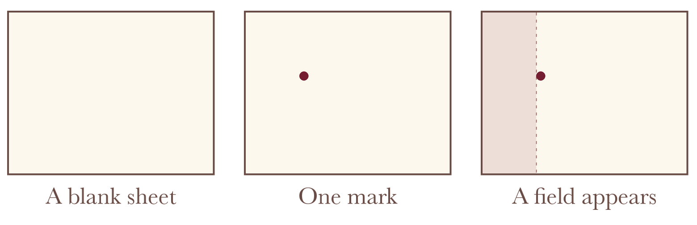

# Wholeness and centers

Place a dot a little off-center on a clean sheet of paper. Cover it with a finger, then lift your finger. With the dot visible, the narrow strip between it and the nearest edge stands out. So does the broad expanse on its other side. One mark has given several regions of blank paper distinct shapes. Alexander begins his account of **wholeness** with this demonstration. Add a second dot and the pair can bring out a diagonal that neither mark made visible alone.[^1]

*The last drawing shades one region you can already see in the middle drawing. How many others can you find?*

Alexander calls a region that hangs together in this way a **center**. It can be large or small, overlap another center, and owe much of its character to something outside its boundary. Wholeness is his name for the arrangement of these centers and the relative strength they give one another. On a sheet of paper the dot is easy to point to. The broad field beside it is just as important to what you see.[^2]

## Where would you stop your bicycle?

Alexander offers a photograph of a cyclist who has stopped under a roadside tree. He asks what made that particular spot inviting. Look at the canopy and the clearance under its branches. Together with the ground they form a sheltered place to stand. A list of objects in the photograph could mention the tree, the bicycle and the road and still miss the place the cyclist actually chose.[^3]

The distinction matters when something is about to change. Imagine taking a bench away from a doorway. The building and bench might each survive the move intact. The little waiting place they made together might disappear. On a neighborhood walk, ask someone to show you a place like that before you mark the positions of things on your map. [Try a first walk](../living-neighborhoods/first-walk.md)

## Read across the books

- For a building-scale example, read the account of a window, the patch of light it casts, and the seat drawn up beside it in *The Phenomenon of Life*, chapter 3, p. 91. Compare [*Window Place*, pattern 180](../patterns/window-place.md).
- For the move from observing centers to making one, turn to *The Process of Creating Life*, chapter 10, “Always Making Centers,” pp. 267–298. Then follow the garden through an actual design sequence in [Generative codes](generative-codes.md).

[^1]: Alexander, *The Phenomenon of Life*, ch. 3, pp. 81–87. Compare the dot diagrams with your own sheet of paper.

[^2]: *The Phenomenon of Life*, ch. 3, pp. 83–91. The account moves from marks on paper to centers in a room.

[^3]: *The Phenomenon of Life*, ch. 3, pp. 92–93. Find the shaded space in the photograph before reading Alexander’s description.
