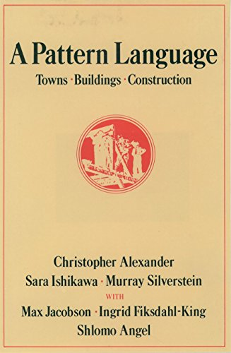

<section class="wiki-intro" aria-labelledby="book-title">

<h1 id="book-title">Christopher Alexander Wiki</h1>

A field guide to the ideas, buildings, and everyday places of Christopher Alexander and his collaborators.

<a href="/concepts">Explore the concepts</a><a href="/living-neighborhoods/first-walk">Take a first walk</a>

<figure class="wiki-jacket">

<figcaption><a href="https://christopher-alexander-ces-archive.org/book/a-pattern-language/"><cite>A Pattern Language</cite></a> Oxford University Press, 1977</figcaption>
</figure>
</section>
<section class="wiki-guide" aria-labelledby="contents-title">

<h2 id="contents-title">Where to begin</h2>

Why does one window become everyone’s favorite place to sit? How do families laying out a neighborhood decide where a path should go?

Alexander and his collaborators spent decades studying questions like these in buildings, on drawing boards, and out on the land.

<section class="wiki-route">
<h3><a href="/concepts">Concepts</a></h3>

What gives one place more life than another? Start with <a href="/concepts/wholeness-and-centers">wholeness and centers</a>, then see how <a href="/concepts/generative-codes">generative codes</a> guide what gets built first.

</section>
<section class="wiki-route">
<h3><a href="/practice">Practical guides</a></h3>

Follow the making of the <a href="/practice/eishin-campus">Eishin campus</a> in Japan, where teachers and students helped decide how a whole school would sit on the land.

</section>
<section class="wiki-route">
<h3><a href="/living-neighborhoods">Living Neighborhoods</a></h3>

<a href="/living-neighborhoods/first-walk">Take a walk with a neighbor</a> and compare the places each of you would preserve. Then follow a project through the <a href="/living-neighborhoods/collection">authors’ collection</a>.

</section>
<section class="wiki-route">
<h3><a href="/patterns">A Pattern Language</a></h3>

Browse <a href="/patterns">all 253 patterns</a> by number and printed page, from <em>Independent Regions</em> to <em>Things from Your Life</em>. For something to try indoors, start with <em>Window Place</em>.

</section>

</section>

