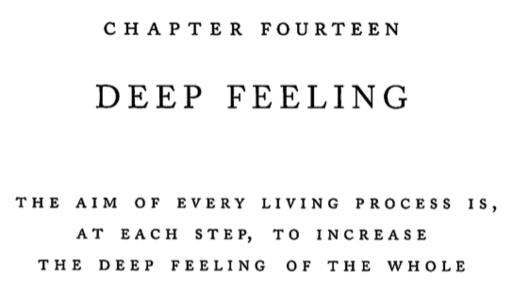
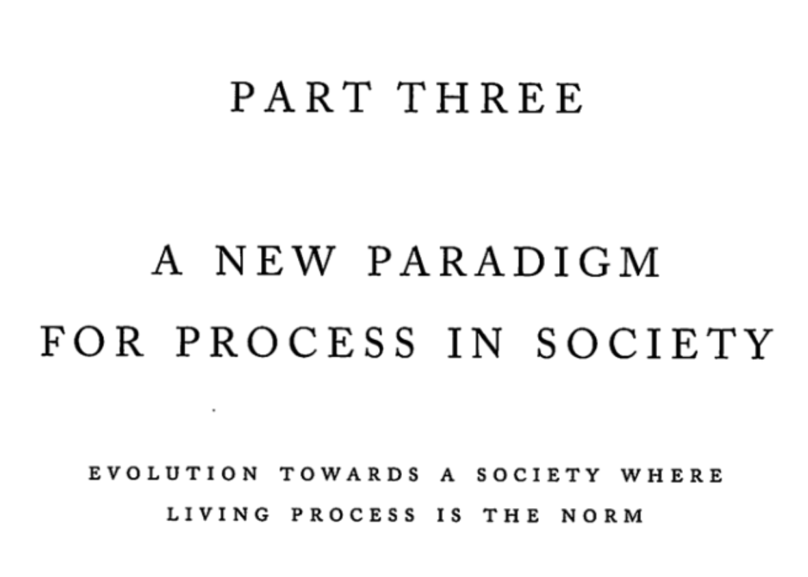
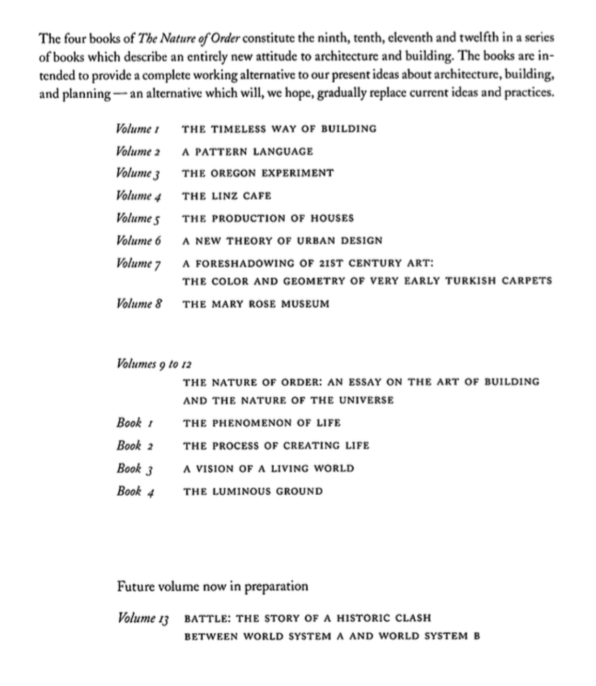
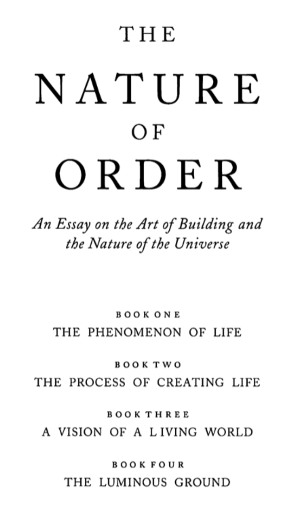
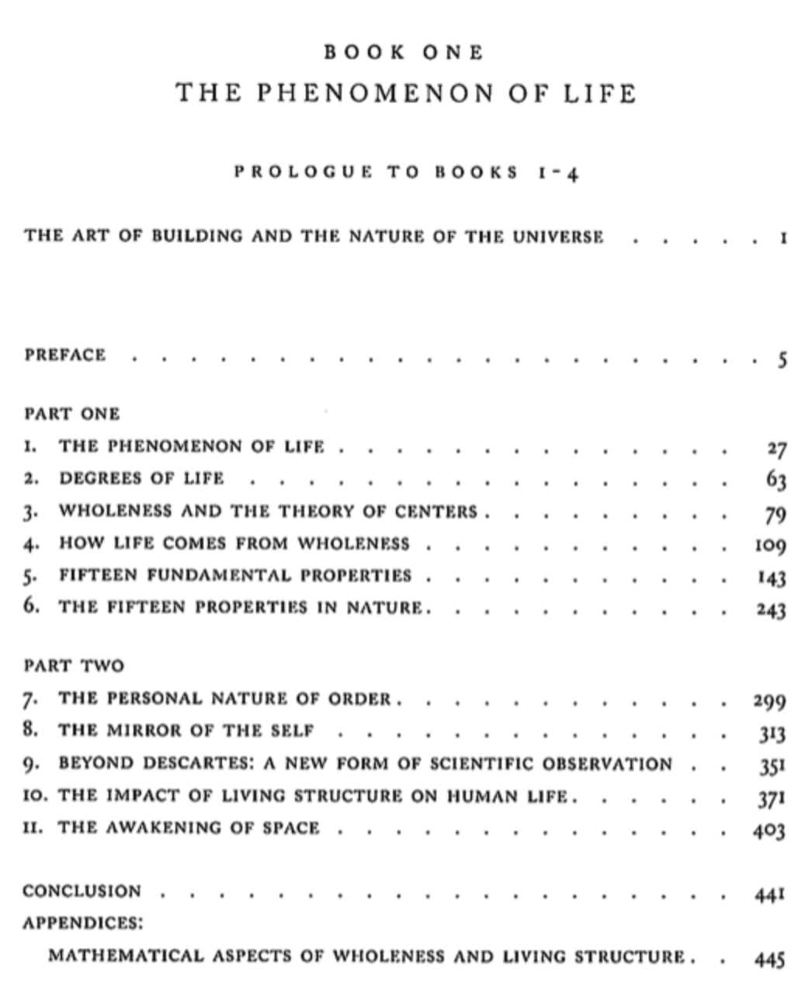
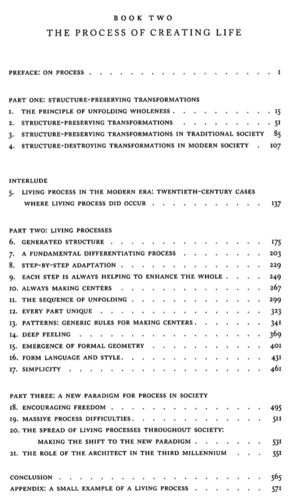
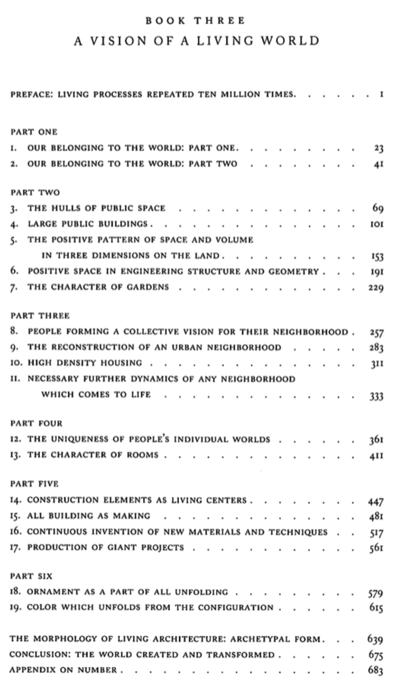
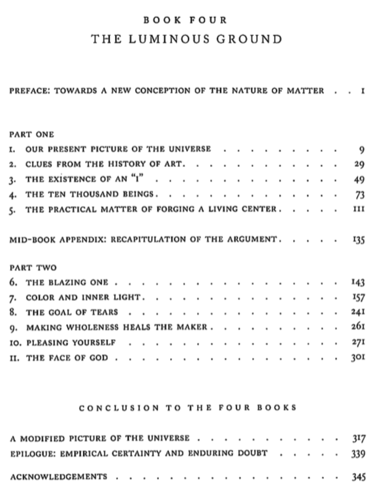

This sketch grew into [The Nature of Order in pictures](/nature-of-order), a quick visual way into the four books.

## Summary

- Qu: What is the nature of the "well" spaces?
  - (v crudely) Places where we feel whole, complete, well
- Qu: How do we do that? i.e. create well spaces ...
  - [A] we have that experience with living things, with nature ... 
  -  => Want to create "living" things
- Qu: How do we create living things?
  - ==> What is the nature of a living process? 
    - ===> Every living process at each step increases the deep feeling of the whole (or aims to do so)
      - ===> we create "living" buildings by following the same kinds of generative whole-enhancing processes as living things
        - ====> have a generative sequence that identifies and develop centers - develop centers and apply symmetry preserving transformations (here's a list of 15) and use patterns for creating and enhancing centers (see "A Pattern Language")

*Source: Book 2*

- Qu: why is this hard to do (in our society)?
  - A: because the whole system is designed around a different (non-generative) approach
    - ==> to build living things we need a paradigmatic shift in our entire society!

*Source: Book 2, part III*

## 4 volumes

### Context of the whole series including previous books

Nature of Order is the culmination and consolidation of all of Alexander's work in one multi-volume work. It supersedes and integrates all the previous work including A Pattern Language.

### Nature of Order itself with table of contents

### Book 1

### Book 2

### Book 3

### Book 4

