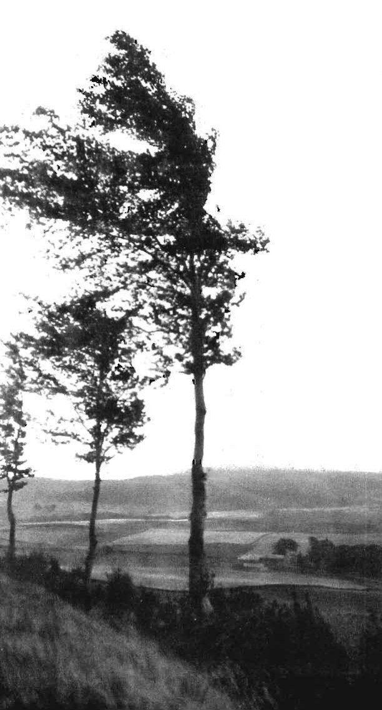
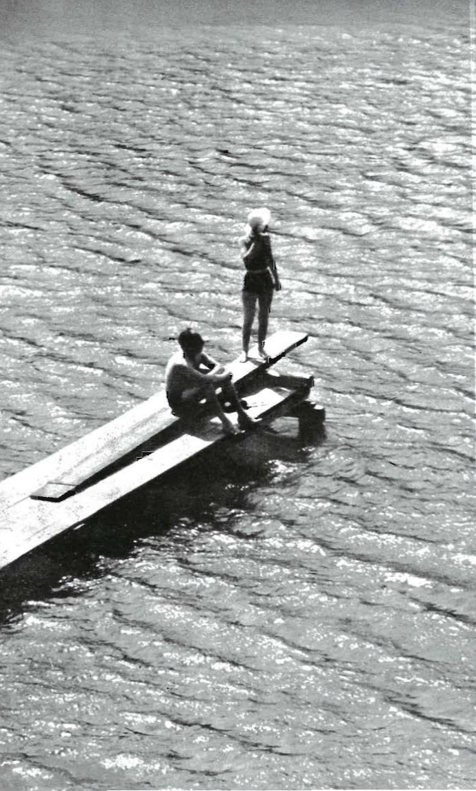
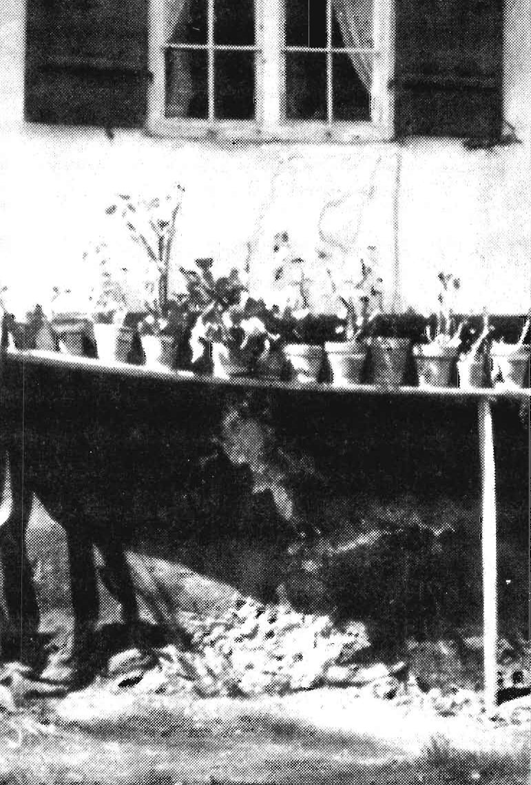
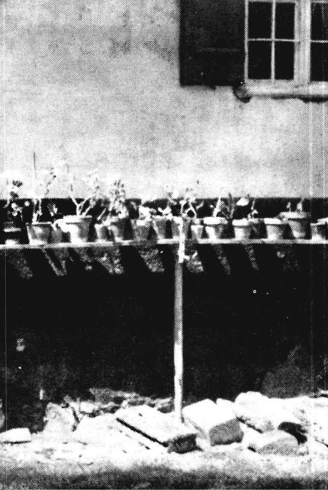
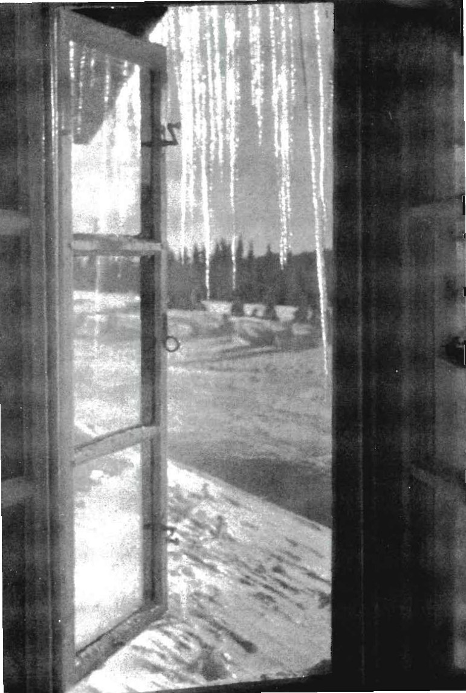

# The peach tree and the quality without a name

<strong>Christopher Alexander · <cite>The Timeless Way of Building</cite> (1979)</strong>

Our introduction: chapter 2 of *The Timeless Way of Building* opens with five photographs and then a peach tree. When Alexander wants to show someone the quality he cares about, he first describes a tree tied flat against a warm brick wall in an English garden. Then he tries seven words for that quality, one after another: alive, whole, comfortable, free, exact, egoless, eternal. Each word gets an example of his and then the reason it falls short. By the end he has circled the quality closely without naming it. The passages below are Alexander's, from chapter 2, "The quality without a name", pp. 19–40, in the order he wrote them; the italic sentences are his own headlines. The section headings, captions and the short links between passages are ours. For the idea itself and where he took it later, see [Life (the quality without a name)](../concepts/quality-without-a-name.md).

## Five photographs · pp. 20–24

The chapter opens with five full-page photographs, between the chapter's opening headline (p. 19) and the start of its text (p. 25). The book gives them no captions.

*Wind-bent trees (p. 20), a pier (p. 21), potted plants on a table across the spread on pp. 22–23 (the two photographs appear to show one long table), and a window in winter (p. 24). Descriptions ours.*

## The peach tree · p. 25

> *We have been taught that there is no objective difference between good buildings and bad, good towns and bad.*
>
> *The fact is that the difference between a good building and a bad building, between a good town and a bad town, is an objective matter. It is the difference between health and sickness, wholeness and dividedness, self-maintenance and self-destruction. In a world which is healthy, whole, alive, and self-maintaining, people themselves can be alive and self-creating. In a world which is unwhole and self-destroying, people cannot be alive: they will inevitably themselves be self-destroying, and miserable.*
>
> *But it is easy to understand why people believe so firmly that there is no single, solid basis for the difference between good building and bad.*
>
> *It happens because the single central quality which makes the difference cannot be named.*
>
> The first place I think of, when I try to tell someone about this quality, is a corner of an English country garden, where a peach tree grows against a wall.
>
> The wall runs east to west; the peach tree grows flat against its southern side. The sun shines on the tree and as it warms the bricks behind the tree, the warm bricks themselves warm the peaches on the tree. It has a slightly dozy quality. The tree, carefully tied to grow flat against the wall; warming the bricks; the peaches growing in the sun; the wild grass growing around the roots of the tree, in the angle where the earth and roots and wall all meet.
>
> This quality is the most fundamental quality there is in anything.

## Never twice the same · p. 26

> *It is never twice the same, because it always takes its shape from the particular place in which it occurs.*
>
> In one place it is calm, in another it is stormy; in one person it is tidy; in another it is careless; in one house it is light; in another it is dark; in one room it is soft and quiet; in another it is yellow. In one family it is a love of picnics; in another dancing; in another playing poker; in another group of people it is not family life at all.

## Freedom from inner contradictions · p. 26

> *It is a subtle kind of freedom from inner contradictions.*
>
> A system has this quality when it is at one with itself; it lacks it when it is divided.
>
> It has it when it is true to its own inner forces; lacks it when it is untrue to its own inner forces.
>
> It has it when it is at peace with itself; and lacks it when it is at war with itself.
>
> You already know this quality. The feeling for it is the most primitive feeling which an animal or a man can have. The feeling for it is as primitive as the feeling for our own well-being, for our own health, as primitive as the intuition which tells us when something is false or true.

Between here and the next passage (pp. 26–28) he argues that physics, by studying simple systems like atoms, has taught us that what a thing is and what it ought to be are separate questions, and that in complex systems, people and places among them, they are not.

## Why it has no name · p. 28

> This oneness, or the lack of it, is the fundamental quality for any thing. Whether it is in a poem, or a man, or in a building full of people, or in a forest, or a city, everything that matters stems from it. It embodies everything.
>
> *Yet still this quality cannot be named.*
>
> The fact that this quality cannot be named does not mean that it is vague or imprecise. It is impossible to name because it is unerringly precise. Words fail to capture it because it is much more precise than any word. The quality itself is sharp, exact, with no looseness in it whatsoever. But each word you choose to capture it has fuzzy edges and extensions which blur the central meaning of the quality.
>
> I shall try to show you now, why words can never capture it, by circling round it, through the medium of half a dozen words.

## Alive · p. 29

> *The word which we most often use to talk about the quality without a name is the word "alive."*
>
> There is a sense in which the distinction between something alive and something lifeless is much more general, and far more profound, than the distinction between living things and nonliving things, or between life and death. Things which are living may be lifeless; nonliving things may be alive. A man who is walking and talking can be alive; or he can be lifeless. Beethoven's last quartets are alive; so are the waves at the ocean shore; so is a candle flame; a tiger may be more alive, because more in tune with its own inner forces, than a man.
>
> A well-made fire is alive. There is a world of difference between a fire which is a pile of burning logs, and a fire which is made by someone who really understands a fire. He places each log exactly to make the air between the logs just right. He doesn't stir the logs with a poker, but while they are burning, grasps each one, and places it again, perhaps only an inch from where it was before. The logs are so exactly placed that they form channels for the draft. Waves of liquid yellow flame run up the logs when the draft blows. Each log glows with full intensity. The fire, watched, burns so intensely and so steadily, that when it dies, finally, it burns to nothing; when the last glow dies, there is nothing but a little dust left in the fireplace.
>
> *But the very beauty of the word "alive" is just its weakness.*
>
> The overwhelming thing that stays with you is that the fire lives. And yet this is a metaphor. Literally, we know that plants and animals are alive, and fire and music are not alive. If we are pressed to explain why we call one fire alive and another dead, then we are at a loss. The metaphor makes us believe that we have found a word to grasp the quality without a name. But we can only use the word to name the quality, when we already understand the quality.

## Whole · p. 30

> *Another word we often use to talk about the quality without a name is "whole."*
>
> A thing is whole according to how free it is of inner contradictions. When it is at war with itself, and gives rise to forces which act to tear it down, it is unwhole. The more free it is of its own inner contradictions, the more whole and healthy and wholehearted it becomes.
>
> Compare the trees along a wild and windblown lake, with an eroded gully. These trees and branches are so made that when the wind blows they all bend, and all the forces in the system, even the violent forces of the wind, are still in balance when the trees are bent; and because they are in balance, they do no harm, they do no violence. The configuration of the bending trees makes them self-maintaining.
>
> But think about a piece of land that is very steep, and where erosion is taking place. There aren't enough tree roots to hold the earth together, let's say; the rain falls, in torrents, and carries the earth down streams which form gullies; again, the earth is still not bound together because there aren't enough plants there; the wind blows; the erosion goes further; next time the water comes, it runs in the very same gullies, and deepens them; and widens them. The configuration of this system is such that the forces which it gives birth to, which arise in it, in the long run act to destroy the system. The system is self-destroying; it does not have the capacity to contain the forces which arise within it.
>
> The system of the trees and wind is whole; the system of the gully and the rain is unwhole.
>
> *But the word "whole" is too enclosed.*
>
> It suggests closure, containment, finiteness. When you call a thing whole, it makes you think that it is whole unto itself, and isolated from the world around it. But a lung is whole, only so long as it is breathing oxygen from the air outside the organism; a person is whole only so long as he is a member of some human group; a town is whole only so long as it is in balance with the surrounding countryside.
>
> The word carries a subtle hint of self-containment. And self-containment always undermines the quality which has no name. For this reason, the word "whole" can never perfectly describe this quality.

## Comfortable · p. 32

> *Another facet of the quality which has no name is caught by the word "comfortable."*
>
> The word "comfortable" is more profound than people usually realize. The mystery of genuine comfort goes far beyond the simple idea that the word first seems to mean. Places which are comfortable are comfortable because they have no inner contradictions, because there is no little restlessness disturbing them.
>
> Imagine yourself on a winter afternoon with a pot of tea, a book, a reading light, and two or three huge pillows to lean back against. Now make yourself comfortable. Not in some way which you can show to other people, and say how much you like it. I mean so that you *really* like it, for *yourself*.
>
> You put the tea where you can reach it: but in a place where you can't possibly knock it over. You pull the light down, to shine on the book, but not too brightly, and so that you can't see the naked bulb. You put the cushions behind you, and place them, carefully, one by one, just where you want them, to support your back, your neck, your arm: so that you are supported just comfortably, just as you want to sip your tea, and read, and dream.
>
> When you take the trouble to do all that, and you do it carefully, with much attention, then it may begin to have the quality which has no name.
>
> *Yet the word "comfortable" is easy to misuse, and has too many other meanings.*
>
> There are kinds of comfort which stultify and deaden too. It is too easy to use the word for situations which have no life in them because they are too sheltered.
>
> A family with too much money, a bed which is too soft, a room which always has an even temperature, a covered path on which you never have to walk out in the rain, these are all "comfortable" in a more stupid sense, and so distort the central meaning of the word.

## Free · p. 33

> *A word which overcomes the lack of openness in the words "whole" and "comfortable," is the word "free."*
>
> The quality without a name is never calculated, never perfect; that subtle balance of forces only happens when the ideas and images are left behind; and created with abandon.
>
> Think of a truck, filled with bags of cement. If the bags are stacked perfectly, in lines, it may be careful, and intelligent, and quite precise. But it will not begin to have the quality without a name, until there is a certain freedom there: the men who piled the bags, running, and throwing them, forgetting themselves, throwing themselves into it, lost, wild ...
>
> And a steel mill too can have this quality because its freedom and its wildness show there, blazing in the night.
>
> *And yet, of course, this freedom can be too theatrical: a pose, a form, a manner.*
>
> A building which has a "free" form—a shape without roots in the forces or materials it is made of—is like a man whose gestures have no roots in his own nature. Its shape is borrowed, artificial, forced, contrived, made to copy outside images, not generated by the forces inside. That kind of so-called freedom is opposite to the quality which has no name.

## Exact · p. 34

> *A word which helps restore the balance is the word "exact."*
>
> The word "exact" helps to counterbalance the impression of other words like "comfortable" and "free." These words suggest that the quality without a name is somehow inexact. And it is true that it is loose and fluid and relaxed. But it is never inexact. The forces in a situation are real forces. There is no getting round them. If the adaptation to the forces is not perfectly exact, there can be no comfort, and no freedom, because the small forces which have been left out will always work to make the system fail.
>
> Suppose that I am trying to make a table for the blackbirds in my garden. In winter, when the snow is on the ground, and the blackbirds are short of food, I will put food out for them on the table. So I build the table; and dream about the clusters of blackbirds which will come flocking to the table in the snow.
>
> But it is not so easy to build a table that will really work. The birds follow their own laws; and if I don't understand them, they just won't come. If I put the table too low, the birds won't fly down to it, because they don't like to swoop too close to the ground. If it is too high in the air, or too exposed, the wind won't let them settle on it. If it is near a laundry line, blowing in the wind, they will be frightened by the moving line. Most of the places where I put the table actually don't work.
>
> I slowly learn that blackbirds have a million subtle forces guiding them in their behavior. If I don't understand these forces, there is simply nothing I can do to make the table come to life. So long as the placing of the table is inexact, my image of the blackbirds flocked around the table eating, is just wishful thinking. To make the table live, I must take these forces seriously, and place the table in a position which is perfectly exact.
>
> *And, yet, of course, the word "exact" does not describe it properly.*
>
> It has no sense of freedom in it; and it is too reminiscent of those other things which are exact in an entirely different sense.
>
> Usually, when we say something is exact, we mean that it fits some abstract image perfectly. If I cut a square of cardboard, and make it perfectly exact, it means that I have made the cardboard perfectly square: its sides are exactly equal: and its angles are exactly ninety degrees. I have matched an image perfectly.
>
> The meaning of the word "exact" which I use here is almost opposite. A thing which has the quality without a name never fits any image exactly. What is exact is its adaptation to the forces which are in it. But this exactness requires that it be loose and fluid in its form.

## Egoless · p. 36

> *A word which goes much deeper than the word "exact" is "egoless."*
>
> When a place is lifeless or unreal, there is almost always a mastermind behind it. It is so filled with the will of its maker that there is no room for its own nature.
>
> Think, by contrast, of the decoration on an old bench—small hearts carved in it; simple holes, cut out while it was being put together—these can be egoless.
>
> They are not carved according to some plan. They are carefree, carved into it, wherever there seems to be a gap. It is not in the least contrived; there is no effort in the decoration; it does not seek to express the personality of the man who carved it. It is so natural, that it almost seems as though the bench itself cried out for it: and the carver simply did what was required.
>
> *And yet, although the old bench and its carving may be egoless, this word is also not quite right.*
>
> It does not mean, for instance, that the man who made it left his own person out of it. It was part of his person that he liked the bench, and wanted to carve hearts in it. Perhaps he made it for his favorite girl.
>
> It is perfectly possible to make a thing which has the quality which has no name, and still let it reflect your personality. Your person, and the likes and dislikes which are part of you, are themselves forces in your garden, and your garden must reflect those forces just as it reflects the other forces which make leaves grow and birds sing.
>
> But if you use the word "ego" to mean the center of a person's character, then the idea of making something egoless can sound as though you want the person to efface himself completely. That is not what the word means at all; and yet because of it, the word is not quite right.

## Eternal · p. 37

> *A last word which can help to catch the quality without a name is the word "eternal."*
>
> All things and people and places which have the quality without a name, reach into the realm of the eternal.
>
> Some are eternal in almost a literal sense: they are so strong, so balanced, so strongly self-maintaining, that they are not easily disturbed, almost imperishable. Others reach the quality for no more than an instant, and then fall back into the lesser state, where inner contradictions rule.
>
> The word "eternal" describes them both. For the instant that they have this quality, they reach into the realm of eternal truth. At that moment when they are free from inner contradictions, they take their place among the order of things which stand outside of time.
>
> *I once saw a simple fish pond in a Japanese village which was perhaps eternal.*
>
> A farmer made it for his farm. The pond was a simple rectangle, about 6 feet wide, and 8 feet long; opening off a little irrigation stream. At one end, a bush of flowers hung over the water. At the other end, under the water, was a circle of wood, its top perhaps 12 inches below the surface of the water. In the pond there were eight great ancient carp, each maybe 18 inches long, orange, gold, purple, and black: the oldest one had been there eighty years. The eight fish swam, slowly, slowly, in circles—often within the wooden circle. The whole world was in that pond. Every day the farmer sat by it for a few minutes. I was there only one day and I sat by it all afternoon. Even now, I cannot think of it without tears. Those ancient fish had been swimming, slowly, in that pond for eighty years. It was so true to the nature of the fish, and flowers, and the water, and the farmers, that it had sustained itself for all that time, endlessly repeating, always different. There is no degree of wholeness or reality which can be reached beyond that simple pond.
>
> *And yet, like all the other words, this word confuses more than it explains.*
>
> It hints at a religious quality. The hint is accurate. And yet it makes it seem as though the quality which that pond has is a mysterious one. It is not mysterious. It is above all ordinary. What makes it eternal is its ordinariness. The word "eternal" cannot capture that.

## No single name · p. 39

> *And so you see, in spite of every effort to give this quality a name, there is no single name which captures it.*
>
> Imagine the quality without a name as a point, and each of the words which we have tried as an ellipse. Each ellipse includes this point. But each ellipse also covers many other meanings, which are distant from this point.
>
> Since every word is always an ellipse like this—then every word will always be too broad, too vague, too large in scope to refer only and exactly to the quality which is the point. No word can ever catch the quality without a name because the quality is too particular, and words too broad. And yet it is the most important quality there is, in anyone, or anything.
>
> *It is not only simple beauty of form and color. Man can make that without making nature. It is not only fitness to purpose. Man can make that too, without making nature. And it is not only the spiritual quality of beautiful music or of a quiet mosque, that comes from faith. Man can make that too, without making nature.*
>
> *The quality which has no name includes these simpler sweeter qualities. But it is so ordinary as well, that it somehow reminds us of the passing of our life.*
>
> *It is a slightly bitter quality.*

## Notes on the reading

Each passage starts on the page in its heading and runs on unbroken unless marked. The one cut is the argument about physics on pp. 26–28, summarised above in our words. After "lost, wild" the book has a spaced ellipsis of its own, shown here as "...". Next comes chapter 3, "Being alive", on the search for this quality in our own lives.

## See also

- [Life (the quality without a name)](../concepts/quality-without-a-name.md): the concept, and how *The Nature of Order* later names the quality "life".
- [The argument of *The Timeless Way* in its contents](timeless-way-map.md): the book's detailed table of contents, where this chapter is step 2.
- [Notes on *The Timeless Way of Building*](timeless-way-notes.md): Rufus Pollock's reading notes, arranged under the same seven words.
- [*The Timeless Way of Building*](../works/1979-the-timeless-way-of-building.md): the book.
