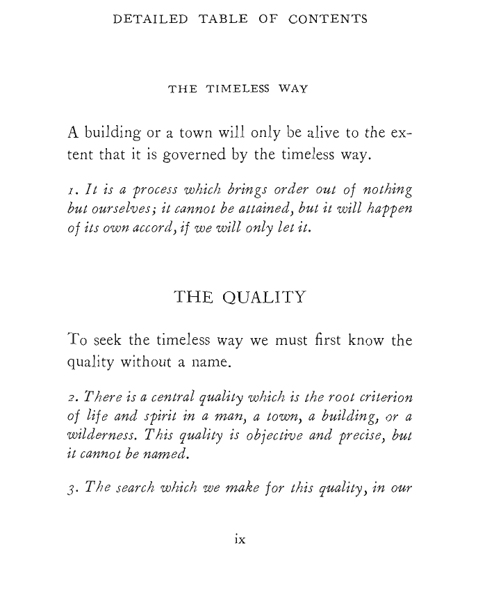

# The argument of *The Timeless Way* in its contents

<strong>Christopher Alexander · <cite>The Timeless Way of Building</cite> (1979)</strong>

<aside class="wiki-ours">Our introduction
At the front of <em>The Timeless Way of Building</em>, after the ordinary list of chapters, there is a "Detailed table of contents" (pp. ix–xv). It sums up each of the 27 chapters in a sentence or two, set in italics, and opens each of the five parts with a plain sentence. Read straight through, these sentences make the whole argument of the book in about three pages. The sentences often run on from one chapter to the next ("And, beyond that ...", "Then finally ..."), and each chapter's summary is, with small changes of wording, the italic headline at the top of that chapter. Just before the contents, a short note from Alexander says how he meant the book to be read. Both are transcribed below and checked line by line against the scan. The chapter titles and page numbers come from the short contents on pp. vii–viii. The headings and this introduction are ours.
</aside>

*The first page of the detailed table of contents, p. ix.*

## On reading this book

> What lies in this book is perhaps more important as a whole than in its details. If you only have an hour to spend on it, it makes much more sense to read the whole book roughly in that hour, than to read only the first two chapters in detail. For this reason, I have arranged each chapter in such a way that you can read the whole chapter in a couple of minutes, simply by reading the headlines which are in italics. If you read the beginning and end of every chapter, and the italic headlines that lie between them, turning the pages almost as fast as you can, you will be able to get the overall structure of the book in less than an hour.
>
> Then, if you want to go into detail, you will know where to go, but always in the context of the whole.

## The timeless way

A building or a town will only be alive to the extent that it is governed by the timeless way.

**1. The timeless way** · p. 3 *It is a process which brings order out of nothing but ourselves; it cannot be attained, but it will happen of its own accord, if we will only let it.*

## The quality

To seek the timeless way we must first know the quality without a name.

**2. The quality without a name** · p. 19 *There is a central quality which is the root criterion of life and spirit in a man, a town, a building, or a wilderness. This quality is objective and precise, but it cannot be named.*

**3. Being alive** · p. 41 *The search which we make for this quality, in our own lives, is the central search of any person, and the crux of any individual person's story. It is the search for those moments and situations when we are most alive.*

**4. Patterns of events** · p. 55 *In order to define this quality in buildings and in towns, we must begin by understanding that every place is given its character by certain patterns of events that keep on happening there.*

**5. Patterns of space** · p. 75 *These patterns of events are always interlocked with certain geometric patterns in the space. Indeed, as we shall see, each building and each town is ultimately made out of these patterns in the space, and out of nothing else: they are the atoms and the molecules from which a building or a town is made.*

**6. Patterns which are alive** · p. 101 *The specific patterns out of which a building or a town is made may be alive or dead. To the extent they are alive, they let our inner forces loose, and set us free; but when they are dead, they keep us locked in inner conflict.*

**7. The multiplicity of living patterns** · p. 123 *The more living patterns there are in a place—a room, a building, or a town—the more it comes to life as an entirety, the more it glows, the more it has that self-maintaining fire which is the quality without a name.*

**8. The quality itself** · p. 137 *And when a building has this fire, then it becomes a part of nature. Like ocean waves, or blades of grass, its parts are governed by the endless play of repetition and variety created in the presence of the fact that all things pass. This is the quality itself.*

## The gate

To reach the quality without a name we must then build a living pattern language as a gate.

**9. The flower and the seed** · p. 157 *This quality in buildings and in towns cannot be made, but only generated, indirectly, by the ordinary actions of the people, just as a flower cannot be made, but only generated from the seed.*

**10. Our pattern languages** · p. 167 *The people can shape buildings for themselves, and have done it for centuries, by using languages which I call pattern languages. A pattern language gives each person who uses it the power to create an infinite variety of new and unique buildings, just as his ordinary language gives him the power to create an infinite variety of sentences.*

**11. Our pattern languages (cont.)** · p. 193 *These pattern languages are not confined to villages and farm society. All acts of building are governed by a pattern language of some sort, and the patterns in the world are there, entirely because they are created by the pattern languages which people use.*

**12. The creative power of language** · p. 211 *And, beyond that, it is not just the shape of towns and buildings which comes from pattern languages—it is their quality as well. Even the life and beauty of the most awe-inspiring great religious buildings came from the languages their builders used.*

**13. The breakdown of language** · p. 225 *But in our time the languages have broken down. Since they are no longer shared, the processes which keep them deep have broken down; and it is therefore virtually impossible for anybody, in our time, to make a building live.*

**14. Patterns which can be shared** · p. 243 *To work our way towards a shared and living language once again, we must first learn how to discover patterns which are deep, and capable of generating life.*

**15. The reality of patterns** · p. 277 *We may then gradually improve these patterns which we share, by testing them against experience: we can determine, very simply, whether these patterns make our surroundings live, or not, by recognizing how they make us feel.*

**16. The structure of a language** · p. 305 *Once we have understood how to discover individual patterns which are alive, we may then make a language for ourselves for any building task we face. The structure of the language is created by the network of connections among individual patterns: and the language lives, or not, as a totality, to the degree these patterns form a whole.*

**17. The evolution of a common language for a town** · p. 325 *Then finally, from separate languages for different building tasks, we can create a larger structure still, a structure of structures, evolving constantly, which is the common language for a town. This is the gate.*

## The way

Once we have built the gate, we can pass through it to the practice of the timeless way.

**18. The genetic power of language** · p. 351 *Now we shall begin to see in detail how the rich and complex order of a town can grow from thousands of creative acts. For once we have a common pattern language in our town, we shall all have the power to make our streets and buildings live, through our most ordinary acts. The language, like a seed, is the genetic system which gives our millions of small acts the power to form a whole.*

**19. Differentiating space** · p. 365 *Within this process, every individual act of building is a process in which space gets differentiated. It is not a process of addition, in which preformed parts are combined to create a whole, but a process of unfolding, like the evolution of an embryo, in which the whole precedes the parts, and actually gives birth to them, by splitting.*

**20. One pattern at a time** · p. 385 *The process of unfolding goes step by step, one pattern at a time. Each step brings just one pattern to life; and the intensity of the result depends on the intensity of each one of these individual steps.*

**21. Shaping one building** · p. 403 *From a sequence of these individual patterns, whole buildings with the character of nature will form themselves within your thoughts, as easily as sentences.*

**22. Shaping a group of buildings** · p. 427 *In the same way, groups of people can conceive their larger public buildings, on the ground, by following a common pattern language, almost as if they had a single mind.*

**23. The process of construction** · p. 455 *Once the buildings are conceived like this, they can be built, directly, from a few simple marks made in the ground—again within a common language, but directly, and without the use of drawings.*

**24. The process of repair** · p. 475 *Next, several acts of building, each one done to repair and magnify the product of the previous acts, will slowly generate a larger and more complex whole than any single act can generate.*

**25. The slow emergence of a town** · p. 493 *Finally, within the framework of a common language, millions of individual acts of building will together generate a town which is alive, and whole, and unpredictable, without control. This is the slow emergence of the quality without a name, as if from nothing.*

**26. Its ageless character** · p. 511 *And as the whole emerges, we shall see it take that ageless character which gives the timeless way its name. This character is a specific, morphological character, sharp and precise, which must come into being any time a building or a town becomes alive: it is the physical embodiment, in buildings, of the quality without a name.*

## The kernel of the way

And yet the timeless way is not complete, and will not fully generate the quality without a name, until we leave the gate behind.

**27. The kernel of the way** · p. 531 *Indeed this ageless character has nothing, in the end, to do with languages. The language, and the processes which stem from it, merely release the fundamental order which is native to us. They do not teach us, they only remind us of what we know already, and of what we shall discover time and time again, when we give up our ideas and opinions, and do exactly what emerges from ourselves.*

## See also

- [The peach tree and the quality without a name](the-peach-tree-and-the-quality.md): chapter 2 in Alexander's words, with the seven words he tries for the quality.
- [Life (the quality without a name)](../concepts/quality-without-a-name.md): the concept the first part of the book sets out.
- [Notes on *The Timeless Way of Building*](timeless-way-notes.md): Rufus Pollock's reading notes, chapter by chapter.
- [*The Timeless Way of Building*](../works/1979-the-timeless-way-of-building.md): the book.
