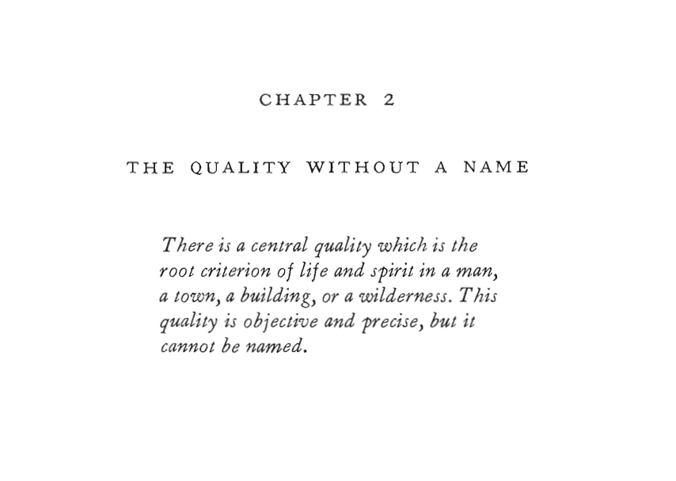

> A building or a town will only be alive to the extent that it is governed by the timeless way.
>
> — *The Timeless Way of Building*, "The Timeless Way", p. 1

## 2 The Quality Without a Name

> There is a central quality which is the root criterion of life and spirit in a man, a town, a building, or a wilderness. This quality is objective and precise, but it cannot be named.
>
> — *The Timeless Way of Building*, ch. 2, "The Quality Without a Name", p. 19

### There is an *objective* difference between good and bad

> We have been taught that there is no objective difference between good buildings and bad, good towns and bad.
>
> The fact is that the difference between a good building and a bad building, between a good town and a bad town, is an objective matter. It is the difference between health and sickness, wholeness and dividedness, self-maintenance and self-destruction. In a world which is healthy, whole, alive, and self-maintaining, people themselves can be alive and self-creating. In a world which is unwhole and self-destroying, people cannot be alive: they will inevitably themselves be self-destroying, and miserable.
>
> But it is easy to understand why people believe so firmly that there is no single, solid basis for the difference between good building and bad.
>
> It happens because the single central quality which makes the difference cannot be named.
>
> The first place I think of, when I try to tell someone about this quality, is a corner of an English country garden, where a peach tree grows against a wall.
>
> — *The Timeless Way of Building*, ch. 2, "The Quality Without a Name", p. 25

### Alive

### Whole

### Comfortable

### Free

### Exact

### Egoless

### Eternal

### There is no exact name

> And so you see, in spite of every effort to give this quality a name, there is no single name which captures it.
>
> Imagine the quality without a name as a point, and each of the words which we have tried as an ellipse. Each ellipse includes this point. But each ellipse also covers many other meanings, which are distant from this point.
>
> Since every word is always an ellipse like this—then every word will always be too broad, too vague, too large in scope to refer only and exactly to the quality which is the point. No word can ever catch the quality without a name because the quality is too particular, and words too broad. And yet it is the most important quality there is, in anyone, or anything.
>
> It is not only simple beauty of form and color. Man can make that without making nature. It is not only fitness to purpose. Man can make that too, without making nature. And it is not only the spiritual quality of beautiful music or of a quiet mosque, that comes from faith. Man can make that too, without making nature.
>
> — *The Timeless Way of Building*, ch. 2, "The Quality Without a Name", p. 39

> The quality which has no name includes these simpler sweeter qualities. But it is so ordinary as well, that it somehow reminds us of the passing of our life.
>
> It is a slightly bitter quality.
>
> — *The Timeless Way of Building*, ch. 2, "The Quality Without a Name", p. 40

## XX

### p.109 - example of courtyard and windows

> When a courtyard has a view out to a larger space, has crossing paths from different rooms, and has a veranda or a porch, these forces can resolve themselves. The view out makes it comfortable, the crossing paths help generate a sense of habit there, the porch makes it easier to go out more often . . . and gradually the courtyard becomes a pleasant customary place to be.
>
> — *The Timeless Way of Building*, ch. 6, "Patterns Which Are Alive", p. 109

> But in a courtyard where the pattern of the opening and veranda and crossing paths is missing, there are forces which conflict in such a way that no one can resolve them for himself.
>
> — *The Timeless Way of Building*, ch. 6, "Patterns Which Are Alive", p. 110

> And the same can happen even in a window: A window with a "window place" helps a person come to life.
>
> Everyone knows how beautiful a room is when it has a bay window in it, or a window seat, or a special ledge next to the window, or a small alcove which is entirely glassed. The feeling that rooms with these kinds of places in them are especially beautiful is not merely whimsy. It has a fundamental organic reason behind it.
>
> When you are in a living room for any length of time, two of the many forces acting on you are the following: 1. You have a tendency to go towards the light. People are phototropic, biologically, so that it is often comfortable to place yourself where the light is. 2. If you are in the room for any length of time, you probably want to sit down, and make yourself comfortable.
>
> In a room which has at least one window that is a "place"—a window seat, a bay window, a window with a wide low windowsill that invites you to pull your favorite chair over to it because you can see out so easily, a special ledge next to the window, or a small alcove which is entirely glassed—in this room you can give in to both forces: you can resolve the conflict for yourself.
>
> In short, you can be comfortable.
>
> But a room which has no window place, in which the windows are just "holes," sets up a hopeless inner conflict in me which I can't resolve.
>
> — *The Timeless Way of Building*, ch. 6, "Patterns Which Are Alive", p. 111

### p.141 beautiful space - la cheraille esque

