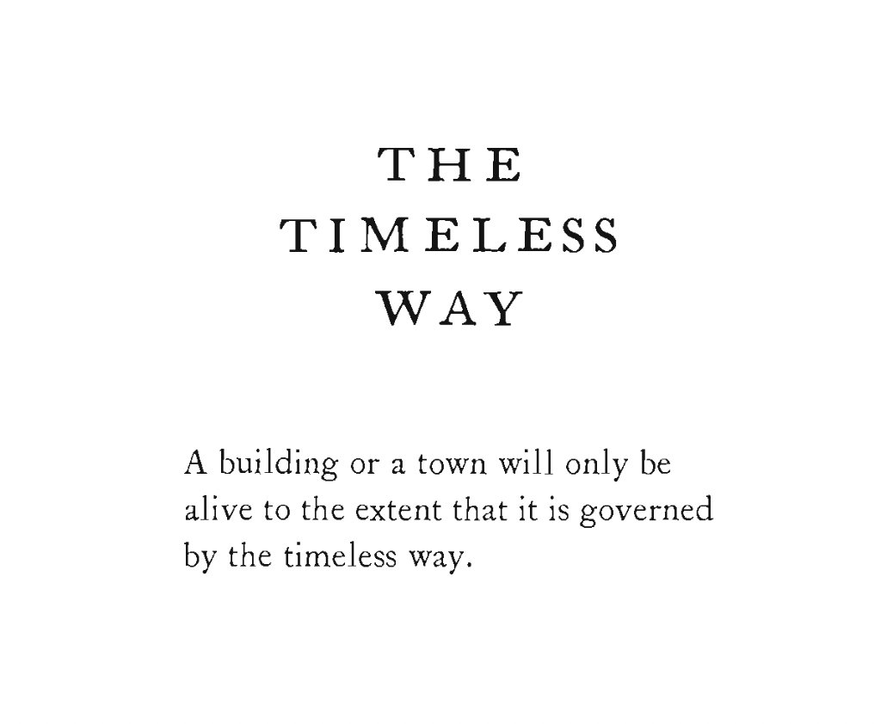
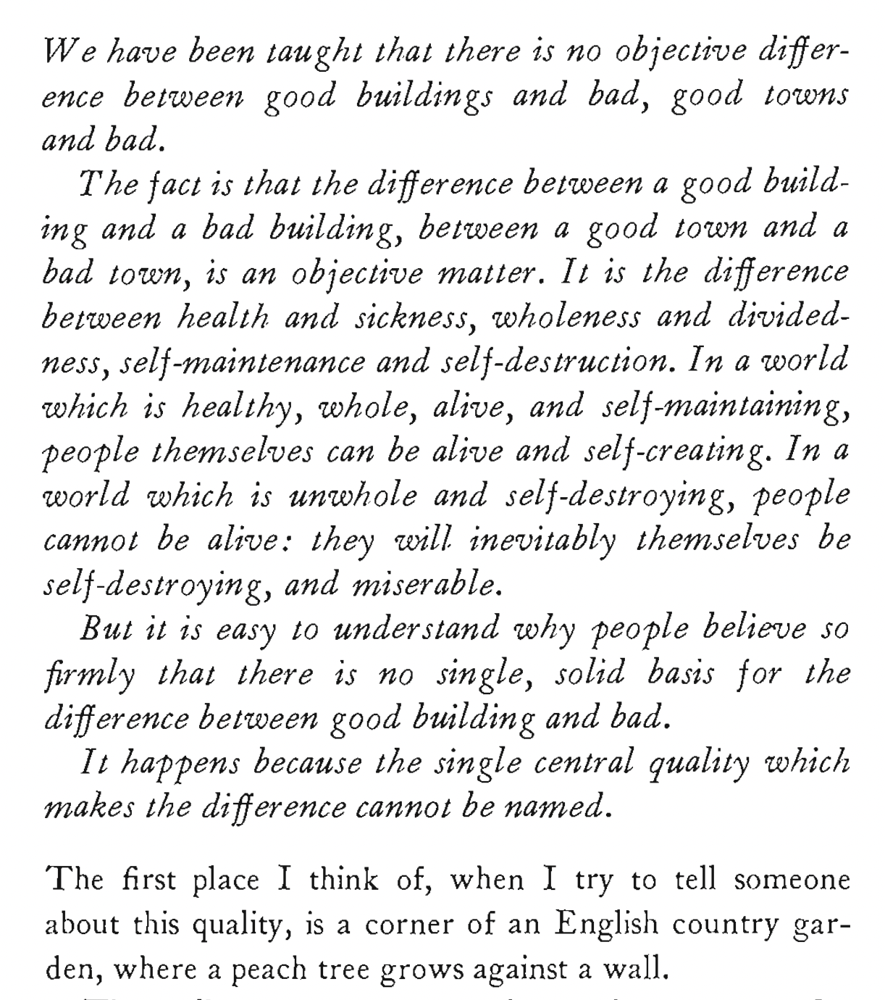
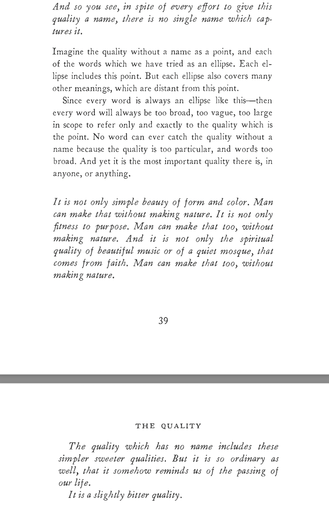
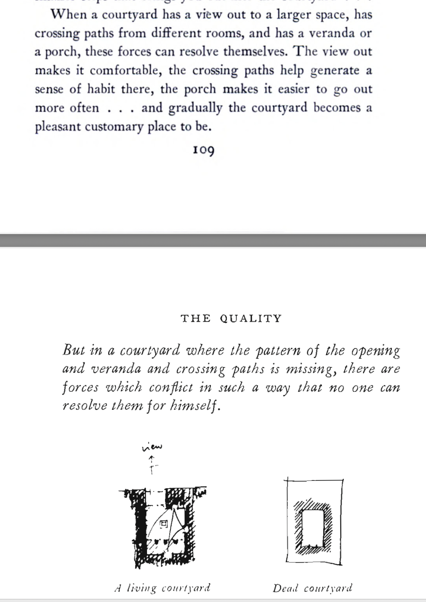
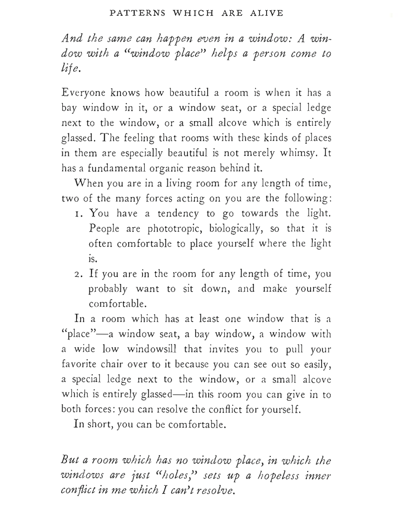
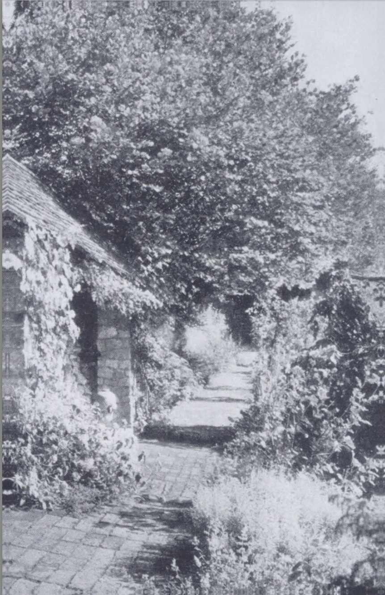

## 2 The Quality Without a Name

### There is an *objective* difference between good and bad

### Alive

### Whole

### Comfortable

### Free

### Exact

### Egoless

### Eternal

### There is no exact name

## XX

### p.109 - example of courtyard and windows

### p.141 beautiful space - la cheraille esque

