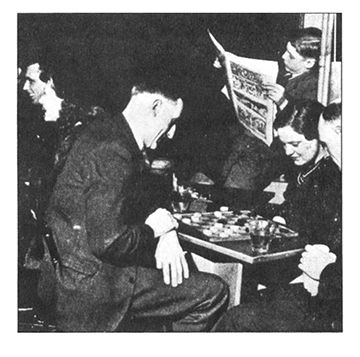
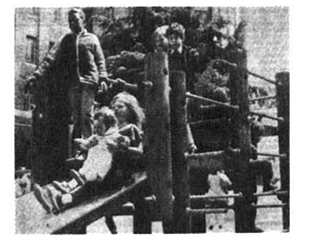
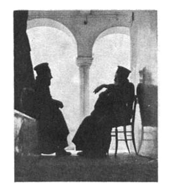
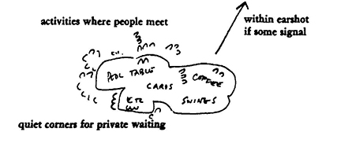

<section class="pattern-plate" aria-labelledby="t-a-place-to-wait">
<a href="/patterns">A Pattern Language</a> · <a href="/patterns#buildings">Buildings</a> · Pattern 150 · p. 707 · *
<h1 class="pattern-title" id="t-a-place-to-wait">A Place To Wait</h1><figure class="pattern-figure pl-figure"></figure><nav class="pattern-links" aria-label="Connections"><h2>Links to</h2><ul><li><a href="/patterns/interchange">34 Interchange</a></li><li><a href="/patterns/health-center">47 Health Center</a></li><li><a href="/patterns/still-water">71 Still Water</a></li><li><a href="/patterns/small-services-without-red-tape">81 Small Services Without Red Tape</a></li><li><a href="/patterns/office-connections">82 Office Connections</a></li><li><a href="/patterns/street-cafe">88 Street Cafe</a></li><li><a href="/patterns/sleeping-in-public">94 Sleeping In Public</a></li><li><a href="/patterns/light-on-two-sides-of-every-room">159 Light On Two Sides Of Every Room</a></li><li><a href="/patterns/street-windows">164 Street Windows</a></li><li><a href="/patterns/opening-to-the-street">165 Opening To The Street</a></li><li><a href="/patterns/garden-seat">176 Garden Seat</a></li><li><a href="/patterns/the-shape-of-indoor-space">191 The Shape Of Indoor Space</a></li></ul><h2>Linked from</h2><ul><li><a href="/patterns/street-cafe">88 Street Cafe</a></li><li><a href="/patterns/bus-stop">92 Bus Stop</a></li><li><a href="/patterns/sleeping-in-public">94 Sleeping In Public</a></li><li><a href="/patterns/activity-pockets">124 Activity Pockets</a></li><li><a href="/patterns/sequence-of-sitting-spaces">142 Sequence Of Sitting Spaces</a></li><li><a href="/patterns/reception-welcomes-you">149 Reception Welcomes You</a></li><li><a href="/patterns/alcoves">179 Alcoves</a></li></ul></nav></section><article class="pattern-text" aria-label="The text of A Place To Wait">
708… in any office, or workshop, or public service, or station, or clinic, where people have to wait—<a class="pl-ref" href="/patterns/interchange">INTERCHANGE (34)</a>, <a class="pl-ref" href="/patterns/health-center">HEALTH CENTER (47)</a>, <a class="pl-ref" href="/patterns/small-services-without-red-tape">SMALL SERVICES WITHOUT RED TAPE (81)</a>, <a class="pl-ref" href="/patterns/office-connections">OFFICE CONNECTIONS (82)</a>, it is essential to provide a special place for waiting, and doubly essential that this place not have the sordid, enclosed, time-slowed character of ordinary waiting rooms.

◆ ◆ ◆

<strong>The process of waiting has inherent conflicts in it</strong>

On the one hand, whatever people are waiting for—the doctor, an airplane, a business appointment—has built in uncertainties, which make it inevitable that they must spend a long time hanging around, waiting, doing nothing.

On the other hand, they cannot usually afford to enjoy this time. Because it is unpredictable, they must hang at the very door. Since they never know exactly when their turn will come, they cannot even take a stroll or sit outside. They must stay in the narrow confine of the waiting room, waiting their turn. But this, of course, is an extremely demoralizing situation: nobody wants to wait at somebody else’s beck and call. Kafka’s greatest works, <em>The Castle</em> and <em>The Trial</em>, both deal almost entirely with the way this kind of atmosphere destroys a man.

The classic “waiting room” does nothing to resolve this problem. A tight dreary little room, with people staring at each other, fidgeting, a magazine or two to flip—this is the very situation which creates the conflict. Evidence for the deadening effect of this situation comes from Scott Briar (“Welfare From Below: Recipients’ Views of the Public Welfare System,” in Jacobus Tenbroek, ed., <em>The Law and the Poor</em>, San Francisco: Chandler Publishing Company, 1966, p. 52). We all know that time seems to pass more slowly when we are bored or anxious or restless. Briar found that people waiting in welfare agencies consistently thought they had been waiting for longer than they really had. Some thought they had been waiting four times as long.

The fundamental problem then, is this. How can the people 709who are waiting, spend their time wholeheartedly—live the hours or minutes while they wait, as fully as the other hours of their day—and yet still be on hand, whenever the event or the person they are waiting for is ready?

It can be done best when the waiting is fused with some other activity: an activity that draws in other people who are not there essentially to wait—a cafe, pool tables, tables, a reading room, where the activities and the seats around them are within earshot of the signal that the interviewer (or the plane, or whatever) is ready. For example, the Pediatrics Clinic at San Francisco General Hospital built a small playground beside the entrance, to serve as a waiting area for children and a play area for the neighborhood.

<figure class="pl-figure"><figcaption><em>Waiting room at the fediatrics clinic</em>.</figcaption></figure>

In another example we know, a horseshoe pit was built alongside a terrace where people came to wait for appointments. The people waiting inevitably started pitching horseshoes, others joined in, people left as their appointments came up—there was an easy flow between the horseshoe pit, the terrace, and the offices.

Waiting can also be a situation where the person waiting finds himself with free time, and, with the support of the surroundings, is able to draw into himself, become still, meditative—quite the opposite of the activity described above.

The right atmosphere will come naturally if the waiting area provides some places that are quiet, protected, and do not draw out the anxiety of the wait. Some examples: a seat near a bus 710stop, under a tree, protected from the street; a window seat that looks down upon a street scene below; a protected seat in a garden, a swing or a hammock; a dark place and a glass of beer, far enough away from passages so that a person is not always looking up when someone comes or goes; a private seat by a fish tank.

In summary, then, people who are waiting must be free to do what they want. If they want to sit outside the interviewer’s door, they can. If they want to get up and take a stroll, or play a game of pool, or have a cup of coffee, or watch other people, they can. If they want to sit privately and fall into a daydream, they can. And all this without having to fear that they are losing their place in line.

<figure class="pl-figure"><figcaption><em>Quiet waiting</em>.</figcaption></figure>

Therefore:

<strong>In places where people end up waiting (for a bus, for an appointment, for a plane), create a situation which makes the waiting positive. Fuse the waiting with some other activity—newspaper, coffee, pool tables, horseshoes; something which draws people in who are not simply waiting. And also the opposite: make a place which can draw a person waiting into a reverie; quiet; a positive silence.</strong>

711

<figure class="pl-figure"></figure>
◆ ◆ ◆

The active part might have a window on the street—<a class="pl-ref" href="/patterns/street-windows">STREET WINDOWS (164)</a>, WINDOW PLACE (l80), a Cafe <a class="pl-ref" href="/patterns/street-cafe">STREET CAFE (88)</a>, games, positive engagements with the people passing by—<a class="pl-ref" href="/patterns/opening-to-the-street">OPENING TO THE STREET (165)</a>. The quiet part might have a quiet garden seat—<a class="pl-ref" href="/patterns/garden-seat">GARDEN SEAT (176)</a>, a place for people to doze—<a class="pl-ref" href="/patterns/sleeping-in-public">SLEEPING IN PUBLIC (94)</a>, perhaps a pond with fish in it—<a class="pl-ref" href="/patterns/still-water">STILL WATER (71)</a>. To the extent that this waiting space is a room, or a group of rooms, it gets its detailed shape from <a class="pl-ref" href="/patterns/light-on-two-sides-of-every-room">LIGHT ON TWO SIDES OF EVERY ROOM (159)</a> and <a class="pl-ref" href="/patterns/the-shape-of-indoor-space">THE SHAPE OF INDOOR SPACE (191)</a>….
</article>

Christopher Alexander, Sara Ishikawa and Murray Silverstein, with Max Jacobson, Ingrid Fiksdahl-King and Shlomo Angel, <cite>A Pattern Language</cite> (Oxford University Press, 1977), pattern 150, pp. 707–711. Text and illustrations from the <a href="https://github.com/natureoforder/sources">Nature of Order sources</a> reading edition, transcribed from the 1977 printing; report errors on <a href="https://github.com/natureoforder/alexander-wiki/issues">GitHub</a>.

<a href="/patterns/reception-welcomes-you">← 149 Reception Welcomes You</a> · <a href="/patterns">All 253 patterns</a> · <a href="/patterns/small-meeting-rooms">151 Small Meeting Rooms →</a>

