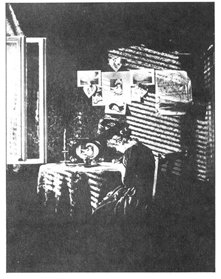
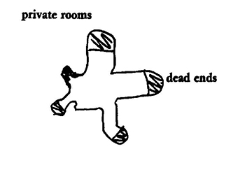

<section class="pattern-plate" aria-labelledby="t-a-room-of-ones-own">
<a href="/patterns">A Pattern Language</a> · <a href="/patterns#buildings">Buildings</a> · Pattern 141 · p. 668 · **
<h1 class="pattern-title" id="t-a-room-of-ones-own">A Room Of One’s Own</h1><figure class="pattern-figure pl-figure"></figure><nav class="pattern-links" aria-label="Connections"><h2>Links to</h2><ul><li><a href="/patterns/the-family">75 The Family</a></li><li><a href="/patterns/house-for-a-small-family">76 House For A Small Family</a></li><li><a href="/patterns/house-for-a-couple">77 House For A Couple</a></li><li><a href="/patterns/intimacy-gradient">127 Intimacy Gradient</a></li><li><a href="/patterns/common-areas-at-the-heart">129 Common Areas At The Heart</a></li><li><a href="/patterns/bed-cluster">143 Bed Cluster</a></li><li><a href="/patterns/teenagers-cottage">154 Teenager’s Cottage</a></li><li><a href="/patterns/old-age-cottage">155 Old Age Cottage</a></li><li><a href="/patterns/home-workshop">157 Home Workshop</a></li><li><a href="/patterns/light-on-two-sides-of-every-room">159 Light On Two Sides Of Every Room</a></li><li><a href="/patterns/alcoves">179 Alcoves</a></li><li><a href="/patterns/workspace-enclosure">183 Workspace Enclosure</a></li><li><a href="/patterns/bed-alcove">188 Bed Alcove</a></li><li><a href="/patterns/dressing-rooms">189 Dressing Rooms</a></li><li><a href="/patterns/the-shape-of-indoor-space">191 The Shape Of Indoor Space</a></li><li><a href="/patterns/things-from-your-life">253 Things From Your Life</a></li></ul><h2>Linked from</h2><ul><li><a href="/patterns/men-and-women">27 Men And Women</a></li><li><a href="/patterns/intimacy-gradient">127 Intimacy Gradient</a></li><li><a href="/patterns/tapestry-of-light-and-dark">135 Tapestry Of Light And Dark</a></li><li><a href="/patterns/sequence-of-sitting-spaces">142 Sequence Of Sitting Spaces</a></li><li><a href="/patterns/teenagers-cottage">154 Teenager’s Cottage</a></li><li><a href="/patterns/settled-work">156 Settled Work</a></li><li><a href="/patterns/bed-alcove">188 Bed Alcove</a></li><li><a href="/patterns/closets-between-rooms">198 Closets Between Rooms</a></li></ul></nav></section><article class="pattern-text" aria-label="The text of A Room Of One’s Own">
669… the <a class="pl-ref" href="/patterns/intimacy-gradient">INTIMACY GRADIENT (127)</a> makes it clear that every house needs rooms where individuals can be alone. In any household which has more than one person, this need is fundamental and essential—<a class="pl-ref" href="/patterns/the-family">THE FAMILY (75)</a>, <a class="pl-ref" href="/patterns/house-for-a-small-family">HOUSE FOR A SMALL FAMILY (76)</a>, <a class="pl-ref" href="/patterns/house-for-a-couple">HOUSE FOR A COUPLE (77)</a>. This pattern, which defines the rooms that people can have to themselves, is the natural counterpart and complement to the social activity provided for in <a class="pl-ref" href="/patterns/common-areas-at-the-heart">COMMON AREAS AT THE HEART (129)</a>.

◆ ◆ ◆

<strong>No one can be close to others, without also having frequent opportunities to be alone.</strong>

A person in a household without a room of his own will always be confronted with a problem: he wants to participate in family life and to be recognized as an important member of that group; but he cannot individualize himself because no part of the house is totally in his control. It is rather like expecting one drowning man to save another. Only a person who has a well-developed strong personal self, can venture out to participate in communal life.

This notion has been explored by two American sociologists, Foote and Cottrell:

There is a critical point beyond which closer contact with another person will no longer lead to an increase in empathy. (A) Up to a certain point, intimate interaction with others increases the capacity to empathize with them. But when others are too constantly present, the organism appears to develop a protective resistance to responding to them…. This limit to the capacity to empathize should be taken into account in planning the optimal size and concentration of urban populations, as well as in planning the schools and the housing of individual families. (B) Families who provide time and space for privacy, and who teach children the utility and satisfaction of withdrawing for private reveries, will show higher average empathic capacity than those who do not. (Foote, N. and L. Cottrell, <em>Identity and Interpersonal Competence</em>, Chicago, 1955, pp. 72–73, 79.)

Alexander Leighton has made a similar point, emphasizing the mental damage that results from a <em>systematic lack of privacy</em> 670“Psychiatric Disorder and Social Environment,” <em>Psychiatry</em>, 18 (3). P-374, 1955].

In terms of space, what is required to solve the problem? Simply, a room of one’s own. A place to go and close the door; a retreat. Visual and acoustic privacy. And to make certain that the rooms are truly private, they must be located at the extremities of the house: at the ends of building wings; at the ends of the <a class="pl-ref" href="/patterns/intimacy-gradient">INTIMACY GRADIENT (127)</a>; far from the common areas.

We shall now look at the individual members of the family one at a time, in slightly more detail.

<em>Wife</em>. We put the wife first, because, classically, it is she who has the greatest difficulty with this problem. She belongs everywhere, and every place inside the house is in a vague sense hers—yet it is only very rarely that the woman of the house has a small room which is specifically and exclusively her own. Virginia Woolfs famous essay “A room of one’s own” is the strongest and most important statement on this issue—and has given this pattern its name.

<em>Husband</em>. In older houses, the man of the house usually had a study or a workshop of his own. However, in modern houses and apartments, this has become as rare as the woman’s own room. And it is certainly just as essential. Many a man associates his house with the mad scene of young children and the enormous demands put on him there. If he has no room of his own, he has to stay at his office, away from home, to get peace and quiet.

<em>Teenagers</em>. For teenage children, we have devoted an entire pattern to this problem: <a class="pl-ref" href="/patterns/teenagers-cottage">TEENAGER’S COTTAGE (154)</a>. We have argued there that it is the teenagers who are faced with the problem of building a firm and strong identity; yet among the adults, it is the young who are most often prevented from having a place in the home that is clearly marked as their own.

<em>Children</em>. Very young children experience the need for privacy less—but they still experience it. They need some place to keep their possessions, to be alone at times, to have a private visit with a playmate. See <a class="pl-ref" href="/patterns/bed-cluster">BED CLUSTER (143)</a> and <a class="pl-ref" href="/patterns/bed-alcove">BED ALCOVE (188)</a>. John Madge has written a good survey of a family’s need for private space (“Privacy and Social Interaction,” Transactions of the Bartlett Society, Vol. 3, 1964-65), and concerning the children he says:

671The bedroom is often the repository of most of these items of personal property around which the individual builds his own satisfactions and which help to differentiate him from the other members of the inner circle of his life—indeed he will often reveal them more freely to a peer in age and sex than to a member of his own family.

In summary then, we propose that a room of one’s own—an alcove or bed nook for younger children—is essential for each member of the family. It helps develop one’s own sense of identity; it strengthens one’s relationship to the rest of the family; and it creates personal territory, thereby building ties with the house itself.

Therefore:

<strong>Give each member of the family a room of his own, especially adults. A minimum room of one’s own is an alcove with desk, shelves, and curtain. The maximum is a cottage—like a <a class="pl-ref" href="/patterns/teenagers-cottage">TEENAGER’S COTTAGE (154)</a>, or an <a class="pl-ref" href="/patterns/old-age-cottage">OLD AGE COTTAGE (155)</a>. In all cases, especially the adult ones, place these rooms at the far ends of the intimacy gradient—far from the common rooms.</strong>

<figure class="pl-figure"></figure>
◆ ◆ ◆

Use this pattern as an antidote to the extremes of “togetherness” created by <a class="pl-ref" href="/patterns/common-areas-at-the-heart">COMMON AREAS AT THE HEART (129)</a>. Even for 672small children, give them at least an alcove in the communal sleeping area—<a class="pl-ref" href="/patterns/bed-alcove">BED ALCOVE (188)</a>; and for the man and woman, give each of them a separate room, beyond the couples realm they share; it may be an expanded dressing room—<a class="pl-ref" href="/patterns/dressing-rooms">DRESSING ROOM (189)</a>, a home workshop—<a class="pl-ref" href="/patterns/home-workshop">HOME WORKSHOP (157)</a>, or once again, an alcove off some other room—<a class="pl-ref" href="/patterns/alcoves">ALCOVES (179)</a>, <a class="pl-ref" href="/patterns/workspace-enclosure">WORKSPACE ENCLOSURE (183)</a>. If there is money for it, it may even be possible to give a person a cottage, attached to the main structure—<a class="pl-ref" href="/patterns/teenagers-cottage">TEENAGER’S COTTAGE (154)</a>, <a class="pl-ref" href="/patterns/old-age-cottage">OLD ACE COTTAGE (155)</a>. In every case there must at least be room for a desk, a chair, and <a class="pl-ref" href="/patterns/things-from-your-life">THINGS FROM YOUR LIFE (253)</a>. And for the detailed shape of the room, see <a class="pl-ref" href="/patterns/light-on-two-sides-of-every-room">LIGHT ON TWO SIDES OF EVERY ROOM (159)</a> and <a class="pl-ref" href="/patterns/the-shape-of-indoor-space">THE SHAPE OF INDOOR SPACE (191)</a>….
</article>

Christopher Alexander, Sara Ishikawa and Murray Silverstein, with Max Jacobson, Ingrid Fiksdahl-King and Shlomo Angel, <cite>A Pattern Language</cite> (Oxford University Press, 1977), pattern 141, pp. 668–672. Text and illustrations from the <a href="https://github.com/natureoforder/sources">Nature of Order sources</a> reading edition, transcribed from the 1977 printing; report errors on <a href="https://github.com/natureoforder/alexander-wiki/issues">GitHub</a>.

<a href="/patterns/private-terrace-on-the-street">← 140 Private Terrace On The Street</a> · <a href="/patterns">All 253 patterns</a> · <a href="/patterns/sequence-of-sitting-spaces">142 Sequence Of Sitting Spaces →</a>

