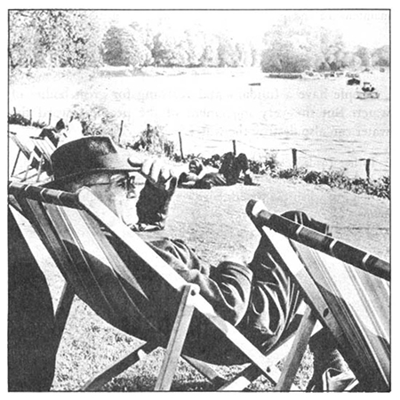
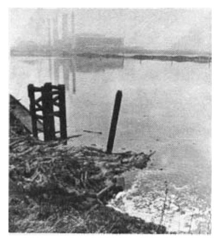
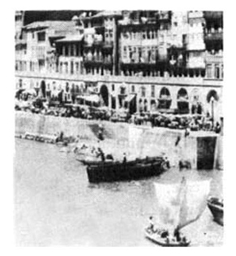
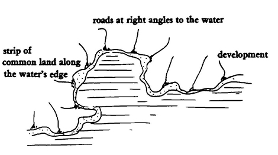

<section class="pattern-plate" aria-labelledby="t-access-to-water">
<a href="/patterns">A Pattern Language</a> · <a href="/patterns#towns">Towns</a> · Pattern 25 · p. 135 · *
<h1 class="pattern-title" id="t-access-to-water">Access To Water</h1><figure class="pattern-figure pl-figure"></figure><nav class="pattern-links" aria-label="Connections"><h2>Links to</h2><ul><li><a href="/patterns/the-countryside">7 The Countryside</a></li><li><a href="/patterns/parallel-roads">23 Parallel Roads</a></li><li><a href="/patterns/sacred-sites">24 Sacred Sites</a></li><li><a href="/patterns/promenade">31 Promenade</a></li><li><a href="/patterns/small-parking-lots">103 Small Parking Lots</a></li></ul><h2>Linked from</h2><ul><li><a href="/patterns/subculture-boundary">13 Subculture Boundary</a></li><li><a href="/patterns/ring-roads">17 Ring Roads</a></li><li><a href="/patterns/mini-buses">20 Mini-Buses</a></li><li><a href="/patterns/pools-and-streams">64 Pools And Streams</a></li><li><a href="/patterns/still-water">71 Still Water</a></li></ul></nav></section><article class="pattern-text" aria-label="The text of Access To Water">
136… water is always precious. Among the special natural places covered by <a class="pl-ref" href="/patterns/sacred-sites">SACRED SITES (24)</a>, we single out the ocean beaches, lakes, and river banks, because they are irreplaceable. Their maintenance and proper use require a special pattern.

◆ ◆ ◆

<strong>People have a fundamental yearning for great bodies of water. But the very movement of the people toward the water can also destroy the water.</strong>

Either roads, freeways, and industries destroy the water’s edge and make it so dirty or so treacherous that it is virtually inaccessible; or when the water’s edge is preserved, it falls into private hands.

<figure class="pl-figure"><figcaption><em>Access to water is blocked</em>.</figcaption></figure>

But the need that people have for water is vital and profound. (See, for example, C. G. Jung, <em>Symbols of Transformation</em>, where Jung takes bodies of water which appear in dreams as a consistent representation of the dreamer’s unconscious.)

The problem can be solved only if it is understood that people will build places <em>near</em> the water because it is entirely natural; but that the land immediately along the water’s edge must be preserved for common use. To this end the roads which can destroy the water’s edge must be kept back from it and only allowed near it when they lie at right angles to it.

137

<figure class="pl-figure"><figcaption><em>Life forms around the water’s edge</em>.</figcaption></figure>

The width of the belt of land along the water may vary with the type of water, the density of development along it, and the ecological conditions. Along high density development, it may be no more than a simple stone promenade. Along low density development, it may be a common parkland extending hundreds of yards beyond a beach.

Therefore:

<strong>When natural bodies of water occur near human settlements, treat them with great respect. Always preserve a belt of common land, immediately beside the water. And allow dense settlements to come right down to the water only at infrequent intervals along the water’s edge.</strong>

<figure class="pl-figure"></figure>
138

◆ ◆ ◆

The width of the common land will vary with the type of water and the ecological conditions. In one case, it may be no more than a simple stone promenade along a river bank a few feet wide—<a class="pl-ref" href="/patterns/promenade">PROMENADE (31)</a>. In another case, it may be a swath of dunes extending hundreds of yards beyond a beach—<a class="pl-ref" href="/patterns/the-countryside">THE COUNTRYSIDE (7)</a>. In any case, do not build roads along the water within one mile of the water; instead, make all the approach roads at right angles to the edge, and very far apart—<a class="pl-ref" href="/patterns/parallel-roads">PARALLEL ROADS (23)</a>. If parking is provided, hep the lots small—<a class="pl-ref" href="/patterns/small-parking-lots">SMALL PARKING LOTS (103)</a>….
</article>

Christopher Alexander, Sara Ishikawa and Murray Silverstein, with Max Jacobson, Ingrid Fiksdahl-King and Shlomo Angel, <cite>A Pattern Language</cite> (Oxford University Press, 1977), pattern 25, pp. 135–138. Text and illustrations from the <a href="https://github.com/natureoforder/sources">Nature of Order sources</a> reading edition, transcribed from the 1977 printing; report errors on <a href="https://github.com/natureoforder/alexander-wiki/issues">GitHub</a>.

<a href="/patterns/sacred-sites">← 24 Sacred Sites</a> · <a href="/patterns">All 253 patterns</a> · <a href="/patterns/life-cycle">26 Life Cycle →</a>

