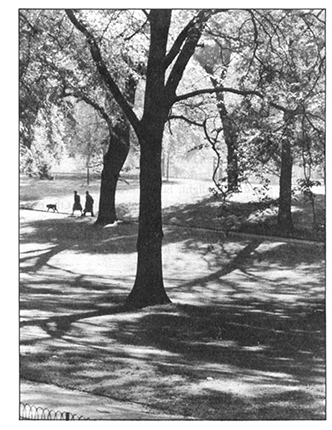
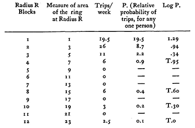
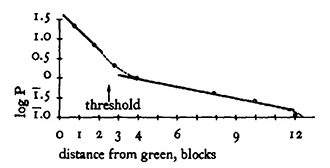
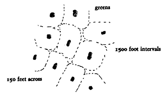

<section class="pattern-plate" aria-labelledby="t-accessible-green">
<a href="/patterns">A Pattern Language</a> · <a href="/patterns#towns">Towns</a> · Pattern 60 · p. 304 · **
<h1 class="pattern-title" id="t-accessible-green">Accessible Green</h1><figure class="pattern-figure pl-figure"></figure><nav class="pattern-links" aria-label="Connections"><h2>Links to</h2><ul><li><a href="/patterns/neighborhood-boundary">15 Neighborhood Boundary</a></li><li><a href="/patterns/work-community">41 Work Community</a></li><li><a href="/patterns/quiet-backs">59 Quiet Backs</a></li><li><a href="/patterns/grave-sites">70 Grave Sites</a></li><li><a href="/patterns/local-sports">72 Local Sports</a></li><li><a href="/patterns/animals">74 Animals</a></li><li><a href="/patterns/sleeping-in-public">94 Sleeping In Public</a></li><li><a href="/patterns/garden-wall">173 Garden Wall</a></li></ul><h2>Linked from</h2><ul><li><a href="/patterns/subculture-boundary">13 Subculture Boundary</a></li><li><a href="/patterns/identifiable-neighborhood">14 Identifiable Neighborhood</a></li><li><a href="/patterns/neighborhood-boundary">15 Neighborhood Boundary</a></li><li><a href="/patterns/work-community">41 Work Community</a></li><li><a href="/patterns/children-in-the-city">57 Children In The City</a></li><li><a href="/patterns/public-outdoor-room">69 Public Outdoor Room</a></li><li><a href="/patterns/animals">74 Animals</a></li><li><a href="/patterns/shopfront-schools">85 Shopfront Schools</a></li><li><a href="/patterns/hierarchy-of-open-space">114 Hierarchy Of Open Space</a></li><li><a href="/patterns/garden-wall">173 Garden Wall</a></li></ul></nav></section><article class="pattern-text" aria-label="The text of Accessible Green">
305… at the heart of neighborhoods, and near all work communities, there need to be small greens—identifiable neighborhood (14), <a class="pl-ref" href="/patterns/work-community">work community (41)</a>. Of course it makes the most sense to locate these greens in such a way that they help form the boundaries and neighborhoods and backs—subculture boundary (13), <a class="pl-ref" href="/patterns/neighborhood-boundary">neighborhood boundary (15)</a>, <a class="pl-ref" href="/patterns/quiet-backs">quiet backs (59)</a>.

◆ ◆ ◆

<strong>People need green open places to go to; when they are close they use them. But if the greens are more than three minutes away, the distance overwhelms the need.</strong>

Parks are meant to satisfy this need. But parks, as they are usually understood, are rather large and widely spread through the city. Very few people live within three minutes of a park.

Our research suggests that even though the need for parks is very important, and even though it is vital for people to be able to nourish themselves by going to walk, and run, and play on open greens, this need is very delicate. The only people who make full, daily use of parks are those who live less than three minutes from them. The other people in a city who live more than 3 minutes away, don’t need parks any less; but distance discourages use and so they are unable to nourish themselves, as they need to do.

This problem can only be solved if hundreds of small parks—or greens—are scattered so widely, and so profusely, that every house and every workplace in the city is within three minutes walk of the nearest one.

In more detail: The need for parks within a city is well recognized. A typical example of this awareness is given by the results of a 1971 citizen survey on open space conducted by the Berkeley City Planning Department. The survey showed that the great majority of people living in apartments want two kinds of outdoor spaces above all others: (a) a pleasant, usable private balcony and (b) a quiet public park within walking distance.

But the critical effect of distance on the usefulness of such 306parks is less well known and understood. In order to study this problem, we visited a small park in Berkeley, and asked 22 people who were in the park how often they came there, and how far they had walked to the park. Specifically, we asked each person three questions:

a. Did you walk or drive?

b. How many blocks have you come?

c. How many days ago did you last visit the park?

On the basis of the first question we rejected five subjects who had come by car or bike. The third question gave for each person a measure of the number of times per week that person comes to the park. For example,’if he last came three days ago, we may estimate that he typically comes once per week. This is more reliable than asking the frequency directly, since it relies on a fact which the person is sure of, not on his judgment of a rather intangible frequency.

We now construct a table showing the results. In the first column, we write the number of blocks people walked to get to the park. In the second column we write a measure of the area of the ring-shaped zone which lies at that distance. The area of this ring-shaped zone is proportional to the difference of two squares. For example, the measure of area of the ring at three blocks, is 32—22 = 5.

<figure class="pl-figure"><figcaption><em>Analysis of visiting pattern to a local green</em></figcaption></figure>

307In the third column, we write the number of people who have come from that distance, each person multiplied by the number of trips per week he makes to the park. This gives us a measure of the total number of trips per week, which originate in that ring.

In the fourth column we write the number of trips per week divided by the area of the ring. If we assume that people are distributed throughout the entire area at approximately even density, this gives us a measure of the probability that any one person, in a given ring, will make a trip to the park in a given week.

In the fifth column we write the logarithm (base io) of this probability measure P.

Simple inspection of these data shows that while the probability measure, P, drops in half between one and two blocks, it drops by a factor of four between two and three blocks. Its rate of decrease diminishes from then on. This indicates that an individual’s use of a park changes character radically if he lives more than three blocks away.

For more precision let us examine the relationship between distance and the logarithm of P. Under normal circumstances, the frequency of access to a given center will vary according to some distance decay function, such as P = Ae—Br, where A and B are constants, and r is the radius. This means that if behavior and motivation are constant with respect to distance, and we plot the log of P against the radius, we should get a straight line. Any aberration from the straight line will show us the threshold where one kind of behavior and motivation changes to another. This plot is shown below:

<figure class="pl-figure"><figcaption><em>Beyond two or three blocks use of the green drofs off drastically</em>.</figcaption></figure>

308We see that the resulting curve is S-shaped. It starts going down at a certain angle, then gets much steeper, and then flattens out again. Apparently there is a threshold somewhere between 2 and 3 blocks, where people’s behavior and motivation change drastically.

Those people who live in close proximity to a green follow a high intensity use function—it has a steep gradient and it is very sensitive to increasing distance. But those people who live far from a green appear to adopt a low intensity use function (indicated by a shallower gradient), and their behavior is not as sensitive to distance. It is as if those people with ready access to a green display a full, free responsiveness to it; while people far away have lost their awareness of it and have suffered a reduced sensitivity to the pleasures of the green—for thees people, the green has ceased to be a vital element in their neighborhood life.

Apparently, within a two to three block radius (a three-minute walking distance) people are able to satisfy their need for access to a green, but a greater distance seriously interferes with their ability to meet this need.

This inference Is rather unexpected. We know that people who are close to a green go to it fairly often, presumably because they need the relaxation. The people who live more than three minutes walk from the green also need the relaxation, presumably. But in their case the distance prevents them from meeting their need. It seems then, that to meet this need, everyone—and that means every house and every workplace—must be within three minutes of such a park.

One question remains. How large must a green be in order to satisfy this need? In functional terms this is easy to answer. It must be large enough so that, at least in the middle of it, you feel that you are in touch with nature, and away from the hustle and bustle. Our current estimates suggest that a green should be as much as 60,000 square feet in area, and at least 150 feet wide in the narrowest direction in order to meet this requirement.

Therefore:

<strong>Build one open public green within three minutes’ walk—about 750 feet—of every house and workplace. This 309means that the greens need to be uniformly scattered at 1500-foot intervals, throughout the city. Make the greens at least 150 feet across, and at least 60,000 square feet in area.</strong>

<figure class="pl-figure"></figure>
◆ ◆ ◆

Pay special attention to old trees, look after them—tree places (171); shape the green so that it forms one or more positive room-like spaces and surround it with trees, or walls, or buildings, but not roads or cars—positive outdoor space (106), <a class="pl-ref" href="/patterns/garden-wall">garden wall (173)</a>; and perhaps set aside Borne part of the green for special community functions—holy ground (66), <a class="pl-ref" href="/patterns/grave-sites">grave sites (70)</a>, <a class="pl-ref" href="/patterns/local-sports">local sports (72)</a>, <a class="pl-ref" href="/patterns/animals">animals (74)</a>, <a class="pl-ref" href="/patterns/sleeping-in-public">sleeping in public (94)</a>….
</article>

Christopher Alexander, Sara Ishikawa and Murray Silverstein, with Max Jacobson, Ingrid Fiksdahl-King and Shlomo Angel, <cite>A Pattern Language</cite> (Oxford University Press, 1977), pattern 60, pp. 304–309. Text and illustrations from the <a href="https://github.com/natureoforder/sources">Nature of Order sources</a> reading edition, transcribed from the 1977 printing; report errors on <a href="https://github.com/natureoforder/alexander-wiki/issues">GitHub</a>.

<a href="/patterns/quiet-backs">← 59 Quiet Backs</a> · <a href="/patterns">All 253 patterns</a> · <a href="/patterns/small-public-squares">61 Small Public Squares →</a>

