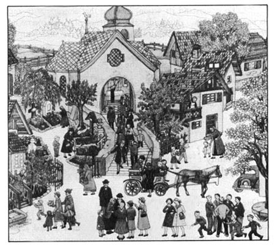
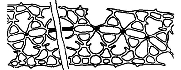
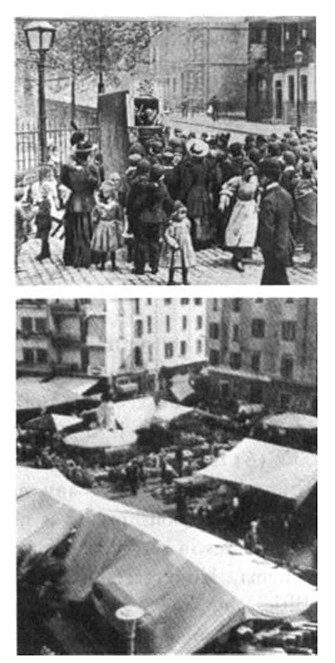
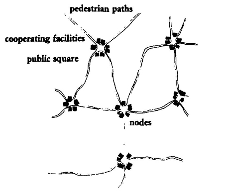

<section class="pattern-plate" aria-labelledby="t-activity-nodes">
<a href="/patterns">A Pattern Language</a> · <a href="/patterns#towns">Towns</a> · Pattern 30 · p. 163 · **
<h1 class="pattern-title" id="t-activity-nodes">Activity Nodes</h1><figure class="pattern-figure pl-figure"></figure><nav class="pattern-links" aria-label="Connections"><h2>Links to</h2><ul><li><a href="/patterns/community-of-7000">12 Community Of 7000</a></li><li><a href="/patterns/subculture-boundary">13 Subculture Boundary</a></li><li><a href="/patterns/identifiable-neighborhood">14 Identifiable Neighborhood</a></li><li><a href="/patterns/neighborhood-boundary">15 Neighborhood Boundary</a></li><li><a href="/patterns/eccentric-nucleus">28 Eccentric Nucleus</a></li><li><a href="/patterns/density-rings">29 Density Rings</a></li><li><a href="/patterns/promenade">31 Promenade</a></li><li><a href="/patterns/night-life">33 Night Life</a></li><li><a href="/patterns/degrees-of-publicness">36 Degrees Of Publicness</a></li><li><a href="/patterns/work-community">41 Work Community</a></li><li><a href="/patterns/university-as-a-marketplace">43 University As A Marketplace</a></li><li><a href="/patterns/local-town-hall">44 Local Town Hall</a></li><li><a href="/patterns/health-center">47 Health Center</a></li><li><a href="/patterns/network-of-paths-and-cars">52 Network Of Paths And Cars</a></li><li><a href="/patterns/small-public-squares">61 Small Public Squares</a></li><li><a href="/patterns/birth-places">65 Birth Places</a></li><li><a href="/patterns/teen-age-society">84 Teen-Age Society</a></li><li><a href="/patterns/shopfront-schools">85 Shopfront Schools</a></li><li><a href="/patterns/individually-owned-shops">87 Individually Owned Shops</a></li><li><a href="/patterns/street-cafe">88 Street Cafe</a></li><li><a href="/patterns/beer-hall">90 Beer Hall</a></li><li><a href="/patterns/food-stands">93 Food Stands</a></li><li><a href="/patterns/pedestrian-street">100 Pedestrian Street</a></li><li><a href="/patterns/paths-and-goals">120 Paths And Goals</a></li></ul><h2>Linked from</h2><ul><li><a href="/patterns/subculture-boundary">13 Subculture Boundary</a></li><li><a href="/patterns/men-and-women">27 Men And Women</a></li><li><a href="/patterns/eccentric-nucleus">28 Eccentric Nucleus</a></li><li><a href="/patterns/promenade">31 Promenade</a></li><li><a href="/patterns/night-life">33 Night Life</a></li><li><a href="/patterns/interchange">34 Interchange</a></li><li><a href="/patterns/degrees-of-publicness">36 Degrees Of Publicness</a></li><li><a href="/patterns/work-community">41 Work Community</a></li><li><a href="/patterns/network-of-paths-and-cars">52 Network Of Paths And Cars</a></li><li><a href="/patterns/street-cafe">88 Street Cafe</a></li><li><a href="/patterns/travelers-inn">91 Traveler’s Inn</a></li><li><a href="/patterns/food-stands">93 Food Stands</a></li></ul></nav></section><article class="pattern-text" aria-label="The text of Activity Nodes">
164… this pattern forms those essential nodes of life which help to generate <a class="pl-ref" href="/patterns/identifiable-neighborhood">IDENTIFIABLE NEIGHBORHOOD (14)</a>, <a class="pl-ref" href="/patterns/promenade">PROMENADE (31)</a>, <a class="pl-ref" href="/patterns/network-of-paths-and-cars">NETWORK OF PATHS AND CARS (52)</a>, and <a class="pl-ref" href="/patterns/pedestrian-street">PEDESTRIAN STREET (100)</a>. To understand its action, imagine that a community and its boundary are growing under the influence of <a class="pl-ref" href="/patterns/community-of-7000">COMMUNITY OF 7000 (12)</a>, <a class="pl-ref" href="/patterns/subculture-boundary">SUBCULTURE BOUNDARY (13)</a>, <a class="pl-ref" href="/patterns/identifiable-neighborhood">IDENTIFIABLE NEIGHBORHOOD (14)</a>, <a class="pl-ref" href="/patterns/neighborhood-boundary">NEIGHBORHOOD BOUNDARY (15)</a>, <a class="pl-ref" href="/patterns/eccentric-nucleus">ECCENTRIC NUCLEUS (28)</a>, and <a class="pl-ref" href="/patterns/density-rings">DENSITY RINGS (29)</a>. As they grow, certain “stars” begin to form, where the most important paths meet. These stars are potentially the vital spots of a community. The growth of these stars and of the paths which form them need to be guided to form genuine community crossroads.

◆ ◆ ◆

<strong>Community facilities scattered individually through the city do nothing for the life of the city.</strong>

One of the greatest problems in existing communities is the fact that the available public life in them is spread so thin that it has no impact on the community. It is not in any real sense available to the members of the community. Studies of pedestrian behavior make it clear that people seek out concentrations of other people, whenever they are available (for instance, Jan Gehl, “Mennesker til Fods (Pedestrians),” <em>Arkitekten</em>, No. 20, 1968).

To create these concentrations of people in a community, facilities must be grouped densely round very small public squares which can function as nodes—with all pedestrian movement in the community organized to pass through these nodes. Such nodes require four properties.

First, each node must draw together the main paths in the surrounding community. The major pedestrian paths should converge on the square, with minor paths funneling into the major ones, to create the basic star-shape of the pattern, This is much harder to do than one might imagine. To give an example of the difficulty which arises when we try to build this relationship into a town, we show the following plan—a scheme of 165ours for housing in Peru-in which the paths are all convergent on a very small number of squares.

<figure class="pl-figure"><figcaption><em>Public paths converge on centers of action</em>.</figcaption></figure>

This is not a very good plan—it is too stiff and formal. But it is possible to achieve the same relationship in a far more relaxed manner. In any case the relationship between paths, community facilities, and squares is vital and hard to achieve. It must be taken seriously, from the very outset, as a major feature of the city.

Second, to keep the activity concentrated, it is essential to make the squares rather small, smaller than one might imagine. A square of about 45 X 60 feet can keep the normal pace of public life well concentrated. This figure is discussed in detail under <a class="pl-ref" href="/patterns/small-public-squares">SMALL PUBLIC SQUARE (61)</a>.

Third, the facilities grouped around any one node must be chosen for their symbiotic relationships. It is not enough merely to group communal functions in so-called community centers. For example, church, cinema, kindergarten, and. police station are all community facilities, but they do not support one another mutually. Different people go to them, at different times, with different things in mind. There is no point in grouping them together. To create intensity of action, the facilities which are placed together round any one node must function in a cooperative manner, and must attract the same kinds of people, at the same times of day. For example, when evening entertainments are grouped together, the people who are having a night out can use any one of them, and the total concentration of action increases—see <a class="pl-ref" href="/patterns/night-life">NIGHT LIFE (33)</a>. When kindergartens and small parks and gardens are grouped together, young families with children may use either, so their total attraction is increased.

Fourth, these activity nodes should be distributed rather evenly 166across the community, so that no house or workplace is more than a few hundred yards from one. In this way a contrast of “busy and quiet” can be achieved at a small scale-and large dead areas can be avoided.

<figure class="pl-figure"><figcaption><em>Nodes of different size</em>.</figcaption></figure>

Therefore:

<strong>Create nodes of activity throughout the community, spread about 300 yards apart. First identify those existing spots in the community where action seems to concentrate itself. Then modify the layout of the paths in the community to bring as many of them through these spots as possible. This makes each spot function as a “node” in the 167path network. Then, at the center of each node, make a small public square, and surround it with a combination of community facilities and shops which arc mutually supportive.</strong>

<figure class="pl-figure"></figure>
◆ ◆ ◆

Connect those centers which are most dense, with a wider, more important path for strolling—<a class="pl-ref" href="/patterns/promenade">PROMENADE (31)</a>; make special centers for night activities—<a class="pl-ref" href="/patterns/night-life">NIGHT LIFE (33)</a>; whenever new paths are built, make certain that they pass through the centers, so that they intensify the life still further—<a class="pl-ref" href="/patterns/paths-and-goals">PATHS AND GOALS (120)</a>; and differentiate the paths so they are wide near the centers and smaller away from them-<a class="pl-ref" href="/patterns/degrees-of-publicness">DEGREES OF PUBLICNESS (36)</a>. At the heart of every center, build a small public squar—<a class="pl-ref" href="/patterns/small-public-squares">MALL PUBLIC SQUARES (61)</a>, and surround each square with an appropriate mix of mutually self-reinforcing facilities—<a class="pl-ref" href="/patterns/work-community">WORK COMMUNITY (41)</a>, <a class="pl-ref" href="/patterns/university-as-a-marketplace">UNIVERSITY AS A MARKETPLACE (43)</a>, <a class="pl-ref" href="/patterns/local-town-hall">LOCAL TOWN HALL (44)</a>, <a class="pl-ref" href="/patterns/health-center">HEALTH CENTER (47)</a>, <a class="pl-ref" href="/patterns/birth-places">BIRTH PLACES (65)</a>, <a class="pl-ref" href="/patterns/teen-age-society">TEENAGE SOCIETY (84)</a>, <a class="pl-ref" href="/patterns/shopfront-schools">SHOPFRONT SCHOOL (85)</a>, <a class="pl-ref" href="/patterns/individually-owned-shops">INDIVIDUALLY OWNED SHOPS (87)</a>, <a class="pl-ref" href="/patterns/street-cafe">STREET CAFE (88)</a>, <a class="pl-ref" href="/patterns/beer-hall">BEER HALL (90)</a>, <a class="pl-ref" href="/patterns/food-stands">FOOD STANDS (93)</a>….
</article>

Christopher Alexander, Sara Ishikawa and Murray Silverstein, with Max Jacobson, Ingrid Fiksdahl-King and Shlomo Angel, <cite>A Pattern Language</cite> (Oxford University Press, 1977), pattern 30, pp. 163–167. Text and illustrations from the <a href="https://github.com/natureoforder/sources">Nature of Order sources</a> reading edition, transcribed from the 1977 printing; report errors on <a href="https://github.com/natureoforder/alexander-wiki/issues">GitHub</a>.

<a href="/patterns/density-rings">← 29 Density Rings</a> · <a href="/patterns">All 253 patterns</a> · <a href="/patterns/promenade">31 Promenade →</a>

