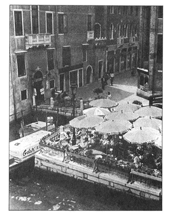
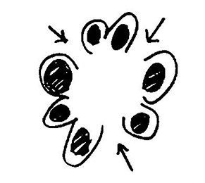
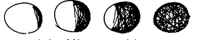
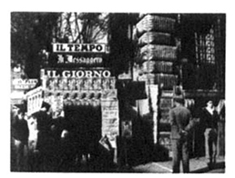
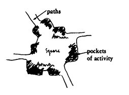

<section class="pattern-plate" aria-labelledby="t-activity-pockets">
<a href="/patterns">A Pattern Language</a> · <a href="/patterns#buildings">Buildings</a> · Pattern 124 · p. 599 · **
<h1 class="pattern-title" id="t-activity-pockets">Activity Pockets</h1><figure class="pattern-figure pl-figure"></figure><nav class="pattern-links" aria-label="Connections"><h2>Links to</h2><ul><li><a href="/patterns/promenade">31 Promenade</a></li><li><a href="/patterns/small-public-squares">61 Small Public Squares</a></li><li><a href="/patterns/public-outdoor-room">69 Public Outdoor Room</a></li><li><a href="/patterns/street-cafe">88 Street Cafe</a></li><li><a href="/patterns/bus-stop">92 Bus Stop</a></li><li><a href="/patterns/food-stands">93 Food Stands</a></li><li><a href="/patterns/pedestrian-street">100 Pedestrian Street</a></li><li><a href="/patterns/building-thoroughfare">101 Building Thoroughfare</a></li><li><a href="/patterns/arcades">119 Arcades</a></li><li><a href="/patterns/paths-and-goals">120 Paths And Goals</a></li><li><a href="/patterns/path-shape">121 Path Shape</a></li><li><a href="/patterns/building-fronts">122 Building Fronts</a></li><li><a href="/patterns/a-place-to-wait">150 A Place To Wait</a></li><li><a href="/patterns/outdoor-room">163 Outdoor Room</a></li><li><a href="/patterns/trellised-walk">174 Trellised Walk</a></li><li><a href="/patterns/seat-spots">241 Seat Spots</a></li><li><a href="/patterns/sitting-wall">243 Sitting Wall</a></li></ul><h2>Linked from</h2><ul><li><a href="/patterns/food-stands">93 Food Stands</a></li><li><a href="/patterns/building-thoroughfare">101 Building Thoroughfare</a></li><li><a href="/patterns/hierarchy-of-open-space">114 Hierarchy Of Open Space</a></li><li><a href="/patterns/roof-garden">118 Roof Garden</a></li><li><a href="/patterns/path-shape">121 Path Shape</a></li><li><a href="/patterns/building-fronts">122 Building Fronts</a></li><li><a href="/patterns/pedestrian-density">123 Pedestrian Density</a></li><li><a href="/patterns/something-roughly-in-the-middle">126 Something Roughly In The Middle</a></li><li><a href="/patterns/building-edge">160 Building Edge</a></li><li><a href="/patterns/seat-spots">241 Seat Spots</a></li><li><a href="/patterns/sitting-wall">243 Sitting Wall</a></li></ul></nav></section><article class="pattern-text" aria-label="The text of Activity Pockets">
600… in many large scale patterns which define public space, the edge is critical: <a class="pl-ref" href="/patterns/promenade">PROMENADE (31)</a>, <a class="pl-ref" href="/patterns/small-public-squares">SMALL PUBLIC SQUARES (61)</a>, <a class="pl-ref" href="/patterns/public-outdoor-room">PUBLIC OUTDOOR ROOM (69)</a>, <a class="pl-ref" href="/patterns/pedestrian-street">PEDESTRIAN STREET (100)</a>, <a class="pl-ref" href="/patterns/building-thoroughfare">BUILDING THOROUGHFARE (101)</a>, <a class="pl-ref" href="/patterns/path-shape">PATH SHAPE (121)</a>. This pattern helps complete the edge of all these larger patterns.

◆ ◆ ◆

<strong>The life of a public square forms naturally around its edge. If the edge fails, then the space never becomes lively.</strong>

In more detail: people gravitate naturally toward the edge of public spaces. They do not linger out in the open. If the edge does not provide them with places where it is natural to linger, the space becomes a place to walk through, not a place to stop. It is therefore clear that a public square should be surrounded by pockets of activity: shops, stands, benches, displays, rails, courts, gardens, news racks. In effect, the edge must be scalloped.

Further, the process of lingering is a gradual one; it happens; people do not make up their minds to stay; they stay or go, according to a process of gradual involvement. This means that the various pockets of activity around the edge should all be next to paths and entrances so that people pass right by them as they pass through. The goal-oriented activity of coming and going then has a chance to turn gradually into something more relaxed. And once many small groups form around the edge, it is likely that they will begin to overlap and spill in toward the center of the square. We therefore specify that pockets of activity must alternate with access points.

<figure class="pl-figure"><figcaption><em>A conceptual diagram</em>.</figcaption></figure>

601The scalloped edge mast surround the space entirely. We may see this clearly as follows: draw a circle to represent the space, and darken some part of its perimeter to stand for the scalloped edge. Now draw chords which join different points along this darkened perimeter. As the length of the darkened edge gets smaller, the area of the space covered by these chords wanes drastically. This shows how quickly the life in the space will drop when the length of the scalloped edge gets shorter. To make the space lively, the scalloped edge must surround the space completely.

<figure class="pl-figure"><figcaption><em>As the activities grow around the space, it becomes more lively</em>.</figcaption></figure>

When we say that the edge must be scalloped with activity, we mean this conceptually—not literally. In fact, to build this pattern, you must build the activity pockets <em>forward</em> into the square: first rough out the major paths that cross the space and the spaces left over between these paths; then build the activity pockets into these “in-between” spaces, bringing them forward, into the square.

<figure class="pl-figure"><figcaption><em>A pocket of activity which bulges into the square</em>.</figcaption></figure>

Therefore:

<strong>Surround public gathering places with pockets of activity—small, partly enclosed areas at the edges, which jut forward 602into the open space between the paths, and contain activities which make it natural for people to pause and get involved.</strong>

<figure class="pl-figure"></figure>
◆ ◆ ◆

Lead paths between the pockets of activity—<a class="pl-ref" href="/patterns/paths-and-goals">PATHS AND GOALS (120)</a>—and shape the pockets themselves with arcades and seats, and sitting walls, and columns and trellises—<a class="pl-ref" href="/patterns/arcades">ARCADES (119)</a>, <a class="pl-ref" href="/patterns/outdoor-room">OUTDOOR ROOM (163)</a>, <a class="pl-ref" href="/patterns/trellised-walk">TRELLISED WALK (174)</a>, <a class="pl-ref" href="/patterns/seat-spots">SEAT SPOTS (241)</a>, <a class="pl-ref" href="/patterns/sitting-wall">SITTING WALL (243)</a>; above all shape them with the fronts of buildings—<a class="pl-ref" href="/patterns/building-fronts">BUILDING FRONTS (122)</a>; and include, within the pockets, newsstands—<a class="pl-ref" href="/patterns/bus-stop">BUS STOPS (92)</a>, <a class="pl-ref" href="/patterns/food-stands">FOOD STANDS (93)</a>, gardens, games, small shops, <a class="pl-ref" href="/patterns/street-cafe">STREET CAFES (88)</a>, and <a class="pl-ref" href="/patterns/a-place-to-wait">A PLACE TO WAIT(150)</a>…
</article>

Christopher Alexander, Sara Ishikawa and Murray Silverstein, with Max Jacobson, Ingrid Fiksdahl-King and Shlomo Angel, <cite>A Pattern Language</cite> (Oxford University Press, 1977), pattern 124, pp. 599–602. Text and illustrations from the <a href="https://github.com/natureoforder/sources">Nature of Order sources</a> reading edition, transcribed from the 1977 printing; report errors on <a href="https://github.com/natureoforder/alexander-wiki/issues">GitHub</a>.

<a href="/patterns/pedestrian-density">← 123 Pedestrian Density</a> · <a href="/patterns">All 253 patterns</a> · <a href="/patterns/stair-seats">125 Stair Seats →</a>

