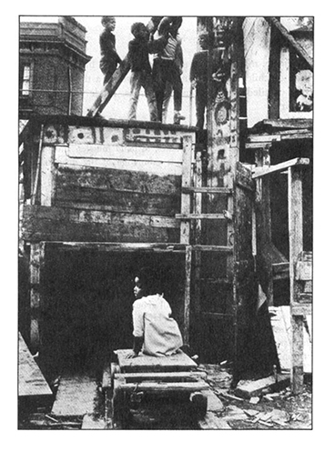
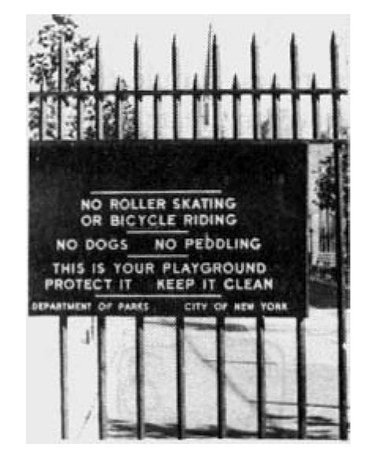
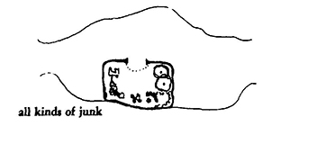

<section class="pattern-plate" aria-labelledby="t-adventure-playground">
<a href="/patterns">A Pattern Language</a> · <a href="/patterns#towns">Towns</a> · Pattern 73 · p. 367
<h1 class="pattern-title" id="t-adventure-playground">Adventure Playground</h1><figure class="pattern-figure pl-figure"></figure><nav class="pattern-links" aria-label="Connections"><h2>Links to</h2><ul><li><a href="/patterns/bike-paths-and-racks">56 Bike Paths And Racks</a></li><li><a href="/patterns/connected-play">68 Connected Play</a></li><li><a href="/patterns/garden-wall">173 Garden Wall</a></li><li><a href="/patterns/child-caves">203 Child Caves</a></li><li><a href="/patterns/sitting-wall">243 Sitting Wall</a></li></ul><h2>Linked from</h2><ul><li><a href="/patterns/neighborhood-boundary">15 Neighborhood Boundary</a></li><li><a href="/patterns/health-center">47 Health Center</a></li><li><a href="/patterns/children-in-the-city">57 Children In The City</a></li><li><a href="/patterns/holy-ground">66 Holy Ground</a></li><li><a href="/patterns/childrens-home">86 Children’s Home</a></li></ul></nav></section><article class="pattern-text" aria-label="The text of Adventure Playground">
368… inside the local neighborhood, even if there is common land where children can meet and play—common land (67), <a class="pl-ref" href="/patterns/connected-play">connected play (68)</a>; it is essential that there be at least one smaller part, which is differentiated, where the play is wilder, and where the children have access to all kinds of junk.

◆ ◆ ◆

<strong>A castle, made of cartons, rocks, and old branches, by a group of children for themselves, is worth a thousand perfectly detailed, exactly finished castles, made for them in a factory.</strong>

Play has many functions: it gives children a chance to be together, a chance to use their bodies, to build muscles, and to test new skills. But above all, play is a function of the imagination. A child’s play is his way of dealing with the issues of his growth, of relieving tensions and exploring the future. It reflects directly the problems and joys of his social reality. Children come to terms with the world, wrestle with their pictures of it, and reform these pictures constantly, through those adventures of imagination we call play.

Any kind of playground which disturbs, or reduces, the role of imagination and makes the child more passive, more the recipient of someone else’s imagination, may look nice, may be clean, may be safe, may be healthy—but it just cannot satisfy the fundamental need which play is all about. And, to put it bluntly, it is a waste of time and money. Huge abstract sculptured play-lands are just as bad as asphalt playgrounds and jungle gyms. They are not just sterile; they are useless. The functions they perform have nothing to do with the child’s most basic needs.

This need for adventurous and imaginative play is taken care of handily in small towns and in the countryside, where children have access to raw materials, space, and a somewhat comprehensible environment. In cities, however, it has become a pressing concern. The world of private toys and asphalt playgrounds does not provide the proper settings for this kind of play.

The basic work on this problem has come from Lady Allen of 369Hurtwood. In a series of projects and publications over the past twenty years, Lady Allen has developed the concept of the adventure playground for cities, and we refer the reader, above all, to her work. (See, for example, her book, <em>Planning for Play</em>, Cambridge: MIT Press, 1968.) We believe that her work is so substantial, that, by itself, it establishes the essential pattern for neighborhood playgrounds.

<figure class="pl-figure"><figcaption><em>No playing</em>.</figcaption></figure>

Colin Ward has also written an excellent review, “Adventure Playgrounds: A Parable of Anarchy,” <em>Anarchy</em> 7, September 1961. Here is a description <em>of</em> the Grimsby playground, from that review:

At the end of each summer the children saw up their shacks and shanties into firewood which they deliver in fantastic quantities to old age pensioners. When they begin building in the spring, “it’s just a hole in the ground—and they crawl into it.” Gradually the holes give way to two-storey huts. Similarly with the notices above their dens. It begins with nailing up “Keep Out” signs. After this come more personal names like “Bughold Cave” and “Dead Man’s Cave,” but by the end of the summer they have communal names like “Hospital” or “Estate Agent.” There is an everchanging range of activities due entirely to the imagination and enterprise of the children themselves….

Therefore:

<strong>Set up a playground for the children in each neighborhood. Not a highly finished playground, with asphalt and 370swings, but a place with raw materials of all kinds—nets, boxes, barrels, trees, ropes, simple tools, frames, grass, and water—where children can create and re-create playgrounds of their own.</strong>

<figure class="pl-figure"></figure>
◆ ◆ ◆

Make sure that the adventure playground is in the sun—sunny place (161); make hard surfaces for bikes and carts and toy trucks and trolleys, and soft surfaces for mud and building things <a class="pl-ref" href="/patterns/bike-paths-and-racks">bike paths and racks (56)</a>, carden growing wild (172), <a class="pl-ref" href="/patterns/child-caves">child caves (203)</a>; and make the boundary substantial with a <a class="pl-ref" href="/patterns/garden-wall">garden wall (173)</a> or <a class="pl-ref" href="/patterns/sitting-wall">sitting wall (243)</a>….
</article>

Christopher Alexander, Sara Ishikawa and Murray Silverstein, with Max Jacobson, Ingrid Fiksdahl-King and Shlomo Angel, <cite>A Pattern Language</cite> (Oxford University Press, 1977), pattern 73, pp. 367–370. Text and illustrations from the <a href="https://github.com/natureoforder/sources">Nature of Order sources</a> reading edition, transcribed from the 1977 printing; report errors on <a href="https://github.com/natureoforder/alexander-wiki/issues">GitHub</a>.

<a href="/patterns/local-sports">← 72 Local Sports</a> · <a href="/patterns">All 253 patterns</a> · <a href="/patterns/animals">74 Animals →</a>

