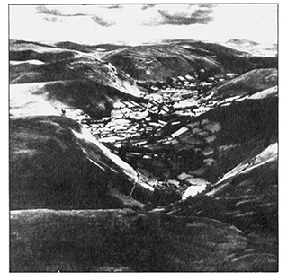
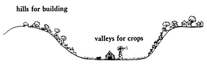

<section class="pattern-plate" aria-labelledby="t-agricultural-valleys">
<a href="/patterns">A Pattern Language</a> · <a href="/patterns#towns">Towns</a> · Pattern 4 · p. 26 · *
<h1 class="pattern-title" id="t-agricultural-valleys">Agricultural Valleys</h1><figure class="pattern-figure pl-figure"></figure><nav class="pattern-links" aria-label="Connections"><h2>Links to</h2><ul><li><a href="/patterns/independent-regions">1 Independent Regions</a></li><li><a href="/patterns/city-country-fingers">3 City Country Fingers</a></li><li><a href="/patterns/the-countryside">7 The Countryside</a></li></ul><h2>Linked from</h2><ul><li><a href="/patterns/independent-regions">1 Independent Regions</a></li><li><a href="/patterns/the-distribution-of-towns">2 The Distribution Of Towns</a></li><li><a href="/patterns/city-country-fingers">3 City Country Fingers</a></li><li><a href="/patterns/the-countryside">7 The Countryside</a></li></ul></nav></section><article class="pattern-text" aria-label="The text of Agricultural Valleys">
27… this pattern helps maintain the <a class="pl-ref" href="/patterns/independent-regions">INDEPENDENT REGIONS (1)</a> by making regions more self-sufficient agriculturally; and it will create <a class="pl-ref" href="/patterns/city-country-fingers">CITY COUNTRY FINGERS (3)</a> almost automatically by preserving agricultural land in urban areas. But just exactly which land ought to be preserved, and which land built upon?

◆ ◆ ◆

<strong>The land which is best for agriculture happens to be best for building too. But it is limited—and once destroyed, it cannot be regained for centuries.</strong>

In the last few years, suburban growth has been spreading over all land, agricultural or not. It cats up this limited resource and, worse still, destroys the possibility of farming close to cities once and for all. But we know, from the arguments of <a class="pl-ref" href="/patterns/city-country-fingers">CITY COUNTRY FINGERS (3)</a>, that it is important to have open farmland near the places where people live. Since the arable land which can be used for farming lies mainly in the valleys, it is essential that the valley floors within our urban regions be left untouched and kept for farming.

The most complete study of this problem that we know, comes from Ian McHarg (<em>Design With Nature</em>, New York: Natural History Press, 1969). In his “Plan for the Valleys” (WallaceMcHarg Associates, Philadelphia, 1963), he shows how town development can be diverted to the hillsides and plateaus, leaving the valleys clear. The pattern is supported, also, by the fact that there are several possible practical approaches to the task of implementation (McHarg, pp. 79–93).

Therefore:

<strong>Preserve all agricultural valleys as farmland and protect this land from any development which would destroy or lock up the unique fertility of the soil. Even when valleys 28are not cultivated now, protect them: keep them for farms and parks and wilds.</strong>

<figure class="pl-figure"></figure>
◆ ◆ ◆

Keep town and city development along the hilltops and hillsides—<a class="pl-ref" href="/patterns/city-country-fingers">CITY COUNTRY FINGERS (3)</a>. And in the valleys, treat the ownership of the land as a form of stewardship, embracing basic ecological responsibilities—<a class="pl-ref" href="/patterns/the-countryside">THE COUNTRYSIDE (7)</a>….
</article>

Christopher Alexander, Sara Ishikawa and Murray Silverstein, with Max Jacobson, Ingrid Fiksdahl-King and Shlomo Angel, <cite>A Pattern Language</cite> (Oxford University Press, 1977), pattern 4, pp. 26–28. Text and illustrations from the <a href="https://github.com/natureoforder/sources">Nature of Order sources</a> reading edition, transcribed from the 1977 printing; report errors on <a href="https://github.com/natureoforder/alexander-wiki/issues">GitHub</a>.

<a href="/patterns/city-country-fingers">← 3 City Country Fingers</a> · <a href="/patterns">All 253 patterns</a> · <a href="/patterns/lace-of-country-streets">5 Lace Of Country Streets →</a>

