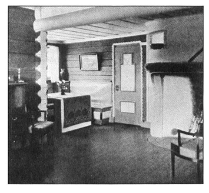
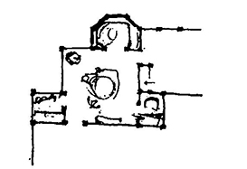
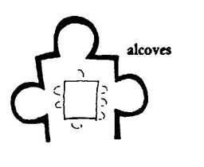

<section class="pattern-plate" aria-labelledby="t-alcoves">
<a href="/patterns">A Pattern Language</a> · <a href="/patterns#buildings">Buildings</a> · Pattern 179 · p. 828 · **
<h1 class="pattern-title" id="t-alcoves">Alcoves</h1><figure class="pattern-figure pl-figure"></figure><nav class="pattern-links" aria-label="Connections"><h2>Links to</h2><ul><li><a href="/patterns/common-areas-at-the-heart">129 Common Areas At The Heart</a></li><li><a href="/patterns/farmhouse-kitchen">139 Farmhouse Kitchen</a></li><li><a href="/patterns/sequence-of-sitting-spaces">142 Sequence Of Sitting Spaces</a></li><li><a href="/patterns/flexible-office-space">146 Flexible Office Space</a></li><li><a href="/patterns/a-place-to-wait">150 A Place To Wait</a></li><li><a href="/patterns/small-meeting-rooms">151 Small Meeting Rooms</a></li><li><a href="/patterns/window-place">180 Window Place</a></li><li><a href="/patterns/ceiling-height-variety">190 Ceiling Height Variety</a></li><li><a href="/patterns/the-shape-of-indoor-space">191 The Shape Of Indoor Space</a></li><li><a href="/patterns/half-open-wall">193 Half-Open Wall</a></li><li><a href="/patterns/built-in-seats">202 Built-In Seats</a></li><li><a href="/patterns/thickening-the-outer-walls">211 Thickening The Outer Walls</a></li><li><a href="/patterns/column-place">226 Column Place</a></li></ul><h2>Linked from</h2><ul><li><a href="/patterns/beer-hall">90 Beer Hall</a></li><li><a href="/patterns/farmhouse-kitchen">139 Farmhouse Kitchen</a></li><li><a href="/patterns/a-room-of-ones-own">141 A Room Of One’s Own</a></li><li><a href="/patterns/sequence-of-sitting-spaces">142 Sequence Of Sitting Spaces</a></li><li><a href="/patterns/reception-welcomes-you">149 Reception Welcomes You</a></li><li><a href="/patterns/compost">178 Compost</a></li><li><a href="/patterns/window-place">180 Window Place</a></li><li><a href="/patterns/workspace-enclosure">183 Workspace Enclosure</a></li><li><a href="/patterns/communal-sleeping">186 Communal Sleeping</a></li><li><a href="/patterns/half-open-wall">193 Half-Open Wall</a></li><li><a href="/patterns/thick-walls">197 Thick Walls</a></li><li><a href="/patterns/built-in-seats">202 Built-In Seats</a></li><li><a href="/patterns/thickening-the-outer-walls">211 Thickening The Outer Walls</a></li><li><a href="/patterns/stair-vault">228 Stair Vault</a></li><li><a href="/patterns/dormer-windows">231 Dormer Windows</a></li><li><a href="/patterns/pools-of-light">252 Pools Of Light</a></li></ul></nav></section><article class="pattern-text" aria-label="The text of Alcoves">
829… many large rooms are not complete unless they have smaller rooms and alcoves opening off them. This pattern, and several which follow it, define the form of minor rooms and alcoves which help to complete <a class="pl-ref" href="/patterns/common-areas-at-the-heart">COMMON AREAS AT THE HEART (129)</a>, <a class="pl-ref" href="/patterns/farmhouse-kitchen">FARMHOUSE KICHEN (139)</a>, <a class="pl-ref" href="/patterns/sequence-of-sitting-spaces">SEQUENCE OF SITTING SPACES (142)</a>, <a class="pl-ref" href="/patterns/flexible-office-space">FLEXIBLE OFFICE SPACE (146)</a>, <a class="pl-ref" href="/patterns/a-place-to-wait">A PLACE TO WAIT (150)</a>, <a class="pl-ref" href="/patterns/small-meeting-rooms">small meeting rooms (151)</a>, and many others.

◆ ◆ ◆

<strong>No homogeneous room, of homogeneous height, can serve a group of people well. To give a group a chance to be together, as a group, a room must also give them the chance to be alone, in one’s and two’s in the same space.</strong>

This problem is felt most acutely in the common rooms of a house—the kitchen, the family room, the living room. In fact, it is so critical there, that the house can drive the family apart when it remains unsolved. Therefore, while we believe that the pattern applies equally to workplaces and shops and schools—in fact, to all common rooms wherever they are—we shall focus our discussion on the house, and the use of alcoves around the family common rooms.

In modern life, the main function of the family is emotional; it is a source of security and love. But these qualities will only come into existence if the members of the house are <em>physically able to be together as a family</em>.

This is often difficult. The various members of the family come and go at different times of day; even when they are in the house, each has his own private interests: sewing, reading, homework, carpentry, model-building, games. In many houses, these interests force people to go off to their own rooms, away from the family. This happens for two reasons. First, in a normal family room, one person can easily be disturbed by what the others are doing: the person who wants to read, is disturbed by the fact that the others are watching TV. Second, the family room does not usually have any space where people can leave 830things and not have them disturbed. Books left on the dining table get cleared away at meal times; a half-finished game cannot be left standing. Naturally, people get into the habit of doing these things somewhere else—away from the family.

To solve the problem, there must be some way in which the members of the family can be together, even when they are doing different things. This means that the family room needs a number of small spaces where people can do different things. The spaces need to be far enough away from the main room, so that any clutter that develops in them does not encroach on the communal uses of the main room. The spaces need to be connected, so that people are still “together” when they are in them: this means they need to be open to each other. At the same time they need to be secluded, so a person in one of them is not disturbed by the others. In short, the family room must be surrounded by small alcoves. The alcoves should be large enough for one or two people at a time: about six feet wide, and between three and six feet deep. To make it clear that they are separate from the main room, so they do not clutter it up, and so that people in them are secluded, they should be narrower than the family room walls, and have lower ceilings than the main room.

<figure class="pl-figure"><figcaption><em>Family room alcoves</em>.</figcaption></figure>

Since this pattern is so fundamental, we now present several quotes from various writers to underscore the fact that many people have made roughly similar observations:

From <em>Psychosocial Interior of the Family</em>, Gerald Handel, ed., Chicago, 111.: Aldine Publishing Company, 1967, p. 13.

This fundamental duality of family life is of considerable significance, for the individual’s efforts to take his own kind of 831interest in the world, to become his own kind of person, proceed apace with his efforts to find gratifying connection to the other members. At the same time, the other members are engaged in taking their kinds of interest in him, and in themselves. This is the matrix of interaction in which a family develops its life. The family tries to cast itself in a form that satisfies the ways in which its members want to be together and apart….

From <em>Children in the Family</em> by Florence Powdermaker and Louise Grimes, New York: Farrar &amp; Reinhart, Inc., 1940, p. 108: “Even if a child has a room of his own, he doesn’t like being kept there all day long but wants to spend much of his time in other parts of the house… And p. 112:”… he enjoys and craves attention. He likes to show things to adults and have them share in the pleasure of his discoveries. Besides, he is entranced by their activities and would like to have a finger in every pie.”

And from Svend Riemer, “Sociological Theory of Home Adjustment,” <em>American Soc. Rev.</em>, Vol. 8, No. 3, June 1943, p. 277:

In adjustment to the activities of other members of the family, it will be necessary to “migrate” … between the different rooms of the family home. Even the same activity may have to be moved from one room to the other at different times of the day.

Home studies for example may have to be carried out in the living room during the afternoon, while food is being prepared in the kitchen} they may have to be continued in the kitchen during the evening hours, when the living room is occupied by leisure time activities of other members of the family. This “migration” between different rooms is apt to impair intellectual concentration. It may convey a sense of insecurity. Its possible disadvantages have to be seriously considered whenever children are reared in the family home.

It is clear then, that the opposing needs for some seclusion and some community at the same time in the same space, occur in almost every family. It is not hard to see that only slightly different versions of the very same forces exist in all communal rooms. People want to be together; but at the same time they want the opportunity for some small amount of privacy, without giving up community.

If ten people, or five, are together in a room, and two of them want to pull away to one side to have a quiet talk together, they need a place to do it. Only the alcove, or some version of the 832alcove, can give them the privacy they need, without forcing them to give the group up altogether.

Therefore:

<strong>Make small places at the edge of any common room, usually no more than 6 feet wide and 3 to 6 feet deep and possibly much smaller. These alcoves should be large enough for two people to sit, chat, or play and sometimes large enough to contain a desk or a table.</strong>

<figure class="pl-figure"></figure>
◆ ◆ ◆

Give the alcove a ceiling which is markedly lower than the ceiling height in the main room—ceiling <a class="pl-ref" href="/patterns/ceiling-height-variety">HEIGHT VARIETY (190)</a>; make a partial boundary between the alcove and the common room by using low walls and thick columns—<a class="pl-ref" href="/patterns/half-open-wall">HALF-OPEN WALL (193)</a>, <a class="pl-ref" href="/patterns/column-place">COLUMN PLACE (226)</a>; when the alcove is on an outside wall, make it into a window place, with a nice window, low till, and a built-in seat—<a class="pl-ref" href="/patterns/window-place">WINDOW PLACE (180)</a>, <a class="pl-ref" href="/patterns/built-in-seats">BUILT-IN SEATS (202)</a>; and treat it as <a class="pl-ref" href="/patterns/thickening-the-outer-walls">thickening the outer walls (211)</a>. For details on the shape of the alcove, see <a class="pl-ref" href="/patterns/the-shape-of-indoor-space">the shape of INDOOR SPACE (191)</a> ….
</article>

Christopher Alexander, Sara Ishikawa and Murray Silverstein, with Max Jacobson, Ingrid Fiksdahl-King and Shlomo Angel, <cite>A Pattern Language</cite> (Oxford University Press, 1977), pattern 179, pp. 828–832. Text and illustrations from the <a href="https://github.com/natureoforder/sources">Nature of Order sources</a> reading edition, transcribed from the 1977 printing; report errors on <a href="https://github.com/natureoforder/alexander-wiki/issues">GitHub</a>.

<a href="/patterns/compost">← 178 Compost</a> · <a href="/patterns">All 253 patterns</a> · <a href="/patterns/window-place">180 Window Place →</a>

