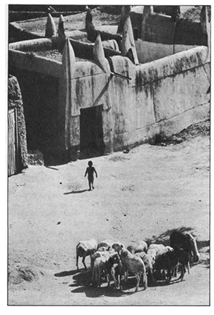
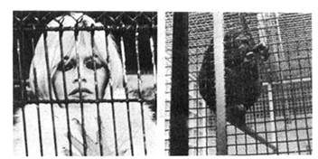
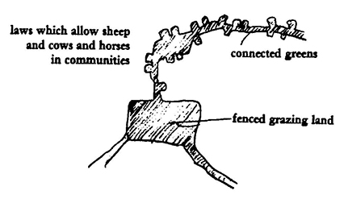

<section class="pattern-plate" aria-labelledby="t-animals">
<a href="/patterns">A Pattern Language</a> · <a href="/patterns#towns">Towns</a> · Pattern 74 · p. 371
<h1 class="pattern-title" id="t-animals">Animals</h1><figure class="pattern-figure pl-figure"></figure><nav class="pattern-links" aria-label="Connections"><h2>Links to</h2><ul><li><a href="/patterns/green-streets">51 Green Streets</a></li><li><a href="/patterns/accessible-green">60 Accessible Green</a></li><li><a href="/patterns/common-land">67 Common Land</a></li><li><a href="/patterns/the-family">75 The Family</a></li><li><a href="/patterns/house-for-a-small-family">76 House For A Small Family</a></li><li><a href="/patterns/house-for-a-couple">77 House For A Couple</a></li><li><a href="/patterns/house-for-one-person">78 House For One Person</a></li><li><a href="/patterns/your-own-home">79 Your Own Home</a></li></ul><h2>Linked from</h2><ul><li><a href="/patterns/children-in-the-city">57 Children In The City</a></li><li><a href="/patterns/accessible-green">60 Accessible Green</a></li><li><a href="/patterns/holy-ground">66 Holy Ground</a></li><li><a href="/patterns/connected-play">68 Connected Play</a></li><li><a href="/patterns/compost">178 Compost</a></li></ul></nav></section><article class="pattern-text" aria-label="The text of Animals">
372… even when there is public land and private land for individual buildings—common land (67), <a class="pl-ref" href="/patterns/your-own-home">your own home (79)</a>, there is no guarantee that animals can flourish there. This pattern helps to form <a class="pl-ref" href="/patterns/green-streets">green streets (51)</a> and <a class="pl-ref" href="/patterns/common-land">common land (67)</a> by giving them the qualities they need to sustain animal life.

◆ ◆ ◆

<strong>Animals are as important a part of nature as the trees and grass and flowers. There is some evidence, in addition, which suggests that contact with animals may play a vital role in a child’s emotional development.</strong>

Yet while it is widely accepted that we need “parks”—at least access to some kind of open space where trees and grass and flowers grow—we do not yet have the same kind of wisdom where sheep, horses, cows, goats, birds, snakes, rabbits, deer, chickens, wildcats, gulls, otters, crabs, fish, frogs, beetles, butterflies, and ants are concerned.

Ann Dreyfus, a family therapist in California, has told us about the way that animals like goats and rabbits help children in their therapy. She finds that children who cannot make contact with people, are nevertheless able to establish contact with these animals. Once this has happened and feelings have started to flow again, the children’s capacity for making contact starts to grow again, and eventually spreads out to family and friends.

But animals are almost missing from cities. In a city there are, broadly speaking, only three kinds of animal: pets, vermin, and animals in the zoo. None of these three provides the emotional sustenance nor the ecological connections that are needed. Pets are pleasant, but so humanized that they have no wild free life of their own. And they give human beings little opportunity to experience the animalness of animals. Vermin—rats, cockroaches—are animals which are peculiar to cities and which depend ecologically on miserable and disorganized conditions, so they are naturally considered as enemies. Animals in the zoo are more or less inaccessible to most of the human population—except as 373occasional curiosities. Besides, it has been said that animals living under the conditions which a zoo provides are essentially psychotic—that is, entirely disturbed from their usual mode of existence—so that it is probably wrong to keep them there—and certainly they can in no way re-create the missing web of animal life which cities need.

<figure class="pl-figure"></figure>
<em>Looking in or looking out</em>—<em>what’s the difference?</em>

It is perfectly possible to reintroduce animals into the natural ecology of cities in a useful and functioning sense, provided that arrangements are made which allow this and do not create a nuisance.

Examples of ecologically useful animals in a city: horses, ponies, donkeys—for local transportation and sport. Pigs—to recycle garbage and for meat. Ducks and chickens—as a source of eggs and meat. Cows—for milk. Goats—milk. Bees—honey and pollination of fruit trees. Birds—to maintain insect balance.

There are essentially two difficulties to overcome, (i) Many of these animals have been driven out of cities by law because they interrupt traffic, leave dung on the street, and carry disease. (2) Many of the animals cannot survive without protection under modern urban conditions. It is necessary to make specific provisions to overcome these difficulties.

Therefore:

<strong>Make legal provisions which allow people to keep any animals on their private lots or in private stables. Create a piece of fenced and protected common land, where animals 374are free to graze, with grass, trees, and water in it. Make at least one system of movement in the neighborhood which is entirely asphalt-free—where dung can fall freely without needing to be cleaned up.</strong>

<figure class="pl-figure"></figure>
◆ ◆ ◆

Make sure that the green areas—green streets (51), <a class="pl-ref" href="/patterns/accessible-green">accessible green (60)</a>—are all connected to one another to form a continuous swath throughout the city for domestic and wild animals. Place the animal commons near a children’s home and near the local schools, so children can take care of the animals—children’s home (86); if there is a lot of dung, make sure that it can be used as a fertilizer—compost (178)….

375<strong><em>within the framework of the common land, the clusters and the work communities, encourage transformation of the smallest independent social institutions: the families, workgroups, and gathering places</em>. <em>irst, the family, in all its forms;</em></strong>

<a class="pl-ref" href="/patterns/the-family">75. THE FAMILY</a>

<a class="pl-ref" href="/patterns/house-for-a-small-family">76. HOUSE FOR A SMALL FAMILY</a>

<a class="pl-ref" href="/patterns/house-for-a-couple">77. HOUSE FOR A COUPLE</a>

<a class="pl-ref" href="/patterns/house-for-one-person">78. HOUSE FOR ONE PERSON</a>

<a class="pl-ref" href="/patterns/your-own-home">79. YOUR OWN HOME</a>
</article>

Christopher Alexander, Sara Ishikawa and Murray Silverstein, with Max Jacobson, Ingrid Fiksdahl-King and Shlomo Angel, <cite>A Pattern Language</cite> (Oxford University Press, 1977), pattern 74, pp. 371–375. Text and illustrations from the <a href="https://github.com/natureoforder/sources">Nature of Order sources</a> reading edition, transcribed from the 1977 printing; report errors on <a href="https://github.com/natureoforder/alexander-wiki/issues">GitHub</a>.

<a href="/patterns/adventure-playground">← 73 Adventure Playground</a> · <a href="/patterns">All 253 patterns</a> · <a href="/patterns/the-family">75 The Family →</a>

