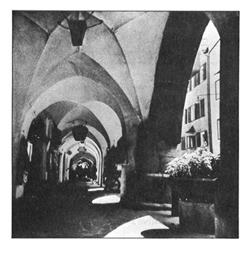
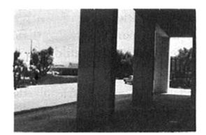
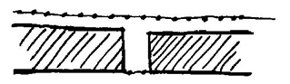
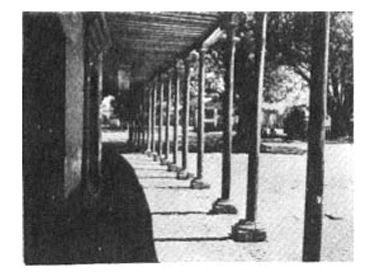
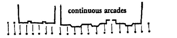

<section class="pattern-plate" aria-labelledby="t-arcades">
<a href="/patterns">A Pattern Language</a> · <a href="/patterns#buildings">Buildings</a> · Pattern 119 · p. 580 · **
<h1 class="pattern-title" id="t-arcades">Arcades</h1><figure class="pattern-figure pl-figure"></figure><nav class="pattern-links" aria-label="Connections"><h2>Links to</h2><ul><li><a href="/patterns/circulation-realms">98 Circulation Realms</a></li><li><a href="/patterns/pedestrian-street">100 Pedestrian Street</a></li><li><a href="/patterns/building-thoroughfare">101 Building Thoroughfare</a></li><li><a href="/patterns/connected-buildings">108 Connected Buildings</a></li><li><a href="/patterns/cascade-of-roofs">116 Cascade Of Roofs</a></li><li><a href="/patterns/sheltering-roof">117 Sheltering Roof</a></li><li><a href="/patterns/building-edge">160 Building Edge</a></li><li><a href="/patterns/ceiling-height-variety">190 Ceiling Height Variety</a></li><li><a href="/patterns/half-open-wall">193 Half-Open Wall</a></li><li><a href="/patterns/structure-follows-social-spaces">205 Structure Follows Social Spaces</a></li><li><a href="/patterns/thickening-the-outer-walls">211 Thickening The Outer Walls</a></li><li><a href="/patterns/low-doorway">224 Low Doorway</a></li><li><a href="/patterns/column-place">226 Column Place</a></li><li><a href="/patterns/column-connections">227 Column Connections</a></li></ul><h2>Linked from</h2><ul><li><a href="/patterns/interchange">34 Interchange</a></li><li><a href="/patterns/university-as-a-marketplace">43 University As A Marketplace</a></li><li><a href="/patterns/pools-and-streams">64 Pools And Streams</a></li><li><a href="/patterns/building-complex">95 Building Complex</a></li><li><a href="/patterns/pedestrian-street">100 Pedestrian Street</a></li><li><a href="/patterns/wings-of-light">107 Wings Of Light</a></li><li><a href="/patterns/connected-buildings">108 Connected Buildings</a></li><li><a href="/patterns/car-connection">113 Car Connection</a></li><li><a href="/patterns/courtyards-which-live">115 Courtyards Which Live</a></li><li><a href="/patterns/sheltering-roof">117 Sheltering Roof</a></li><li><a href="/patterns/roof-garden">118 Roof Garden</a></li><li><a href="/patterns/paths-and-goals">120 Paths And Goals</a></li><li><a href="/patterns/path-shape">121 Path Shape</a></li><li><a href="/patterns/building-fronts">122 Building Fronts</a></li><li><a href="/patterns/activity-pockets">124 Activity Pockets</a></li><li><a href="/patterns/common-areas-at-the-heart">129 Common Areas At The Heart</a></li><li><a href="/patterns/building-edge">160 Building Edge</a></li><li><a href="/patterns/gallery-surround">166 Gallery Surround</a></li><li><a href="/patterns/six-foot-balcony">167 Six-Foot Balcony</a></li><li><a href="/patterns/connection-to-the-earth">168 Connection To The Earth</a></li><li><a href="/patterns/half-open-wall">193 Half-Open Wall</a></li><li><a href="/patterns/column-place">226 Column Place</a></li><li><a href="/patterns/column-connections">227 Column Connections</a></li><li><a href="/patterns/front-door-bench">242 Front Door Bench</a></li><li><a href="/patterns/canvas-roofs">244 Canvas Roofs</a></li></ul></nav></section><article class="pattern-text" aria-label="The text of Arcades">
581… the <a class="pl-ref" href="/patterns/cascade-of-roofs">CASCADE OF ROOFS (116)</a> may be completed by arcades. Paths along the building, short paths between buildings, <a class="pl-ref" href="/patterns/pedestrian-street">PEDESTRIAN STREET (100)</a>, paths between <a class="pl-ref" href="/patterns/connected-buildings">CONNECTED BUILDINGS (108)</a>, and parts of <a class="pl-ref" href="/patterns/circulation-realms">CIRCULATION REALMS (98)</a> are all best as arcades. This is one of the most beautiful patterns in the language; it affects the total character of buildings as few other patterns do.

◆ ◆ ◆

<strong>Arcades—covered walkways at the edge of buildings, which are partly inside, partly outside—play a vital role in the way that people interact with buildings.</strong>

Buildings are often much more unfriendly than they need to be. They do not create the possibility of a connection with the public world outside. They do not genuinely invite the public in; they operate essentially as private territory for the people who are inside.

The problem lies in the fact that there are no strong connections between the territorial world within the building and the purely public world outside. There are no realms between the two kinds of spaces which are ambiguously a part of each—places that are both characteristic of the territory inside and, simultaneously, part of the public world.

The classic solution to this problem is the arcade: arcades create an ambiguous territory between the public world and the private world, and so make buildings friendly. But they need the following properties to be successful.

1. To make them public, the public path to the building must itself become a <em>place</em> that is partly inside the building; and this place must contain the character of the inside.

If the major paths through and beside the buildings are genuinely public, covered by an extension of the building, a low arcade, with openings into the building—many doors and windows and half-open walls—then people are drawn into the building; the action is on display, they feel tangentially a part of it. Perhaps they will watch, step inside, and ask a question.

582

<ol start="2" type="1">
<li>To establish this place as a territory which is also <em>apart</em> from the public world, it must be felt as an extension of the building interior and therefore covered.</li>
</ol>

The arcade is the most simple and beautiful way of making such a territory. Arcades run along the building, where it meets the public world; they are open to the public, yet set partly into the building and at least seven feet deep.

3. Arcades don’t work if the edges of the ceiling are too high. Keep the edges of the arcade ceilings low.

<figure class="pl-figure"><figcaption><em>The edges of the ceiling are too high</em>.</figcaption></figure>

4. In certain cases, the effect of the arcade can be increased if the paths open to the public pass right through the building. This is especially effective in those places where the building wings are narrow—then the passage through the building need be no more than 25 feet long. It is very beautiful if these “tunnels” connect arcades on both sides of the wing. The importance of these arcades which pass right through a building; depends on the same functional effects as those described in <a class="pl-ref" href="/patterns/building-thoroughfare">BUILDING THOROUGHFARE (101)</a>.

<figure class="pl-figure"><figcaption><em>Arcades which pass through buildings</em>.</figcaption></figure>

In those parts of the world where this pattern has taken hold, there are miles of linked and half-linked arcades and covered walks passing by and through the public parts of the town. This covered space then becomes the setting for much of the informal business of the city. Indeed, Rudofsky claims that such space “takes the place of the ancient forum.” A good deal of his book, 583<em>Streets for Peofle</em>, is concerned with the arcade and the marvelous ambiguities of its space:

It simply never occurs to us to make streets into oases rather than deserts. In countries where their function has not yet deteriorated into highways and parking lots, a number of arrangements make streets fit for humans; pergole and awnings (that is, awnings spread across a street), tentlike structures, or permanent roofs. All are characteristic of the Orient, or countries with an oriental heritage, like Spain. The most refined street coverings, a tangible expression of civic solidarity—or, should one say, of philanthropy—are arcades. Unknown and unappreciated in our latitudes, the function of this singularly ingratiating feature goes far beyond providing shelter against the elements or protecting pedestrians from traffic hazards. Apart from lending unity to the streetscape, they often take the place of the ancient forums. Throughout Europe, North Africa, and Asia, arcades are a common sight because they also have been incorporated into “formal” architecture. Bologna’s streets, to cite but one example, are accompanied by nearly twenty miles of portici. (Bernard Rudofsky, <em>Streets for People</em>, New York: Doubleday, 1969, p. 13.)

<figure class="pl-figure"><figcaption><em>Simple and beautiful</em>.</figcaption></figure>

Therefore:

<strong>Wherever paths run along the edge of buildings, build arcades, and use the arcades, above all, to connect up the buildings to one another, so that a person can walk from place to place under the cover of the arcades.</strong>

<figure class="pl-figure"></figure>
584

◆ ◆ ◆

Keep the arcade low—<a class="pl-ref" href="/patterns/ceiling-height-variety">CEILING HEIGHT VARIETY (190)</a>; bring the roof of the arcade as low as possible—<a class="pl-ref" href="/patterns/sheltering-roof">SHELTERING ROOF (117)</a>; make the columns thick enough to lean against—<a class="pl-ref" href="/patterns/column-place">COLUMN PLACE (226)</a>; and make the openings between columns narrow and low—<a class="pl-ref" href="/patterns/low-doorway">LOW DOORWAY (224)</a>, <a class="pl-ref" href="/patterns/column-connections">COLUMN CONNECTION (227)</a>—either by arching them or by making deep beams or with lattice work—so that the inside feels enclosed—<a class="pl-ref" href="/patterns/building-edge">BUILDING EDGE (160)</a>, <a class="pl-ref" href="/patterns/half-open-wall">HALF-OPEN WALL (193)</a>. For construction see <a class="pl-ref" href="/patterns/structure-follows-social-spaces">STRUCTURE FOLLOWS SOCIAL SPACES (205)</a> and <a class="pl-ref" href="/patterns/thickening-the-outer-walls">THICKENING THE OUTER WALLS (211)</a>….
</article>

Christopher Alexander, Sara Ishikawa and Murray Silverstein, with Max Jacobson, Ingrid Fiksdahl-King and Shlomo Angel, <cite>A Pattern Language</cite> (Oxford University Press, 1977), pattern 119, pp. 580–584. Text and illustrations from the <a href="https://github.com/natureoforder/sources">Nature of Order sources</a> reading edition, transcribed from the 1977 printing; report errors on <a href="https://github.com/natureoforder/alexander-wiki/issues">GitHub</a>.

<a href="/patterns/roof-garden">← 118 Roof Garden</a> · <a href="/patterns">All 253 patterns</a> · <a href="/patterns/paths-and-goals">120 Paths And Goals →</a>

