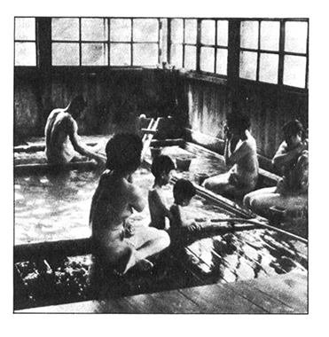
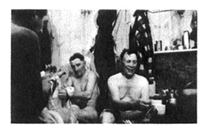
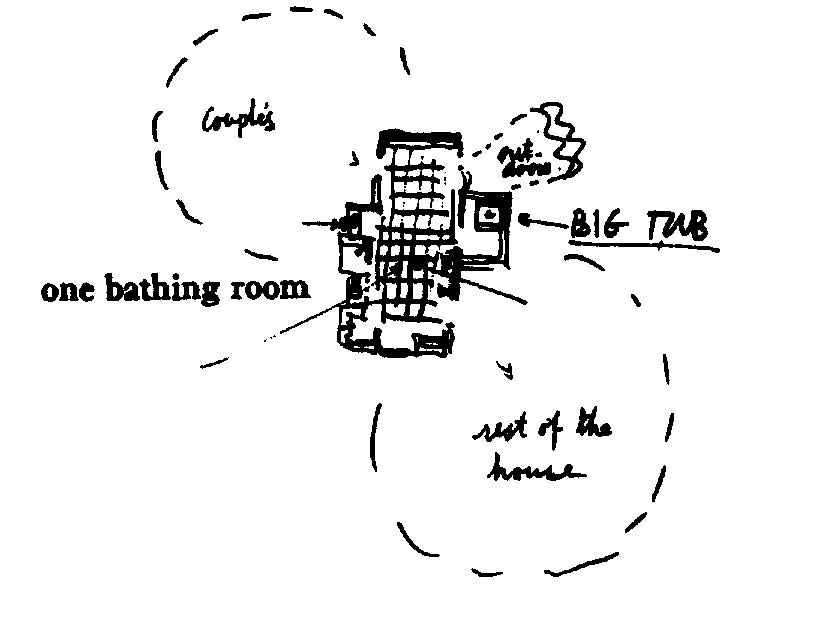

<section class="pattern-plate" aria-labelledby="t-bathing-room">
<a href="/patterns">A Pattern Language</a> · <a href="/patterns#buildings">Buildings</a> · Pattern 144 · p. 681 · *
<h1 class="pattern-title" id="t-bathing-room">Bathing Room</h1><figure class="pattern-figure pl-figure"></figure><nav class="pattern-links" aria-label="Connections"><h2>Links to</h2><ul><li><a href="/patterns/still-water">71 Still Water</a></li><li><a href="/patterns/intimacy-gradient">127 Intimacy Gradient</a></li><li><a href="/patterns/common-areas-at-the-heart">129 Common Areas At The Heart</a></li><li><a href="/patterns/couples-realm">136 Couple’s Realm</a></li><li><a href="/patterns/childrens-realm">137 Children’s Realm</a></li><li><a href="/patterns/sleeping-to-the-east">138 Sleeping To The East</a></li><li><a href="/patterns/light-on-two-sides-of-every-room">159 Light On Two Sides Of Every Room</a></li><li><a href="/patterns/garden-wall">173 Garden Wall</a></li><li><a href="/patterns/compost">178 Compost</a></li><li><a href="/patterns/the-shape-of-indoor-space">191 The Shape Of Indoor Space</a></li><li><a href="/patterns/filtered-light">238 Filtered Light</a></li></ul><h2>Linked from</h2><ul><li><a href="/patterns/local-sports">72 Local Sports</a></li><li><a href="/patterns/intimacy-gradient">127 Intimacy Gradient</a></li><li><a href="/patterns/tapestry-of-light-and-dark">135 Tapestry Of Light And Dark</a></li><li><a href="/patterns/couples-realm">136 Couple’s Realm</a></li><li><a href="/patterns/childrens-realm">137 Children’s Realm</a></li><li><a href="/patterns/dressing-rooms">189 Dressing Rooms</a></li></ul></nav></section><article class="pattern-text" aria-label="The text of Bathing Room">
682… this pattern defines and places the main bathroom of a building. It does it by changing the present character of bathing rooms completely: And its position is so clear, and so essential, that it will probably help to form the sleeping areas and public areas given by larger patterns: <a class="pl-ref" href="/patterns/intimacy-gradient">INTIMACY GRADIENT (127)</a>, <a class="pl-ref" href="/patterns/common-areas-at-the-heart">COMMON AREAS AT THE HEART (129)</a>, <a class="pl-ref" href="/patterns/couples-realm">COUPLE’S REALM (136)</a>, <a class="pl-ref" href="/patterns/childrens-realm">CHILDREN’S REALM (137)</a>, <a class="pl-ref" href="/patterns/sleeping-to-the-east">SLEEPING TO THE EAST (138)</a>, BED CLUSTER (14.3).

◆ ◆ ◆

<strong>“The motions we call bathing are mere ablutions which formerly preceded the bath. The place where they are performed, though adequate for the routine, does not deserve to be called a bathroom.”</strong>

Bernard Rudofsky

Rudofsky points out that cleaning up is only a small part of bathing; that bathing as a whole is a far more basic activity, with therapeutic and pleasurable aspects. In bathing we tend to ourselves, our bodies. It is one of the precious times when we are awake and absolutely naked. The relaxation of the bath puts us into sensual contact with water. It is one of the most direct and simple ways of unwinding. And, most astonishing, there is even evidence that we become less warlike when we tend to ourselves and our children in this way.

Cross culturally there is a correlation between the degree to which a society places restrictions on bodily pleasure—particularly in childhood—and the degree to which the society engages in the glorification of warfare and sadistic practices. (Philip Slater, <em>Pursuit of Loneliness</em>, Boston: Beacon Press, 1970, pp. 89–90.)

We ought to remember … that the thermae of old, with their routine of daily regeneration, were as much a matter of course to their users as our restaurants are to us. Only more so; they were considered indispensable. In the fourth century, the city of Rome alone counted 856 bathing establishments; six hundred years later, Cordoba boasted an even larger number of public baths—and who ever hears as much as its name? (Rudofsky, <em>Behind the Picture Window</em>, New York: Oxford University Press, 1953, p. 118.)

683

<figure class="pl-figure"><figcaption><em>A Finnish sauna</em>.</figcaption></figure>

But bathing for pleasure has had a hard history. It went underground with the Reformation of the Church, the Elizabethan Era, and Puritanism. It became a “scapegoat” for the evils of society—immorality, ungodliness, and disease. It is strange that we have not yet recovered from such nonsense. Contrast our approach to the bath, tub, and shower with these words, written in 1935 by Nikos Kazantzakis, the Greek novelist and poet, after his first Japanese bath:

I feel unsurpassed happiness. I put on the kimono, wear the wooden sandals, return to my room, drink more tea, and, from the open wall, watch the pilgrims as they go up the road beating drums…. I have overcome impatience, nervousness, haste. I enjoy every single second of these simple moments I spend. Happiness, I think, is a simple everyday miracle, like water, and we are not aware of it.

We start, then, with the assumption that there are strong and profound reasons for making something pleasant out of bathing, and that there is something quite wrong with our present way of building several small and separate bathrooms, one for the master bedroom, one for children, perhaps one near the living room—each one of them a compact efficient box. These separate, efficiency bathrooms never give a family the chance to share the intimacies and pleasures of bathing, of being naked and halfnaked together. And yet, of course, this sharing has its limits. House guests and casual visitors must be able to use the bathroom too; and one bathroom will not work for a whole family, if any one person can lock the door and keep it to himself. Yet if we imagine a large bathing room, large enough to make bathing a 684pleasure, we see that we can certainly not afford more than one of them per family.

How can all these problems be resolved? In order to resolve them, we shall list the various forces which seem to be acting. Then we can untangle them.

1 First, the newly re-emerging force, which we have named already—the growing desire that people have to make their bathing into a positive re-generating pleasure.

2 Second, an increasing relaxation about nakedness, which makes it possible to imagine members of a family, and their friends, and even strangers, sharing a bath.

3 Third, the fact that this increasing relaxation has its limits; and that the limits are different for every person. Some people still want to be able to keep their nakedness private: they must be able to have a shower, or use the toilet, unseen, when they want to.

4 The fact that the habit of putting toilets in bathrooms (not next to them as they used to be), springs from the convenience of passing to and fro between the toilet and the bath—or shower—without dressing and undressing to go out into a passage. People want to be comfortably naked while they are in the bathroom—going into the bathroom, going from the toilet to the bath, shaving, and so on. It is a nuisance to have to dress simply to negotiate any one of these connections.

5 And yet, the members of the family must be able to pass between bedrooms and bathroom, in various stages of undress, without passing through public areas. This is especially true of the adults.

6 And visitors must be able to use the bathing room, and must therefore be able to reach it without passing through the private rooms or bedrooms.

The fundamental conflict in these forces seems to be between openness and privacy. There are reasons to draw the functions of the bathroom together, and reasons to keep them separate. This suggests that all the functions of the bathroom be drawn together to form a suite, that this suite or bathing room be conceived of as the only bathroom in the house, but that private realms be created within this suite, where people can shut a door or pull a curtain and be private.

685We imagine the entire bathing room tiled and protected from other parts of the house, and the public outdoors. Within this space it is possible to achieve the right connections between the bath itself and the other parts of the bathing room, and yet keep the bathing room proper open to people who want to use only the sink, the shower, or the toilet. We suggest that the room be placed next to the couple’s realm—they will use it most—but also <em>between</em> the public part of the house and the private part of the house, so that the path from the family commons to the bathing room does not pass through the bedrooms or private workspace. And make sure paths from bedrooms to bathroom do not pass through any area which is visible from the common rooms.

A simple way to cope with the subtleties of nakedness and gowns is to give the bathing room prominent towel racks in several places, each with a few giant towels, towels that people can wrap up in. Under these circumstances a person can simply throw a towel around himself and twist it together when he is uneasy about his nakedness, and otherwise let it drop. This is far better than the formal robes, which are always in the wrong place, and are too much like dressing.

The bath itself should be large enough so that two or three people can get themselves comfortably in the water—so that you feel like staying, not rushing in and out. Light helps a lot. If privacy is an issue, natural light can filter through translucent glass; or a window with clear glass can overlook a private garden.

Finally, a word about the doors: It is important to place them correctly, as they do the most to establish the subtle balance between openness and privacy. We imagine solid unlockable doors to the bathing room as a whole; perhaps swinging doors to establish the fluidity of the area; and then opaque glass doors or curtains on the shower stall; a simple door for the toilet stalls—this is the most private spot; and an open doorway to the alcove which contains the bath. The sinks and the towels, the shelves, and all the other odds and ends are in the tiled outer zone.

Therefore:

<strong>Concentrate the bathing room, toilets, showers, and basins of the house in a single tiled area. Locate this bathing 686room beside the couple’s realm—with private access—in a position half-way between the private secluded parts of the house and the common areas; if possible, give it access to the outdoors; perhaps a tiny balcony or walled garden.</strong>

<strong>Put in a large bath—large enough for at least two people to get completely immersed in water; an efficiency shower and basins for the actual business of cleaning; and two or three racks for huge towels—one by the door, one by the shower, one by the sink.</strong>

<figure class="pl-figure"></figure>
◆ ◆ ◆

Above all, make sure that there is light, plenty of light—<a class="pl-ref" href="/patterns/light-on-two-sides-of-every-room">LIGHT ON TWO SIDES OF EVERY ROOM (159)</a> and <a class="pl-ref" href="/patterns/filtered-light">FILTERED LIGHT (238)</a>; try to place the bathing room so that it opens out into a private part of the garden—<a class="pl-ref" href="/patterns/garden-wall">GARDEN WALL (173)</a>, and perhaps even gives direct access to some local swimming pool—<a class="pl-ref" href="/patterns/still-water">STILL WATER (71)</a>. Line up the toilet with the compost chamber—<a class="pl-ref" href="/patterns/compost">COMPOST (178)</a>; and for the detailed shape of the room and its construction, start with <a class="pl-ref" href="/patterns/the-shape-of-indoor-space">THE SHAPE OF INDOOR SPACE (191)</a>….
</article>

Christopher Alexander, Sara Ishikawa and Murray Silverstein, with Max Jacobson, Ingrid Fiksdahl-King and Shlomo Angel, <cite>A Pattern Language</cite> (Oxford University Press, 1977), pattern 144, pp. 681–686. Text and illustrations from the <a href="https://github.com/natureoforder/sources">Nature of Order sources</a> reading edition, transcribed from the 1977 printing; report errors on <a href="https://github.com/natureoforder/alexander-wiki/issues">GitHub</a>.

<a href="/patterns/bed-cluster">← 143 Bed Cluster</a> · <a href="/patterns">All 253 patterns</a> · <a href="/patterns/bulk-storage">145 Bulk Storage →</a>

