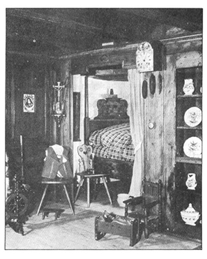
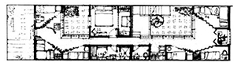
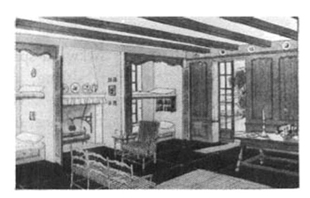
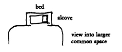

<section class="pattern-plate" aria-labelledby="t-bed-alcove">
<a href="/patterns">A Pattern Language</a> · <a href="/patterns#buildings">Buildings</a> · Pattern 188 · p. 868 · **
<h1 class="pattern-title" id="t-bed-alcove">Bed Alcove</h1><figure class="pattern-figure pl-figure"></figure><nav class="pattern-links" aria-label="Connections"><h2>Links to</h2><ul><li><a href="/patterns/a-room-of-ones-own">141 A Room Of One’s Own</a></li><li><a href="/patterns/bed-cluster">143 Bed Cluster</a></li><li><a href="/patterns/marriage-bed">187 Marriage Bed</a></li><li><a href="/patterns/dressing-rooms">189 Dressing Rooms</a></li><li><a href="/patterns/ceiling-height-variety">190 Ceiling Height Variety</a></li><li><a href="/patterns/half-open-wall">193 Half-Open Wall</a></li><li><a href="/patterns/thick-walls">197 Thick Walls</a></li><li><a href="/patterns/open-shelves">200 Open Shelves</a></li><li><a href="/patterns/natural-doors-and-windows">221 Natural Doors And Windows</a></li></ul><h2>Linked from</h2><ul><li><a href="/patterns/house-for-one-person">78 House For One Person</a></li><li><a href="/patterns/sleeping-in-public">94 Sleeping In Public</a></li><li><a href="/patterns/sleeping-to-the-east">138 Sleeping To The East</a></li><li><a href="/patterns/a-room-of-ones-own">141 A Room Of One’s Own</a></li><li><a href="/patterns/bed-cluster">143 Bed Cluster</a></li><li><a href="/patterns/teenagers-cottage">154 Teenager’s Cottage</a></li><li><a href="/patterns/compost">178 Compost</a></li><li><a href="/patterns/communal-sleeping">186 Communal Sleeping</a></li><li><a href="/patterns/marriage-bed">187 Marriage Bed</a></li><li><a href="/patterns/dressing-rooms">189 Dressing Rooms</a></li></ul></nav></section><article class="pattern-text" aria-label="The text of Bed Alcove">
869… bed alcoves help to generate the form of <a class="pl-ref" href="/patterns/bed-cluster">BED CLUSTERS (143)</a>, COMMUNAL SLEEPING (l86) and <a class="pl-ref" href="/patterns/marriage-bed">MARRIAGE BED (187)</a>. For children, each alcove also functions as <a class="pl-ref" href="/patterns/a-room-of-ones-own">a room of ONE’S OWN (141)</a>, so that even in the smallest house, not only the adults, but every child can have at least a small place to call his own.

◆ ◆ ◆

<strong>Bedrooms make no sense.</strong>

The valuable space around the bed is good for nothing except access to the bed. And all the other functions—dressing, working, and storage of personal belongings which people stuff uncomfortably into the corners of their bedrooms—in fact, need their own space, and are not at all well met by the left over areas around a bed.

In <a class="pl-ref" href="/patterns/bed-cluster">BED CLUSTERS (143)</a>, we have already argued that each child in a family should have a bed alcove of his own, opening off a common play-space. This is based purely on the balance between community and privacy. We shall now try to establish the fact that, for everyone in the house, isolated beds, not only those in clusters, are better off in alcoves than in bedrooms. There are two reasons.

First, the bed in a bedroom creates awkward spaces around it: dressing, working, watching television, sitting, are all rather foreign to the side spaces left over around a bed. We have found that people have a hard time adapting the space around the bed to their needs for bedroom space.

Second, the bed itself seems more comfortable in a space that is adjusted to it. In our design experiments, where lay people have used these patterns to design their own houses, we have noticed a rather strong urge to give the bed a nook of its own, some kind of enclosure. Apparently this particular pattern strikes a chord in people.

Once the bed has been built into a space that is right for it, then the rest of the bedrom space is free to shape itself around the needs for sitting space, play areas, dressing, and storage.

870What are the issues at stake in making a good bed alcove?

<em>Spaciousness</em>. Don’t make it too tight. It must be comfortable to get in and out and to make the bed. If the alcove is going to function as <a class="pl-ref" href="/patterns/a-room-of-ones-own">a room of one’s own (141)</a> for a child, then it needs to be almost a tiny room, with one wall missing.

<figure class="pl-figure"><figcaption><em>Six bed alcoves in one of our houses in Peru</em>.</figcaption></figure>

<em>Ventilation</em>. Bed alcoves need fresh air; at least a vent of some kind that is adjustable, and better still a window.

<em>Privacy</em>. People will want to draw into the alcove and be private. The opening of the alcove needs a curtain or some other kind of enclosure.

<em>Ceiling</em>. According to the arguments developed with the pattern <a class="pl-ref" href="/patterns/ceiling-height-variety">ceiling height variety (190)</a>, the bed, as an intimate social space for one or two, needs a ceiling height somewhat lower than the room beside it.

<figure class="pl-figure"><figcaption><em>Bed alcoves off a family room</em>.</figcaption></figure>

Therefore:

<strong>Don’t put single beds in empty rooms called bedrooms, but instead put individual bed alcoves off rooms with other nonsleeping functions, so the bed itself becomes a tiny private haven.</strong>

871<strong>If you arc building a very small house no more than 300 or 400 square feet—perhaps with the idea of adding to it gradually—this pattern plays an essential role. It will probably be best then to put the alcoves off the family room.</strong>

<figure class="pl-figure"></figure>
◆ ◆ ◆

Build the ceiling low—<a class="pl-ref" href="/patterns/ceiling-height-variety">CEILING HEIGHT VARIETY (190)</a>; add some storage in the walls around the alcove—<a class="pl-ref" href="/patterns/thick-walls">THICK WALLS (197)</a>, <a class="pl-ref" href="/patterns/open-shelves">OPEN SHELVES (200)</a>, and a window, in a natural position—<a class="pl-ref" href="/patterns/natural-doors-and-windows">NATURAL DOORS AND WINDOWS (221)</a>. Perhaps <a class="pl-ref" href="/patterns/half-open-wall">HALF-OPEN WALL (193)</a> will help to give the alcove the right enclosure. Where space is very tight, combine the bed alcove with <a class="pl-ref" href="/patterns/dressing-rooms">DRESSING ROOM (189)</a>. And finally, give each alcove, no matter how small, the characteristics of any indoor space—the shape of INDOOR SPACE (191)….
</article>

Christopher Alexander, Sara Ishikawa and Murray Silverstein, with Max Jacobson, Ingrid Fiksdahl-King and Shlomo Angel, <cite>A Pattern Language</cite> (Oxford University Press, 1977), pattern 188, pp. 868–871. Text and illustrations from the <a href="https://github.com/natureoforder/sources">Nature of Order sources</a> reading edition, transcribed from the 1977 printing; report errors on <a href="https://github.com/natureoforder/alexander-wiki/issues">GitHub</a>.

<a href="/patterns/marriage-bed">← 187 Marriage Bed</a> · <a href="/patterns">All 253 patterns</a> · <a href="/patterns/dressing-rooms">189 Dressing Rooms →</a>

