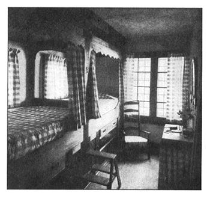
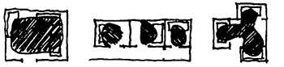
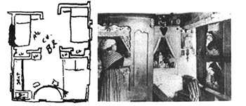
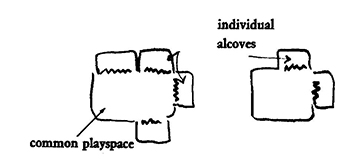

<section class="pattern-plate" aria-labelledby="t-bed-cluster">
<a href="/patterns">A Pattern Language</a> · <a href="/patterns#buildings">Buildings</a> · Pattern 143 · p. 676 · *
<h1 class="pattern-title" id="t-bed-cluster">Bed Cluster</h1><figure class="pattern-figure pl-figure"></figure><nav class="pattern-links" aria-label="Connections"><h2>Links to</h2><ul><li><a href="/patterns/couples-realm">136 Couple’s Realm</a></li><li><a href="/patterns/childrens-realm">137 Children’s Realm</a></li><li><a href="/patterns/sleeping-to-the-east">138 Sleeping To The East</a></li><li><a href="/patterns/light-on-two-sides-of-every-room">159 Light On Two Sides Of Every Room</a></li><li><a href="/patterns/communal-sleeping">186 Communal Sleeping</a></li><li><a href="/patterns/bed-alcove">188 Bed Alcove</a></li><li><a href="/patterns/dressing-rooms">189 Dressing Rooms</a></li><li><a href="/patterns/the-shape-of-indoor-space">191 The Shape Of Indoor Space</a></li><li><a href="/patterns/closets-between-rooms">198 Closets Between Rooms</a></li><li><a href="/patterns/child-caves">203 Child Caves</a></li></ul><h2>Linked from</h2><ul><li><a href="/patterns/house-for-a-small-family">76 House For A Small Family</a></li><li><a href="/patterns/tapestry-of-light-and-dark">135 Tapestry Of Light And Dark</a></li><li><a href="/patterns/childrens-realm">137 Children’s Realm</a></li><li><a href="/patterns/sleeping-to-the-east">138 Sleeping To The East</a></li><li><a href="/patterns/a-room-of-ones-own">141 A Room Of One’s Own</a></li><li><a href="/patterns/communal-sleeping">186 Communal Sleeping</a></li><li><a href="/patterns/bed-alcove">188 Bed Alcove</a></li></ul></nav></section><article class="pattern-text" aria-label="The text of Bed Cluster">
677… the sleeping areas have been defined to be inside the <a class="pl-ref" href="/patterns/couples-realm">COUPLE’S REALM (136)</a> and <a class="pl-ref" href="/patterns/childrens-realm">CHILDREN’S REALM (137)</a>. Beyond that, they are in places facing east to get the morning light—<a class="pl-ref" href="/patterns/sleeping-to-the-east">SLEEPING TO THE EAST (138)</a>. This pattern defines the grouping of the beds within the sleeping areas, and also helps to generate the general sleeping areas themselves.

◆ ◆ ◆

<strong>Every child in the family needs a private place, generally centered around the bed. But in many cultures, perhaps all cultures, young children feel isolated if they sleep alone, if their sleeping area is too private.</strong>

Let us consider the various possible configurations of the children’s beds. At one extreme, they can all be in one room—one shared bedroom. At the other extreme, we can imagine an arrangement in which each child has a private room. And then, in between these two extremes, there is a kind of configuration in which children have their own, small, private spaces, not as large as rooms, clustered around a common playspace. We shall try to show that both extremes are bad; and that some version of the cluster of alcoves is needed to solve the conflict between forces in a young child’s life.

<figure class="pl-figure"><figcaption><em>Three configurations: the shared bedroom, isolated rooms, a cluster of alcoves</em>.</figcaption></figure>

We first discuss the one room version. The problems in this case are obvious. Children are jealous of one another’s toys; they fight over the light, the radio, the game being played, the door open or closed. In short, for young children, especially in that 678age when feelings of possession and control are developing, the one room with many beds is just too difficult.

In the effort to avoid these difficulties, it is not surprising that many parents go to the other extreme—if they can afford it—an arrangement in which each child has his own room. But this creates new difficulties, of an entirely different sort: Young children feel isolated when they are forced to be alone.

The need for contact in the sleeping area is particularly true in strongly traditional cultures like Peru and India, where even adults sleep in groups. In these countries, people simply do not like to feel isolated and draw a great deal of comfort and security from the fact that they are constantly surrounded by people. But even in “privacy-oriented” cultures like the United States, where isolation is common and taken for granted, children, at least, feel the same way. They prefer to sleep in the company of others. For instance, we know that little children like to leave their door ajar at night, and to sleep with some light on; they like to go off to sleep hearing the voices of the adults around the house.

This instinct is so strongly developed in children of all cultures, that we believe it may be unhealthy for little children to have whole rooms of their own, regardless of cultural habit. It is very easy for a cultural relativist to argue that it depends on the cultural setting, and that a culture which puts high value on privacy, self-sufficiency, and aloneness, might very well choose to put each child in his own room in order to foster these attitudes. However, in spite of this potentially reasonable cultural relativism, it seems to us that although adults do need their own rooms, the isolation of a private room for a small child may perhaps be fundamentally incompatible with healthy psycho-social development; and might even do organic damage. It is significant that there is no culture in the world except the United States, and the offshoots of the United States, where this one-child-one-room pattern is widely practiced. And our observations do certainly suggest that this pattern is correlated with emotional withdrawal, and exaggerated conceptions of the individual’s selfsufficiency, which, in the end, bring a person into inner conflicts between the need for contact and the need for withdrawal.

We thus face two conflicting forces. Children need some 679privacy, some way of retreating from endless squabbles about territory, some way of having a miniature version of the adult’s “room of his own.” Yet at the same time, they also need extensive, almost animal, contact with others—their talk, their care, their touch, their sound, their smell.

We believe that this conflict can only be resolved in an arrangement which gives them the opportunity for both; an arrangement of individual spaces which they “own,” clustered around a common playspace so that they are all in sight and sound of one another, never too alone. In a culture with relatively little need for privacy, the clustered beds can get enough privacy by being set into simple, curtained bed-alcoves, see <a class="pl-ref" href="/patterns/bed-alcove">BED ALCOVE (188)</a>. In a culture where people have a strong need for privacy, the clustered beds may be in tiny rooms, surrounding a communal space.

Finally, two examples: One shows the way one lay-designer, working with this pattern language, interpreted this pattern. The other shows a cluster of beds in a Breton farmhouse.

<figure class="pl-figure"><figcaption><em>Two homemade bed clusters</em>.</figcaption></figure>

Therefore:

<strong>Place the children’s beds in alcoves or small alcove-like rooms, around a common playspace. Make each alcove large enough to contain a table, or chair, or shelves—at least some floor area, where each child has his own things. Give the alcoves curtains looking into the common space, but not walls or doors, which will tend once more to isolate the beds too greatly.</strong>

680

<figure class="pl-figure"></figure>
◆ ◆ ◆

Another version of this pattern, more suitable for adults, is given by <a class="pl-ref" href="/patterns/communal-sleeping">COMMUNAL SLEEPING (186)</a>. In both cases, build the individual alcoves according to <a class="pl-ref" href="/patterns/bed-alcove">BED ALCOVE (188)</a>; if the cluster is for children, shape the playspace in the middle according to the specifications of <a class="pl-ref" href="/patterns/childrens-realm">CHILDREN’S REALM (137)</a>, and make the path which leads from the beds, past the kitchen, to the outdoors, according to that pattern too. Use the location of dressing areas and closets to help shape the bed cluster and the individual alcoves <a class="pl-ref" href="/patterns/dressing-rooms">DRESSING ROOM (189)</a>, <a class="pl-ref" href="/patterns/closets-between-rooms">CLOSETS BETWEEN ROOMS (198)</a>; include some tiny nooks and crannies—<a class="pl-ref" href="/patterns/child-caves">CHILD CAVES (203)</a>. Give the entire space <a class="pl-ref" href="/patterns/light-on-two-sides-of-every-room">LIGHT ON TWO SIDES (159)</a>. And for the shape of this space in more detail and its construction, start with <a class="pl-ref" href="/patterns/the-shape-of-indoor-space">THE SHAPE OF INDOOR SPACE (191)</a>….
</article>

Christopher Alexander, Sara Ishikawa and Murray Silverstein, with Max Jacobson, Ingrid Fiksdahl-King and Shlomo Angel, <cite>A Pattern Language</cite> (Oxford University Press, 1977), pattern 143, pp. 676–680. Text and illustrations from the <a href="https://github.com/natureoforder/sources">Nature of Order sources</a> reading edition, transcribed from the 1977 printing; report errors on <a href="https://github.com/natureoforder/alexander-wiki/issues">GitHub</a>.

<a href="/patterns/sequence-of-sitting-spaces">← 142 Sequence Of Sitting Spaces</a> · <a href="/patterns">All 253 patterns</a> · <a href="/patterns/bathing-room">144 Bathing Room →</a>

