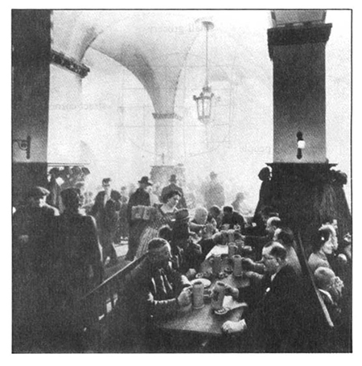
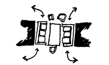
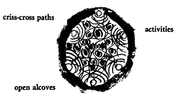

<section class="pattern-plate" aria-labelledby="t-beer-hall">
<a href="/patterns">A Pattern Language</a> · <a href="/patterns#towns">Towns</a> · Pattern 90 · p. 444
<h1 class="pattern-title" id="t-beer-hall">Beer Hall</h1><figure class="pattern-figure pl-figure"></figure><nav class="pattern-links" aria-label="Connections"><h2>Links to</h2><ul><li><a href="/patterns/neighborhood-boundary">15 Neighborhood Boundary</a></li><li><a href="/patterns/promenade">31 Promenade</a></li><li><a href="/patterns/night-life">33 Night Life</a></li><li><a href="/patterns/building-complex">95 Building Complex</a></li><li><a href="/patterns/alcoves">179 Alcoves</a></li><li><a href="/patterns/the-fire">181 The Fire</a></li><li><a href="/patterns/ceiling-height-variety">190 Ceiling Height Variety</a></li></ul><h2>Linked from</h2><ul><li><a href="/patterns/activity-nodes">30 Activity Nodes</a></li><li><a href="/patterns/night-life">33 Night Life</a></li><li><a href="/patterns/childrens-home">86 Children’s Home</a></li><li><a href="/patterns/travelers-inn">91 Traveler’s Inn</a></li></ul></nav></section><article class="pattern-text" aria-label="The text of Beer Hall">
445… in an occasional neighborhood, which functions as the focus of a group of neighborhoods, or in a boundary between neighborhoods—<a class="pl-ref" href="/patterns/neighborhood-boundary">NEIGHBORHOOD BOUNDARY (15)</a>—or on the promenade which forms the focus of a large community—<a class="pl-ref" href="/patterns/promenade">PROMENADE (31)</a>, <a class="pl-ref" href="/patterns/night-life">NIGHT LIFE (33)</a>—there is a special need for something larger and more raucous than a street cafe.

◆ ◆ ◆

<strong>Where can people sing, and drink, and shout and drink, and let go of their sorrows?</strong>

A public drinking house, where strangers and friends are drinking companions, is a natural part of any large community. But all too often, bars degenerate and become nothing more than anchors for the lonely. Robert Sommer has described this in “Design for Drinking,” Chapter 8 of his book <em>Personal Space</em>, Englewood Cliffs, N.J.: Prentice-Hall, 1969.

… it is not difficult in any American city to find examples <em>of</em> the bar where meaningful contact is at a minimum. V. S. Pritchett describes the lonely men in New York City sitting speechlessly on a row of barstools, with their arms triangled on the bar before a bottle of beer, their drinking money before them. If anyone speaks to his neighbor under these circumstances, he is likely to receive a suspicious stare for his efforts. The barman is interested in the patrons as customers—he is there to sell, they are there to buy….

Another visiting Englishman makes the same point when he describes the American bar as a “hoked up saloon; the atmosphere is as chilly as the beer … when I asked a stranger to have a drink, he looked at me as if I were mad. In England if a guy’s a stranger, … each guy buys the other a drink. You enjoy each other’s company, and everyone is happy….” (Tony Kirby, “Who’s Crazy?” <em>The Village Voice</em>, January <em>26</em>, 1967, p. 39.)

Let us consider drinking more in the style of these English pubs. Drink helps people to relax and become open with one another, to sing and dance. But it only brings out these qualities when the setting is right. We think that there are two critical qualities for the setting:

1. The place holds a crowd that is continuously mixing between 446functions—the bar, the dance floor, a fire, darts, the bathrooms, the entrance, the seats; and these activities are concentrated and located round the edge so that they generate continual criss-crossing.

2. The seats should be largely in the form of tables for four to eight set in open alcoves—that is, tables that are defined for small groups, with walls, columns, and curtains—but open at both ends.

<figure class="pl-figure"><figcaption><em>The open alcove—supports the fluidity of the scene</em>.</figcaption></figure>

This form helps sustain the life of the group and lets people come in and out freely. Also, when the tables are large, they invite people to sit down with a stranger or another group.

Therefore:

<strong>Somewhere in the community at least one big place where a few hundred people can gather, with beer and wine, music, and perhaps a half-dozen activities, so that people are continuously criss-crossing from one to another.</strong>

<figure class="pl-figure"></figure>
447

◆ ◆ ◆

Put the tables in two-ended alcoves, roomy enough for people to pass through on their way between activities—<a class="pl-ref" href="/patterns/alcoves">ALCOVES (179)</a>; provide a fire, as the hub of one activity—<a class="pl-ref" href="/patterns/the-fire">THE FIRE (181)</a>; and a variety of ceiling heights to correspond to different social groupings—<a class="pl-ref" href="/patterns/ceiling-height-variety">CEILING HEIGHT VARIETY (190)</a>. For the shape of the building, gardens, parking, and surroundings, begin with <a class="pl-ref" href="/patterns/building-complex">BUILDING COMPLEX (95)</a>….
</article>

Christopher Alexander, Sara Ishikawa and Murray Silverstein, with Max Jacobson, Ingrid Fiksdahl-King and Shlomo Angel, <cite>A Pattern Language</cite> (Oxford University Press, 1977), pattern 90, pp. 444–447. Text and illustrations from the <a href="https://github.com/natureoforder/sources">Nature of Order sources</a> reading edition, transcribed from the 1977 printing; report errors on <a href="https://github.com/natureoforder/alexander-wiki/issues">GitHub</a>.

<a href="/patterns/corner-grocery">← 89 Corner Grocery</a> · <a href="/patterns">All 253 patterns</a> · <a href="/patterns/travelers-inn">91 Traveler’s Inn →</a>

