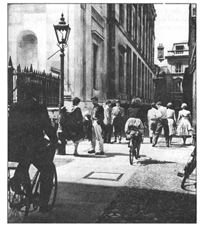
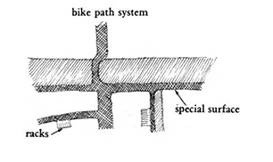

<section class="pattern-plate" aria-labelledby="t-bike-paths-and-racks">
<a href="/patterns">A Pattern Language</a> · <a href="/patterns#towns">Towns</a> · Pattern 56 · p. 289 · *
<h1 class="pattern-title" id="t-bike-paths-and-racks">Bike Paths And Racks</h1><figure class="pattern-figure pl-figure"></figure><nav class="pattern-links" aria-label="Connections"><h2>Links to</h2><ul><li><a href="/patterns/looped-local-roads">49 Looped Local Roads</a></li><li><a href="/patterns/network-of-paths-and-cars">52 Network Of Paths And Cars</a></li><li><a href="/patterns/garden-wall">173 Garden Wall</a></li></ul><h2>Linked from</h2><ul><li><a href="/patterns/local-transport-areas">11 Local Transport Areas</a></li><li><a href="/patterns/housing-in-between">48 Housing In Between</a></li><li><a href="/patterns/children-in-the-city">57 Children In The City</a></li><li><a href="/patterns/adventure-playground">73 Adventure Playground</a></li></ul></nav></section><article class="pattern-text" aria-label="The text of Bike Paths And Racks">
290… within a local transport area (11) there is a heavy concentration of small vehicles like bikes, electric carts, perhaps even horses, which need a system of bike paths. The bike paths will play a veiy large role in helping to create the local transport areas, and may also help to modify <a class="pl-ref" href="/patterns/looped-local-roads">looped local roads (49)</a> and <a class="pl-ref" href="/patterns/network-of-paths-and-cars">NETWORK OP PATHS AND CARS (52)</a>.

◆ ◆ ◆

<strong>Bikes are cheap, healthy, and good for the environment; bat the environment is not designed for them. Bikes on roads are threatened by cars; bikes on paths threaten pedestrians.</strong>

In making the environment safe for bikes, the following problems must be solved:

1. Bikes are threatened where they meet or cross heavy automobile traffic.

2. They are also threatened by parked cars. Parked cars make it difficult for the bike rider to see other people, and they make it difficult for other people to see him. In addition, since the bike rider usually has to ride close to parked cars, he is always in danger of someone opening a car door in front of him.

3. Bikes endanger pedestrians along pedestrian paths; yet people often tend to ride bikes along pedestrian paths, not roads, because they are the shortest routes.

4. Where bikes are in heavy use, for instance around schools and universities, they can lay a pedestrian precinct to waste in their own way, just as cars can.

An obvious solution to these problems is to create a completely independent system of bike paths. However, it is doubtful that this is a viable or desirable solution. The study “Students on Wheels” (Jany, Putney, and Ritter; Department of Landscape Architecture, University of Oregon, Eugene, Oregon, 1972) shows that bike riders and nonbike riders want a mixed system, so long as it is reasonably safe.

We also think that it is essential for bike paths to run in streets 291and along pedestrian paths: if bikes are forced onto a separate system, it will almost certainly be violated by people taking shortcuts across the other networks. And laws which would keep bikes completely off the road and path systems would be discouraging to the already hasseled bike riders. Wherever possible, then, bike paths should coincide with roads and major pedestrian paths.

Where bike paths coincide with major roads, they must be separated from the roadway. It helps put the bike rider in a safer position with respect to the cars if the bike path is raised a few inches from the road; or separated by a row of trees.

Where bike paths run alongside local roads, parking should be removed from that side of the road; the bike surface may simply be part of the road and level with it. An article by Bascome in the <em>Oregon Daily Emerald</em> (October 1971) suggested that bike lanes along streets should always be on the sunny side of the street.

Where bike paths coincide with major pedestrian paths, they should be separate from the paths, perhaps a few inches below them. Here, the change in level gives the pedestrian a sense of safety from the bikes.

Quiet paths and certain pedestrian precincts should be completely protected from bikes for the same reasons that they need to be protected from cars. This can be handled by making the bike path system bypass these places, or by enclosing these places with steps or low walls which force bike riders to dismount and walk their bikes.

Therefore:

<strong>Build a system of paths designated as bike paths, with the following properties: the bike paths are marked clearly with a special, easily recognizable surface (for example, a red asphalt surface). As far as possible they run along local roads, or major pedestrian paths. Where a bike path runs along a local road, its surface may be level with the road—if possible, on the sunny side; where a bike path runs along a pedestrian path, keep it separate from that path and a few inches below it. Bring the system of bike paths to 292within 100 feet of every building, and give every building a bike rack near its main entrance.</strong>

<figure class="pl-figure"></figure>
◆ ◆ ◆

Build the racks for bikes to one side of the main entrance, so that the bikes don’t interfere with people’s natural movement in and out—main entrance (110), and give it some shelter, with the path from the racks to the entrance also under shelter—arcades (119); keep the bikes out of quiet walks and quiet gardens—quiet backs (59), <a class="pl-ref" href="/patterns/garden-wall">garden wall (173)</a>….
</article>

Christopher Alexander, Sara Ishikawa and Murray Silverstein, with Max Jacobson, Ingrid Fiksdahl-King and Shlomo Angel, <cite>A Pattern Language</cite> (Oxford University Press, 1977), pattern 56, pp. 289–292. Text and illustrations from the <a href="https://github.com/natureoforder/sources">Nature of Order sources</a> reading edition, transcribed from the 1977 printing; report errors on <a href="https://github.com/natureoforder/alexander-wiki/issues">GitHub</a>.

<a href="/patterns/raised-walk">← 55 Raised Walk</a> · <a href="/patterns">All 253 patterns</a> · <a href="/patterns/children-in-the-city">57 Children In The City →</a>

