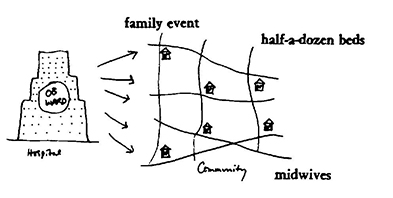

<section class="pattern-plate" aria-labelledby="t-birth-places">
<a href="/patterns">A Pattern Language</a> · <a href="/patterns#towns">Towns</a> · Pattern 65 · p. 328
<h1 class="pattern-title" id="t-birth-places">Birth Places</h1><nav class="pattern-links" aria-label="Connections"><h2>Links to</h2><ul><li><a href="/patterns/identifiable-neighborhood">14 Identifiable Neighborhood</a></li><li><a href="/patterns/life-cycle">26 Life Cycle</a></li><li><a href="/patterns/building-complex">95 Building Complex</a></li><li><a href="/patterns/couples-realm">136 Couple’s Realm</a></li><li><a href="/patterns/farmhouse-kitchen">139 Farmhouse Kitchen</a></li><li><a href="/patterns/garden-wall">173 Garden Wall</a></li></ul><h2>Linked from</h2><ul><li><a href="/patterns/life-cycle">26 Life Cycle</a></li><li><a href="/patterns/activity-nodes">30 Activity Nodes</a></li><li><a href="/patterns/health-center">47 Health Center</a></li><li><a href="/patterns/children-in-the-city">57 Children In The City</a></li></ul></nav></section><article class="pattern-text" aria-label="The text of Birth Places">
… both birth and death need recognition throughout society, where people are, as part of local communities and neighborhoods community of 7OOO (12), <a class="pl-ref" href="/patterns/identifiable-neighborhood">identifiable neighbor hood (14)</a>, <a class="pl-ref" href="/patterns/life-cycle">life cycle (26)</a>. As far as birth is concerned, each group of neighborhoods must be able to take care of the birtli process, in local, human terms. (Note: The development of this pattern is due largely to the work of Judith Shaw, at this writing a graduate student in architecture at the University of California, Berkeley, and a mother of three children.)

◆ ◆ ◆

<strong>It seems unlikely that any process which treats childbirth as a sickness could possibly be a healthy part of a healthy society.</strong>

“Pregnancy is no state of emergency from which the mother may hopefully be returned to ‘normality’ after the birth of the child…. It is a highly active, potent, developmental process of the family going forward to its natural culmination in delivery.” (I. H. Pearse and L. H. Crocker, <em>The Peckham Exferiment)</em> New Haven: Yale University Press, 1946, p. 153.)

The existing obstetrics service in most hospitals follows a well outlined procedure. Having a baby is thought of as an illness and the stay in the hospital as recuperation. Women who are about to deliver are treated as “patients” about to undergo surgery. They are sterilized. Their genitals are scrubbed and shaved. They are gowned in white, and put on a table to be moved back and forth between the various parts of the hospital. Women in labor are put in cubicles to pass the time with virtually no social contact. This time can last for many hours. It is a time when father and children could be present to provide encouragement. But this is not permitted. Delivery usually takes place in a “delivery room” which has the proper “table” for childbirth. 329Except for the particular workings of the delivery table the room has the same properties as an operating theater. The birth becomes a time for separation rather than togetherness. It may be as long as 12 hours before the mother is even allowed to touch her baby, and if she was sedated for the delivery, even longer before she may see her husband.

For about fifteen years there has been a subtle movement to try and recapture the essence of childbirth as a natural phenomenon. There has been no loud protest against obstetricians and hospital rules, but a rather quiet one: several good books, word of mouth, concerned professionals and nonprofessionals, the La Leche League, a few groups around the country whose prime concern is with birth, and the re-emergence of the nurse-midwife. The original effort of these people was aimed at “natural” childbirth, the name being applied in an attempt to bring the concept of childbirth back to a normal physiological occurrence. Lately the focus of the effort has been expanded to include an altered environment for childbirth and to include the family in a positive way. (For an architectural slant, see Lewis Mumford, <em>The Urban Prospect</em>, New York: Harcourt Brace and World, 1968, p. 25)

We quote now from Judith Shaw’s description of a good birth place. She is describing a place comparable to a small nursing home, perhaps associated with a local health center, and with emergency connections to the local hospital:

A small basket for the baby would be provided…. The nurse-midwife would be there always to provide post-partum care…. The nurse-midwife, who lives in, would have a small suite containing a bedroom, sitting room-kitchen and bath….

The eating place would be communal. Each baby would have a place too (his movable basket) so that the mother can bring her child with her to feed or to watch…. The pattern <a class="pl-ref" href="/patterns/farmhouse-kitchen">farmhouse kitchen (139)</a> could play an important role in this building.

… families can come not only to have babies but have their prenatal care, learn methods of natural childbirth, possibly child care, maybe just to talk and in general to become familiar with the place they will come to for the delivery.

The birthing place should have accommodations for the entire family. They can occupy a suite in which they live and in which the mother gives birth to the baby…. Since the delivery would take place in the family suite, the baby, mother, and the family can be 330together immediately. Each suite would have to be equipped with running water and a simple table on which to lay the baby, wash it and give it its initial examination.

Therefore:

<strong>Build local birth places where women go to have their children: places that are specially tailored to childbirth as a natural, eventful moment—where the entire family comes for prenatal care and education; where fathers and midwives help during the hours of labor and birth.</strong>

<figure class="pl-figure"></figure>
◆ ◆ ◆

Include rooms where after the birth the mother and her baby can stay together with the other members of the family—sleep together, eat together, cook together—common areas at the heart (129), <a class="pl-ref" href="/patterns/couples-realm">couple’s realm (136)</a>, <a class="pl-ref" href="/patterns/farmhouse-kitchen">farmhouse kitchen (139)</a>; provide a partly private garden to walk in—half-hidden garden (111), <a class="pl-ref" href="/patterns/garden-wall">garden wall (173)</a>; for the shape of the building, gardens, parking, and surroundings, begin with <a class="pl-ref" href="/patterns/building-complex">building complex (95)</a>….
</article>

Christopher Alexander, Sara Ishikawa and Murray Silverstein, with Max Jacobson, Ingrid Fiksdahl-King and Shlomo Angel, <cite>A Pattern Language</cite> (Oxford University Press, 1977), pattern 65, pp. 328–330. Text and illustrations from the <a href="https://github.com/natureoforder/sources">Nature of Order sources</a> reading edition, transcribed from the 1977 printing; report errors on <a href="https://github.com/natureoforder/alexander-wiki/issues">GitHub</a>.

<a href="/patterns/pools-and-streams">← 64 Pools And Streams</a> · <a href="/patterns">All 253 patterns</a> · <a href="/patterns/holy-ground">66 Holy Ground →</a>

