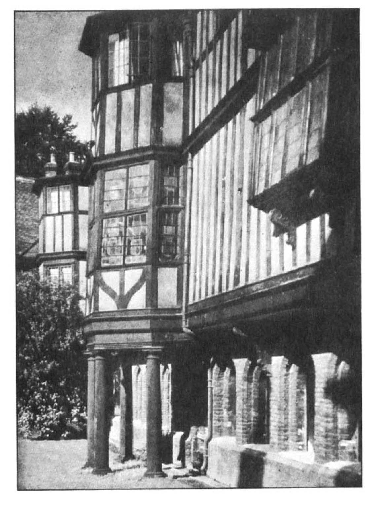
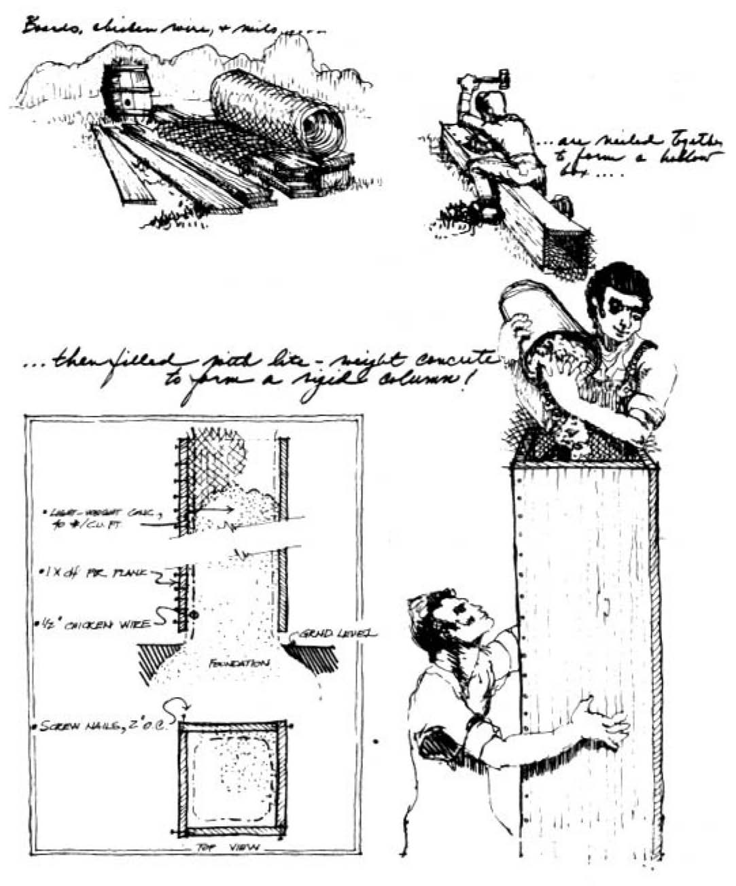
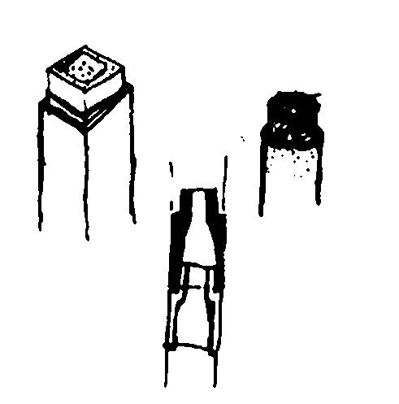
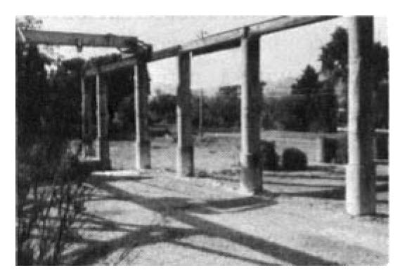
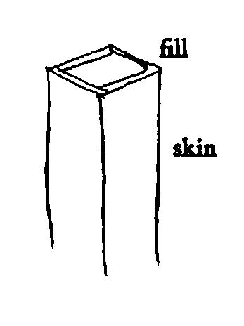

<section class="pattern-plate" aria-labelledby="t-box-columns">
<a href="/patterns">A Pattern Language</a> · <a href="/patterns#construction">Construction</a> · Pattern 216 · p. 1012 · **
<h1 class="pattern-title" id="t-box-columns">Box Columns</h1><figure class="pattern-figure pl-figure"></figure><nav class="pattern-links" aria-label="Connections"><h2>Links to</h2><ul><li><a href="/patterns/good-materials">207 Good Materials</a></li><li><a href="/patterns/final-column-distribution">213 Final Column Distribution</a></li><li><a href="/patterns/root-foundations">214 Root Foundations</a></li><li><a href="/patterns/perimeter-beams">217 Perimeter Beams</a></li><li><a href="/patterns/floor-ceiling-vaults">219 Floor-Ceiling Vaults</a></li><li><a href="/patterns/column-place">226 Column Place</a></li><li><a href="/patterns/column-connections">227 Column Connections</a></li></ul><h2>Linked from</h2><ul><li><a href="/patterns/efficient-structure">206 Efficient Structure</a></li><li><a href="/patterns/columns-at-the-corners">212 Columns At The Corners</a></li><li><a href="/patterns/final-column-distribution">213 Final Column Distribution</a></li><li><a href="/patterns/root-foundations">214 Root Foundations</a></li><li><a href="/patterns/perimeter-beams">217 Perimeter Beams</a></li><li><a href="/patterns/wall-membrane">218 Wall Membrane</a></li><li><a href="/patterns/floor-ceiling-vaults">219 Floor-Ceiling Vaults</a></li><li><a href="/patterns/natural-doors-and-windows">221 Natural Doors And Windows</a></li><li><a href="/patterns/column-place">226 Column Place</a></li><li><a href="/patterns/column-connections">227 Column Connections</a></li><li><a href="/patterns/half-inch-trim">240 Half-Inch Trim</a></li></ul></nav></section><article class="pattern-text" aria-label="The text of Box Columns">
1013… if you use <a class="pl-ref" href="/patterns/root-foundations">ROOT FOUNDATIONS (214)</a>, the columns must be made at the same time as the foundations, since the foundation and the column are integral. The height, spacing, and thickness of the various columns in the building are given by <a class="pl-ref" href="/patterns/final-column-distribution">FINAL COLUMN DISTRIBUTION (213)</a>. This pattern describes the details of construction for the individual columns.

◆ ◆ ◆

<strong>In all the world’s traditional and historic buildings, the columns are expressive, beautiful, and treasured elements. Only in modem buildings have they become ugly and meaningless.</strong>

The fact is that no one any longer knows how to make a column which is at the same time beautiful and structurally efficient. We discuss the problem under seven separate headings:

1 Columns feel uncomfortable unless they are reasonably thick and solid. This feeling is rooted in structural reality. A long thin column, carrying a heavy load, is likely to fail by buckling: and our feelings, apparently, are particularly tuned in to this possibility.

We do not wish to exaggerate the need for thickness. Taken too far, it could easily become a mannerism of a rather ridiculous sort. But columns do need to be comfortable and solid, and only thin when they are short enough to be in no danger of buckling. When the column is a free-standing one, then the need for thickness becomes essential. This is fully discussed under <a class="pl-ref" href="/patterns/column-place">COLUMN PLACE (226)</a>.

2 Structural arguments lead to exactly the same conclusion. Thin, high strength materials, like steel tubes and prestressed concrete, are ruled out by <a class="pl-ref" href="/patterns/good-materials">GOOD MATERIALS (207)</a>. Lower strength materials which are ecologically sound have to be relatively fat to cope with the loads.

3 The column must be cheap. An 8 by 8 solid wood column is too expensive; thick brick or stone columns are almost out of the question in today’s market.

10144 It must be warm to the touch. Concrete columns and painted steel columns have an unpleasant surface and are not very easy to face.

5 If the column takes bending, the highest strength materials should be concentrated toward the outside. Buckling and bending strength both depend on the moment of inertia, which is highest when the material is as far as possible from the neutral axis. A stalk of grass is the archetypal example.

<figure class="pl-figure"><figcaption><em>A version of box columns made of 1 inch wood flanks, nailed together with spiral groove nails, and filled with chicken wire and ultra-lightweight concrete</em>.</figcaption></figure>

1015

<ol start="6" type="1">
<li>The column must be easy to connect to foundations, beams, and walls. Precast concrete columns are very hard to connect. So are metal columns. Brick columns are easy to connect to brick walls—not to the lighter weight skin structures required by WALL MEMBRANE (2l8).</li>
</ol>

7. The column must be hand nailable, and hand cuttable to make on-site modification and later repair as easy as possible. Again, current materials do not easily meet this requirement.

A column which has all these features is a box column, where the hollow tube can be made as thick as is required, and then filled with a strong compressive material. Such a column can be made cheaper than comparable wood and steel columns; the outer skin can be made with a material that is beautiful, easy to repair, and soft to the touch; the column can be stiffened for bending, either by the skin itself, or by extra reinforcing; and, for structural integrity, the fill material can be made continuous with the column’s footings and beams.

An example of a box column which we have built and tested is a wooden box column, made with 1 inch wooden planks and filled with lightweight concrete the same density as wood, so that it has the overall volume and mass of a heavy 8 inch solid column. The drawing opposite shows these wooden box columns being made.

<figure class="pl-figure"><figcaption><em>Possible box columns</em></figcaption></figure>

Box columns can be made in many other ways. One kind is made by stacking 8 by 8 inch lightweight concrete blocks, and filling the cavity with a concrete of the same density. Some wire reinforcing inside the column is required to give the column tensile strength. A hollow brick column, filled with earth is 1016another possibility. Concrete, vinyl, and terracotta sewer pipe filled with lightweight concrete and reinforced with mesh; a resin-impregnated cardboard tube filled with earth; or two concentric cardboard tubes with the outer ring filled with concrete and the inner ring filled with earth; still another is made from a tube of chicken wire wesh, filled with rubble, plastered and whitewashed on the outside. And still another can be made with self-aligning hollow tiles for the skin. The tiles can be molded by hand with a hand press—in concrete or tile; the soft tile will make beautiful rose red, soft warm columns.

<figure class="pl-figure"><figcaption><em>Box columns made from concrete sewer fife, fiUed with concrete</em>.</figcaption></figure>

Therefore:

<strong>Make the columns in the form of filled hollow tubes, with a stiff tubular outer skin, and a solid core that is strong in compression. Give the skin of the column some tensile strength—preferably in the skin itself, but perhaps with reinforcing wires in the fill.</strong>

<figure class="pl-figure"></figure>
1017

◆ ◆ ◆

As you already know, it is best to build the columns integral with <a class="pl-ref" href="/patterns/root-foundations">ROOT FOUNDATIONS (214)</a> on the ground floor, or integral with the <a class="pl-ref" href="/patterns/floor-ceiling-vaults">FLOOR-CEILING VAULTS (219)</a> on upper floors, and to fill them in one continuous pour. Once the columns are in position, put in the <a class="pl-ref" href="/patterns/perimeter-beams">PERIMETER BEAMS (217)</a>, and fill the beams at the same time that you fill the upper part of the column. If the column is free standing, put in column braces or column capitals —<a class="pl-ref" href="/patterns/column-connections">COLUMN CONNECTION (227)</a>—to brace the connection between the two. And make the columns especially thick, or build them in pairs, where they are free-standing, so that they form a <a class="pl-ref" href="/patterns/column-place">COLUMN PLACE (226)</a>….
</article>

Christopher Alexander, Sara Ishikawa and Murray Silverstein, with Max Jacobson, Ingrid Fiksdahl-King and Shlomo Angel, <cite>A Pattern Language</cite> (Oxford University Press, 1977), pattern 216, pp. 1012–1017. Text and illustrations from the <a href="https://github.com/natureoforder/sources">Nature of Order sources</a> reading edition, transcribed from the 1977 printing; report errors on <a href="https://github.com/natureoforder/alexander-wiki/issues">GitHub</a>.

<a href="/patterns/ground-floor-slab">← 215 Ground Floor Slab</a> · <a href="/patterns">All 253 patterns</a> · <a href="/patterns/perimeter-beams">217 Perimeter Beams →</a>

