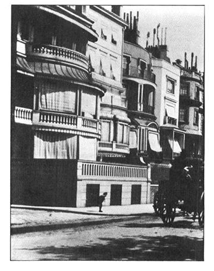
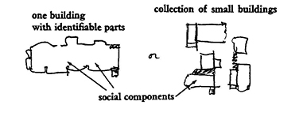

<section class="pattern-plate" aria-labelledby="t-building-complex">
<a href="/patterns">A Pattern Language</a> · <a href="/patterns#buildings">Buildings</a> · Pattern 95 · p. 468 · **
<h1 class="pattern-title" id="t-building-complex">Building Complex</h1><figure class="pattern-figure pl-figure"></figure><nav class="pattern-links" aria-label="Connections"><h2>Links to</h2><ul><li><a href="/patterns/number-of-stories">96 Number Of Stories</a></li><li><a href="/patterns/circulation-realms">98 Circulation Realms</a></li><li><a href="/patterns/main-building">99 Main Building</a></li><li><a href="/patterns/site-repair">104 Site Repair</a></li><li><a href="/patterns/south-facing-outdoors">105 South Facing Outdoors</a></li><li><a href="/patterns/wings-of-light">107 Wings Of Light</a></li><li><a href="/patterns/long-thin-house">109 Long Thin House</a></li><li><a href="/patterns/main-entrance">110 Main Entrance</a></li><li><a href="/patterns/arcades">119 Arcades</a></li><li><a href="/patterns/structure-follows-social-spaces">205 Structure Follows Social Spaces</a></li></ul><h2>Linked from</h2><ul><li><a href="/patterns/four-story-limit">21 Four-Story Limit</a></li><li><a href="/patterns/row-houses">38 Row Houses</a></li><li><a href="/patterns/university-as-a-marketplace">43 University As A Marketplace</a></li><li><a href="/patterns/birth-places">65 Birth Places</a></li><li><a href="/patterns/the-family">75 The Family</a></li><li><a href="/patterns/your-own-home">79 Your Own Home</a></li><li><a href="/patterns/self-governing-workshops-and-offices">80 Self-Governing Workshops And Offices</a></li><li><a href="/patterns/small-services-without-red-tape">81 Small Services Without Red Tape</a></li><li><a href="/patterns/office-connections">82 Office Connections</a></li><li><a href="/patterns/teen-age-society">84 Teen-Age Society</a></li><li><a href="/patterns/shopfront-schools">85 Shopfront Schools</a></li><li><a href="/patterns/childrens-home">86 Children’s Home</a></li><li><a href="/patterns/individually-owned-shops">87 Individually Owned Shops</a></li><li><a href="/patterns/street-cafe">88 Street Cafe</a></li><li><a href="/patterns/corner-grocery">89 Corner Grocery</a></li><li><a href="/patterns/beer-hall">90 Beer Hall</a></li><li><a href="/patterns/travelers-inn">91 Traveler’s Inn</a></li><li><a href="/patterns/number-of-stories">96 Number Of Stories</a></li><li><a href="/patterns/shielded-parking">97 Shielded Parking</a></li><li><a href="/patterns/circulation-realms">98 Circulation Realms</a></li><li><a href="/patterns/main-building">99 Main Building</a></li><li><a href="/patterns/pedestrian-street">100 Pedestrian Street</a></li><li><a href="/patterns/building-thoroughfare">101 Building Thoroughfare</a></li><li><a href="/patterns/site-repair">104 Site Repair</a></li><li><a href="/patterns/connected-buildings">108 Connected Buildings</a></li><li><a href="/patterns/half-hidden-garden">111 Half-Hidden Garden</a></li><li><a href="/patterns/cascade-of-roofs">116 Cascade Of Roofs</a></li><li><a href="/patterns/paths-and-goals">120 Paths And Goals</a></li><li><a href="/patterns/building-fronts">122 Building Fronts</a></li><li><a href="/patterns/bulk-storage">145 Bulk Storage</a></li></ul></nav></section><article class="pattern-text" aria-label="The text of Building Complex">
469… this pattern, the first of the 130 patterns which deal specifically with buildings, is the bottleneck through which all languages pass from the social layouts of the earlier patterns to the smaller ones which define individual spaces.

Assume that you have decided to build a certain building. The social groups or institutions which the building is meant to house are given—partly by the facts peculiar to your own case, and partly, perhaps, by earlier patterns. Now this pattern and the next one—<a class="pl-ref" href="/patterns/number-of-stories">NUMBER OF STORIES (96)</a>, give you the basis of the building’s layout on the site. This pattern shows you roughly how to break the building into parts, NUMBER OF STORIES helps you decide how high to make each part. Obviously, the two patterns must be used together.

◆ ◆ ◆

<strong>A building cannot be a human building unless it is a complex of still smaller buildings or smaller parts which manifest its own internal social facts.</strong>

A building is a visible, concrete manifestation of a social group or social institution. And since every social institution has smaller groups and institutions within it, a human building will always reveal itself, not as a monolith, but as a complex of these smaller institutions, made manifest and concrete too.

A family has couples and groups within it; a factory has teams of workers; a town hall has divisions, departments within the large divisions, and working groups within these departments. A building which shows these subdivisions and articulations in its fabric is a human building—because it lets us live according to the way that people group themselves. By contrast, any monolithic building is denying the facts of its own social structure, and in denying these facts it is asserting other facts of a less human kind and forcing people to adapt their lives to them instead.

We have tried to make this feeling more precise by means of the following conjecture: the more monolithic a building is, and the less differentiated, the more it presents itself as an in 470human, mechanical factory. And when human organizations are housed in enormous, undifferentiated buildings, people stop identifying with the staff who work there as personalities and think only of the institution as an impersonal monolith, staffed by personnel. In short, the more monolithic the building is, the more it prevents people from being personal, and from making human contact with the other people in the building.

The strongest evidence for this conjecture that we have found to date comes from a survey of visitors to public service buildings in Vancouver, British Columbia. (<em>Preliminary Program for Massing Studies, Document 5: Visitor Survey</em>, Environmental Analysis Group, Vancouver, B.C., August 1970.) Two kinds of public service buildings were studied—old, three story buildings and huge modern office buildings. The reactions of visitors to the small building differed from the reactions of visitors to the large buildings in an extraordinary way. The people going to the small buildings most often mentioned friendly and competent staff as the important factor in their satisfaction with the service. In many cases the visitors were able to give names and describe the people with whom they had done business. Visitors to the huge office buildings, on the other hand, mentioned friendliness and staff competence rather infrequently. The great majority of these visitors found their satisfaction in “good physical appearance, and equipment.”

In the monoliths, the visitors’ experience is depersonalized. They stop thinking primarily of the people they are going to see and the quality of the relationship and focus instead on the building itself and its features. The staff becomes “personnel,” interchangeable, and indifferent, and the visitors pay little attention to them as people—friendly or unfriendly, competent or incompetent.

We learn also from this study that in the large buildings visitors complained frequently about the “general atmosphere” of the building, without naming specific problems. There were no such complaints among the visitors to the smaller buildings. It is as if the monoliths induce a kind of free-floating anxiety in people: the environment “feels wrong,” but it is hard to give a reason. It may be that the cause of the uneasiness is so simple—the place is too big, it is difficult to grasp, the people are like bees in a hive—that people are embarrassed to say it outright. 471(“If it is as simple as that, / must be wrong—after all, there are so many of these buildings.”)

However it is, we take this evidence to indicate deep disaffection from the <em>human</em> environment in the huge, undifferentiated office buildings. The buildings impress themselves upon us as things: objects, commodities; they make us forget the people inside, as people; yet when we use these buildings we complain vaguely about the “general atmosphere.”

It seems then that the degree to which a building is broken into visible parts <em>does</em> affect the human relations among people in the building. And if a building must, for psychological reasons, be broken into parts, it seems impossible to find any nr ore natural way of breaking it down, than the one we have suggested. Namely, that the various institutions, groups, subgroups, activities, are visible in the concrete articulation of the physical building, on the grounds that people will only be fully able to identify with people in the building, when the building is a building <em>complex</em>.

A gothic cathedral—though an immense building—is an example of a building complex. Its various parts, the spire, the aisle, the nave, the chancel, the west gate, are a precise reflection of the social groups—the congregation, the choir, the special mass, and so forth.

And, of course, a group of huts in Africa, is human too, because it too is a complex of buildings, not one huge building by itself.

For a complex of buildings at high density, the easiest way of all, of making its human parts identifiable, is to build it up from narrow fronted buildings, each with its own internal stair. This is the basic structure of a Georgian terrace, or the brownstones of New York.

Therefore:

<strong>Never build large monolithic buildings. Whenever possible translate your building program into a building complex, whose parts manifest the actual social facts of the situation. At low densities, a building complex may take the form of a collection of small buildings connected by arcades, paths, bridges, shared gardens, and walls.</strong>

<strong>At higher densities, a single building can be treated as a 472building complex, if its important parts are picked out and made identifiable while still part of one three-dimensional fabric.</strong>

<strong>Even a small building, a house for example, can be conceived as a “building complex”—perhaps part of it is higher than the rest with wings and an adjoining cottage.</strong>

<figure class="pl-figure"></figure>
◆ ◆ ◆

At the highest densities, 3 or 4 stories, and along pedestrian streets, break the buildings into narrow, tall separate buildings, side by side, with common walls, each with its own internal or external stair. As far as possible insist that they be built piecemeal, one at a time, so that each one has time to be adapted to its neighbor. Keep the frontage as low as 25 or 30 feet, <a class="pl-ref" href="/patterns/long-thin-house">LONG THIN HOUSE (109)</a>, BUILDING FRONTS (l22); <a class="pl-ref" href="/patterns/main-entrance">MAIN ENTRANCE (110)</a> and perhaps a part of an <a class="pl-ref" href="/patterns/arcades">ARCADE (119)</a> which connects to next door buildings.

Arrange the buildings in the complex to form realms of movement—<a class="pl-ref" href="/patterns/circulation-realms">CIRCULATION REALMS (98)</a>; build one building from the collection as a main building—the natural center of the site—<a class="pl-ref" href="/patterns/main-building">MAIN BUILDING (99)</a>; place individual buildings where the land is least beautiful, least healthy—<a class="pl-ref" href="/patterns/site-repair">SITE REPAIR (104)</a>; and put them to the north of their respective open space to keep the gardens sunny—<a class="pl-ref" href="/patterns/south-facing-outdoors">SOUTH-FACING OUTDOORS (105)</a>; subdivide them further, into narrow wings, no more than 25 or 30 feet across—<a class="pl-ref" href="/patterns/wings-of-light">WINGS OF LIGHT (107)</a>. For details of construction, start with <a class="pl-ref" href="/patterns/structure-follows-social-spaces">STRUCTURE FOLLOWS SOCIAL SPACES (205)</a>….
</article>

Christopher Alexander, Sara Ishikawa and Murray Silverstein, with Max Jacobson, Ingrid Fiksdahl-King and Shlomo Angel, <cite>A Pattern Language</cite> (Oxford University Press, 1977), pattern 95, pp. 468–472. Text and illustrations from the <a href="https://github.com/natureoforder/sources">Nature of Order sources</a> reading edition, transcribed from the 1977 printing; report errors on <a href="https://github.com/natureoforder/alexander-wiki/issues">GitHub</a>.

<a href="/patterns/sleeping-in-public">← 94 Sleeping In Public</a> · <a href="/patterns">All 253 patterns</a> · <a href="/patterns/number-of-stories">96 Number Of Stories →</a>

