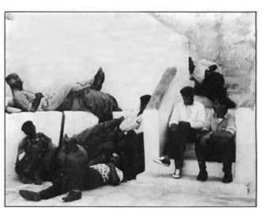
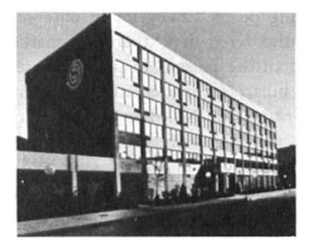
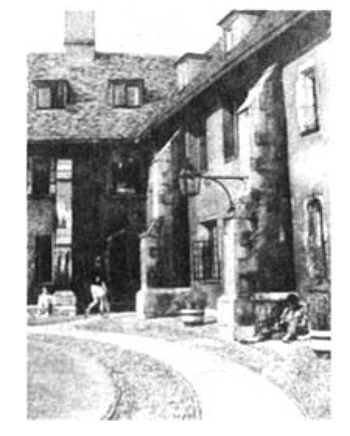
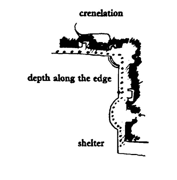

<section class="pattern-plate" aria-labelledby="t-building-edge">
<a href="/patterns">A Pattern Language</a> · <a href="/patterns#buildings">Buildings</a> · Pattern 160 · p. 752 · **
<h1 class="pattern-title" id="t-building-edge">Building Edge</h1><figure class="pattern-figure pl-figure"></figure><nav class="pattern-links" aria-label="Connections"><h2>Links to</h2><ul><li><a href="/patterns/positive-outdoor-space">106 Positive Outdoor Space</a></li><li><a href="/patterns/wings-of-light">107 Wings Of Light</a></li><li><a href="/patterns/arcades">119 Arcades</a></li><li><a href="/patterns/activity-pockets">124 Activity Pockets</a></li><li><a href="/patterns/stair-seats">125 Stair Seats</a></li><li><a href="/patterns/light-on-two-sides-of-every-room">159 Light On Two Sides Of Every Room</a></li><li><a href="/patterns/sunny-place">161 Sunny Place</a></li><li><a href="/patterns/north-face">162 North Face</a></li><li><a href="/patterns/outdoor-room">163 Outdoor Room</a></li><li><a href="/patterns/street-windows">164 Street Windows</a></li><li><a href="/patterns/six-foot-balcony">167 Six-Foot Balcony</a></li><li><a href="/patterns/connection-to-the-earth">168 Connection To The Earth</a></li><li><a href="/patterns/seat-spots">241 Seat Spots</a></li><li><a href="/patterns/front-door-bench">242 Front Door Bench</a></li></ul><h2>Linked from</h2><ul><li><a href="/patterns/necklace-of-community-projects">45 Necklace Of Community Projects</a></li><li><a href="/patterns/sleeping-in-public">94 Sleeping In Public</a></li><li><a href="/patterns/positive-outdoor-space">106 Positive Outdoor Space</a></li><li><a href="/patterns/arcades">119 Arcades</a></li><li><a href="/patterns/building-fronts">122 Building Fronts</a></li><li><a href="/patterns/open-stairs">158 Open Stairs</a></li><li><a href="/patterns/sunny-place">161 Sunny Place</a></li><li><a href="/patterns/gallery-surround">166 Gallery Surround</a></li><li><a href="/patterns/connection-to-the-earth">168 Connection To The Earth</a></li><li><a href="/patterns/terraced-slope">169 Terraced Slope</a></li><li><a href="/patterns/thick-walls">197 Thick Walls</a></li><li><a href="/patterns/front-door-bench">242 Front Door Bench</a></li></ul></nav></section><article class="pattern-text" aria-label="The text of Building Edge">
753… assume that the position of the building edge is fixed—most recently by <a class="pl-ref" href="/patterns/light-on-two-sides-of-every-room">LIGHT ON TWO SIDES OF EVERY ROOM (159)</a>—and before that by the position of the building wings and their interior spaces and by the courts and gardens and streets between the buildings—<a class="pl-ref" href="/patterns/wings-of-light">WINGS OF LIGHT (107)</a>, <a class="pl-ref" href="/patterns/positive-outdoor-space">POSITIVE OUTDOOR SPACE (106)</a>. This pattern now sets the stage for the development of the zone between the indoors and the outdoors. Often this “zone” is thought of as an edge, a line on paper without thickness, a wall. But this is altogether wrong. . .

◆ ◆ ◆

<strong>A building is most often thought of as something which turns inward—toward its rooms. People do not often think of a building as something which must also be oriented toward the outside.</strong>

But unless the building is oriented toward the outside, which surrounds it, as carefully and positively as toward its inside, the space around the building will be useless and blank—with the direct effect, in the long run, that the building will be socially isolated, because you have to cross a no-man’s land to get to it.

Look, for example, at this machine age slab of steel and glass. You cannot approach it anywhere except at its entrance—because the space around it is not made for people.

<figure class="pl-figure"><figcaption><em>The edge cannot support any life.</em></figcaption></figure>

754And compare it with this older, warmer building, which has a continuous surrounding of benches, galleries, balconies, flowers, corners to sit, places to stop. This building edge is alive. It is connected to the world around it by the simple fact that it is made into a positive place where people can enjoy themselves.

<figure class="pl-figure"><figcaption><em>An edge that can be used</em>.</figcaption></figure>

Think of the effect of this small difference. The machine-like building is cut off from its surroundings, isolated, an island. The building with a lively building edge, is connected, part of the social fabric, part of the town, part of the lives of all the people who live and move around it.

We get empirical support for this contrast from the following: apparently people prefer being at the edges of open spaces—and when these edges are made human, people cling to them tenaciously. In observing people’s behavior in outdoor spaces, for example, Jan Gehl discovered that “there is a marked tendency for both standing and sitting persons to place themselves near something—a facade, pillar, furniture, etc.” [“Mennesker til Fods (Pedestrians),” <em>Arkitekten</em>, No. 20, 1968.] This tendency for people to stay at the edges of spaces, is also discussed in the pattern <a class="pl-ref" href="/patterns/activity-pockets">ACTIVITY POCKETS (124)</a>.

If this propensity were taken as seriously outdoors as it is indoors, then the exterior walls of buildings would look very different indeed from the way they look today. They would be 755more like places—walls would weave in and out, and the roof would extend over them to create little places for benches, posters, and notices for people to look at. For the niches to have the right depth, they would have to be occasionally as much as 6 feet deep—see the arguments for <a class="pl-ref" href="/patterns/six-foot-balcony">SIX-FOOT BALCONY (167)</a>.

When it is properly made, such an edge is a realm between realms: it increases the connection between inside and outside, encourages the formation of groups which cross the boundary, encourages movement which starts on one side and ends on the other, and allows activity to be either on, or in the boundary itself. A very fundamental notion.

Therefore:

<strong>Make sure that you treat the edge of the building as a “thing,” a “place,” a zone with volume to it, not a line or interface which has no thickness. Crenelate the edge of buildings with places that invite people to stop. Make places that have depth and a covering, places to sit, lean, and walk, especially at those points along the perimeter which look onto interesting outdoor life.</strong>

<figure class="pl-figure"></figure>
◆ ◆ ◆

756Do it with arcades, galleries, porches, and terraces—<a class="pl-ref" href="/patterns/arcades">ARCADES (119)</a>, <a class="pl-ref" href="/patterns/outdoor-room">OUTDOOR ROOM (163)</a>, GALLERY SURROUND (l66), <a class="pl-ref" href="/patterns/six-foot-balcony">SIX-FOOT BALCONY (167)</a>, <a class="pl-ref" href="/patterns/connection-to-the-earth">CONNECTION TO THE EARTH (168)</a>; take special account of the sun—<a class="pl-ref" href="/patterns/sunny-place">SUNNY PLACE (161)</a>, <a class="pl-ref" href="/patterns/north-face">NORTH FACE (162)</a>; and put in seats and windows which complete the feeling of connection—<a class="pl-ref" href="/patterns/stair-seats">STAIR SEATS (125)</a>, <a class="pl-ref" href="/patterns/street-windows">STREET WINDOWS (164)</a>, <a class="pl-ref" href="/patterns/seat-spots">SEAT SPOTS (241)</a>, <a class="pl-ref" href="/patterns/front-door-bench">FRONT DOOR BENCH (242)</a>….
</article>

Christopher Alexander, Sara Ishikawa and Murray Silverstein, with Max Jacobson, Ingrid Fiksdahl-King and Shlomo Angel, <cite>A Pattern Language</cite> (Oxford University Press, 1977), pattern 160, pp. 752–756. Text and illustrations from the <a href="https://github.com/natureoforder/sources">Nature of Order sources</a> reading edition, transcribed from the 1977 printing; report errors on <a href="https://github.com/natureoforder/alexander-wiki/issues">GitHub</a>.

<a href="/patterns/light-on-two-sides-of-every-room">← 159 Light On Two Sides Of Every Room</a> · <a href="/patterns">All 253 patterns</a> · <a href="/patterns/sunny-place">161 Sunny Place →</a>

