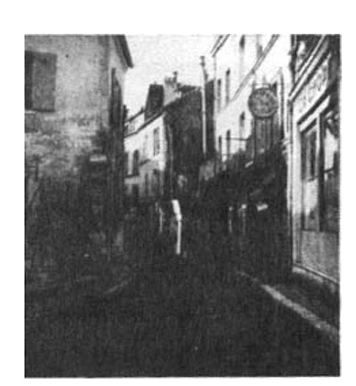
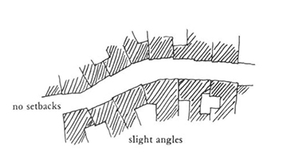

<section class="pattern-plate" aria-labelledby="t-building-fronts">
<a href="/patterns">A Pattern Language</a> · <a href="/patterns#buildings">Buildings</a> · Pattern 122 · p. 593 · *
<h1 class="pattern-title" id="t-building-fronts">Building Fronts</h1><nav class="pattern-links" aria-label="Connections"><h2>Links to</h2><ul><li><a href="/patterns/four-story-limit">21 Four-Story Limit</a></li><li><a href="/patterns/building-complex">95 Building Complex</a></li><li><a href="/patterns/positive-outdoor-space">106 Positive Outdoor Space</a></li><li><a href="/patterns/wings-of-light">107 Wings Of Light</a></li><li><a href="/patterns/arcades">119 Arcades</a></li><li><a href="/patterns/path-shape">121 Path Shape</a></li><li><a href="/patterns/activity-pockets">124 Activity Pockets</a></li><li><a href="/patterns/stair-seats">125 Stair Seats</a></li><li><a href="/patterns/private-terrace-on-the-street">140 Private Terrace On The Street</a></li><li><a href="/patterns/open-stairs">158 Open Stairs</a></li><li><a href="/patterns/building-edge">160 Building Edge</a></li><li><a href="/patterns/street-windows">164 Street Windows</a></li><li><a href="/patterns/opening-to-the-street">165 Opening To The Street</a></li><li><a href="/patterns/gallery-surround">166 Gallery Surround</a></li><li><a href="/patterns/front-door-bench">242 Front Door Bench</a></li></ul><h2>Linked from</h2><ul><li><a href="/patterns/industrial-ribbon">42 Industrial Ribbon</a></li><li><a href="/patterns/small-public-squares">61 Small Public Squares</a></li><li><a href="/patterns/roof-garden">118 Roof Garden</a></li><li><a href="/patterns/path-shape">121 Path Shape</a></li><li><a href="/patterns/activity-pockets">124 Activity Pockets</a></li></ul></nav></section><article class="pattern-text" aria-label="The text of Building Fronts">
… this pattern helps to shape the paths and buildings simultaneously; and so completes <a class="pl-ref" href="/patterns/building-complex">BUILDING COMPLEX (95)</a>, <a class="pl-ref" href="/patterns/wings-of-light">WINGS OF LIGHT (107)</a>, POSITIVE OUTDOOR SPACE (L06), <a class="pl-ref" href="/patterns/arcades">ARCADES (119)</a>, <a class="pl-ref" href="/patterns/path-shape">PATH SHAPE (121)</a>, and also <a class="pl-ref" href="/patterns/activity-pockets">ACTIVITY POCKETS (124)</a>.

◆ ◆ ◆

<strong>Building set-backs from the street, originally invented to protect the public welfare by giving every building light and air, have actually helped greatly to destroy the street as a social space.</strong>

In <a class="pl-ref" href="/patterns/positive-outdoor-space">POSITIVE OUTDOOR SPACE (106)</a> we have described the fact that buildings are not merely placed into the outdoors, but that they actually shape the outdoors. Since streets and squares have such enormous social importance, it is natural to pay close attention to the way that they are shaped by building fronts.

The early twentieth-century urge for “cleanliness” at all costs, and the social efforts to clean up slums, led social reformers to pass laws which make it necessary to place buildings several feet back from the street edge, to make sure that buildings cannot crowd the street and cut off sunshine, light, and air.

But, the set backs have destroyed the streets. Since it is possible to guarantee plenty of air and sun in buildings and streets in other ways—see, for example, <a class="pl-ref" href="/patterns/four-story-limit">FOUR-STORY LIMIT (21)</a> and <a class="pl-ref" href="/patterns/wings-of-light">WINGS OF LIGHT (107)</a>—it is essential to build the front of buildings on the street, so that the streets which they create are usable.

Finally, note that the positive shape of the street cannot be achieved by merely staggering building fronts. If the building fronts are adjusted to the shape of the outdoors, they will almost always take on a variety of slightly uneven angles.

594

<figure class="pl-figure"><figcaption><em>Slight angles in the building fronts</em>.</figcaption></figure>

Therefore:

<strong>On no account allow set-backs between streets or paths or public open land and the buildings which front on them. The set-backs do nothing valuable and almost always destroy the value of the open areas between the buildings. Build right up to the paths; change the laws in all communities where obsolete by-laws make this impossible. And let the building fronts take on slighdy uneven angles as they accommodate to the shape of the street.</strong>

<figure class="pl-figure"></figure>
595

◆ ◆ ◆

Detail the fronts of buildings, indeed the whole building perimeter, according to the pattern <a class="pl-ref" href="/patterns/building-edge">BUILDING EDCE (160)</a>. If some outdoor space is needed at the front of the building, make it part of the street life <em>by</em> making it a <a class="pl-ref" href="/patterns/private-terrace-on-the-street">PRIVATE TERRACE ON THE STREET (140)</a> or <a class="pl-ref" href="/patterns/gallery-surround">GALLERY SURROUND (166)</a>; and give the building many openings onto the street—<a class="pl-ref" href="/patterns/stair-seats">STAIR SEATS (125)</a>, <a class="pl-ref" href="/patterns/open-stairs">OPEN STAIRS (158)</a>, <a class="pl-ref" href="/patterns/street-windows">STREET WINDOWS (164)</a>, <a class="pl-ref" href="/patterns/opening-to-the-street">OPENING TO THE STREET (165)</a>, <a class="pl-ref" href="/patterns/front-door-bench">FRONT DOOR BENCH (242)</a>….
</article>

Christopher Alexander, Sara Ishikawa and Murray Silverstein, with Max Jacobson, Ingrid Fiksdahl-King and Shlomo Angel, <cite>A Pattern Language</cite> (Oxford University Press, 1977), pattern 122, pp. 593–595. Text and illustrations from the <a href="https://github.com/natureoforder/sources">Nature of Order sources</a> reading edition, transcribed from the 1977 printing; report errors on <a href="https://github.com/natureoforder/alexander-wiki/issues">GitHub</a>.

<a href="/patterns/path-shape">← 121 Path Shape</a> · <a href="/patterns">All 253 patterns</a> · <a href="/patterns/pedestrian-density">123 Pedestrian Density →</a>

