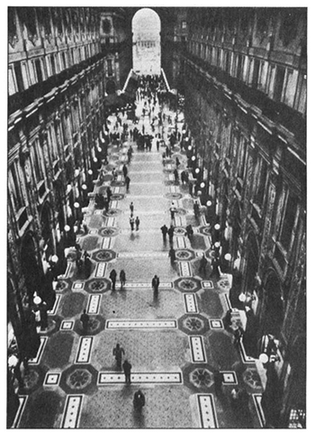
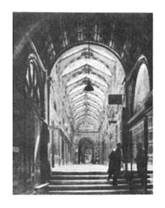
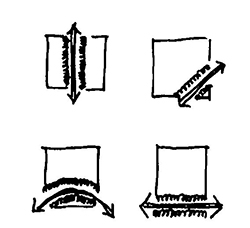
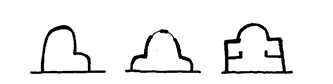
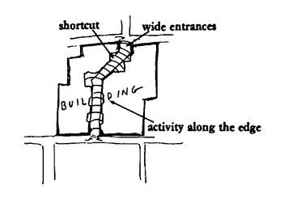

<section class="pattern-plate" aria-labelledby="t-building-thoroughfare">
<a href="/patterns">A Pattern Language</a> · <a href="/patterns#buildings">Buildings</a> · Pattern 101 · p. 492
<h1 class="pattern-title" id="t-building-thoroughfare">Building Thoroughfare</h1><figure class="pattern-figure pl-figure"></figure><nav class="pattern-links" aria-label="Connections"><h2>Links to</h2><ul><li><a href="/patterns/building-complex">95 Building Complex</a></li><li><a href="/patterns/circulation-realms">98 Circulation Realms</a></li><li><a href="/patterns/pedestrian-street">100 Pedestrian Street</a></li><li><a href="/patterns/pedestrian-density">123 Pedestrian Density</a></li><li><a href="/patterns/activity-pockets">124 Activity Pockets</a></li><li><a href="/patterns/tapestry-of-light-and-dark">135 Tapestry Of Light And Dark</a></li><li><a href="/patterns/reception-welcomes-you">149 Reception Welcomes You</a></li><li><a href="/patterns/open-stairs">158 Open Stairs</a></li><li><a href="/patterns/ceiling-height-variety">190 Ceiling Height Variety</a></li><li><a href="/patterns/interior-windows">194 Interior Windows</a></li><li><a href="/patterns/solid-doors-with-glass">237 Solid Doors With Glass</a></li></ul><h2>Linked from</h2><ul><li><a href="/patterns/small-services-without-red-tape">81 Small Services Without Red Tape</a></li><li><a href="/patterns/office-connections">82 Office Connections</a></li><li><a href="/patterns/childrens-home">86 Children’s Home</a></li><li><a href="/patterns/sleeping-in-public">94 Sleeping In Public</a></li><li><a href="/patterns/circulation-realms">98 Circulation Realms</a></li><li><a href="/patterns/arcades">119 Arcades</a></li><li><a href="/patterns/pedestrian-density">123 Pedestrian Density</a></li><li><a href="/patterns/activity-pockets">124 Activity Pockets</a></li><li><a href="/patterns/short-passages">132 Short Passages</a></li><li><a href="/patterns/street-windows">164 Street Windows</a></li><li><a href="/patterns/half-open-wall">193 Half-Open Wall</a></li><li><a href="/patterns/interior-windows">194 Interior Windows</a></li></ul></nav></section><article class="pattern-text" aria-label="The text of Building Thoroughfare">
493… if the building complex is built at high density, then at least part of the circulation cannot be made of outdoor <a class="pl-ref" href="/patterns/pedestrian-street">PEDESTRIAN STREETS (100)</a> because the buildings corer too much of the land; in this case, the main spines of the <a class="pl-ref" href="/patterns/circulation-realms">CIRCULATION REALMS (98)</a> must take the form of building thoroughfares similar to pedestrian streets, but partly or wholly inside the buildings. Building thoroughfares replace the terrible corridors which destroy so much of modern building, and help to generate the indoor layout of a <a class="pl-ref" href="/patterns/building-complex">BUILDING COMPLEX (95)</a>.

◆ ◆ ◆

<strong>When a public building complex cannot be completely served by outdoor pedestrian streets, a new form of indoor street, quite different from the conventional corridor, is needed.</strong>

<figure class="pl-figure"><figcaption><em>An indoor street</em>.</figcaption></figure>

The problem arises under two conditions.

1. <em>Cold weather</em>. In very cold climates to have all circulation outdoors inhibits social communication instead of helping it. Of course, a street can be roofed, particularly with a glass roof. But as soon as it becomes enclosed, it has a different social ecology and begins to function differently.

2. <em>High density</em>. When a building complex is so tightly packed 494on the site that there is no reasonable space for outdoor streets because the entire building complex is a continuous two, three, or four story building, it becomes necessary to think of major thoroughfares in different terms.

To solve the problems posed by these conditions, streets must be replaced by indoor thoroughfares or corridors. But the moment we put them indoors and under cover, they begin to suffer from entirely new problems, which are caused by the fact that they get sterilized by their isolation. First, they become removed from the public realm, and are often deserted. People hardly ever feel free to linger in public corridors when they are off the street. And second, the corridors become so unfriendly that nothing ever happens there. They are designed for scuttling people through, but not for staying in.

In order to solve these new problems, created when we try to put a street indoors, the indoor streets—or building thoroughfares—need five specific characteristics,

<em>1. Shortcut</em>

Public places are meant to invite free loitering. The public places in community buildings (city halls, community centers, public libraries) especially need this quality, because when people feel free to hang around they will necessarily get acquainted with what goes on in the building and may begin to use it.

But people rarely feel free to stay in these places without an Official Reason. Goffman describes this situation as follows:

Being present in a public place without an orientation to apparent goals outside the situation is sometimes called lolling, when position is fixed, and loitering, when some movement is entailed. Either can be deemed sufficiently improper to merit legal action. On many of our city streets, especially at certain hours, the police will question anyone who appears to be doing nothing and ask him to “move along.” (In London, a recent court ruling established that an individual has a right to walk on the street but no legal right merely to stand on it.) In Chicago, an individual in the uniform of a hobo can loll on “the stem,” but once off this preserve he is required to look as if he were intent on getting to some business destination. Similarly, some mental patients owe their commitment to the fact that the police found them wandering on the streets at off hours without any apparent destination or purpose in mind. (Erving Goffman, <em>Behavior in Public Places</em>, New York: Free Press, 1963, p. 56.)

495If a public space is to be really useful it must somehow help to counter the anti-loitering tendency in modern society. Specifically, we have observed these problems:

a. A person will not use a public place if he has to make a special motion toward it, a motion which indicates the intention to use the facility “officially.”

b. If people are asked to state their reason for being in a place (for example, by a receptionist or clerk) they won’t use it freely.

c. Entering a public space through doors, corridors, changes of level, and so on, tends to keep away people who are not entering with a specific goal in mind.

Places which overcome these problems, like the Galleria in Milan, all have a common characteristic: they all have public thoroughfares which slice through them, lined with places to stop and loiter and watch the scene.

<figure class="pl-figure"><figcaption><em>Shortcuts</em>.</figcaption></figure>

<em>2. Width</em>

An indoor street needs to be wide enough for people to feel comfortable walking or stopping along the way. Informal experiments help to determine how much space people need when they pass others. Since the likelihood of three people passing three people is not high, we consider as a maximum two people passing two people, or three people passing one person. Each person takes about two feet; there needs to be about one foot between two groups which pass, so that they do not feel crowded; and 496people usually walk at least one foot away from the wall. The street width, therefore, should be <em>at least 11 feet</em>.

Our experiments also indicate that a person seated or standing at the edge of a street feels uncomfortable if anyone passes closer than five feet. Thus, in places in the street where seats, activities, entrances, and counters are placed, the street should widen to about 16 feet (one-sided) or 20 feet (two-sided).

<em>3. Height</em>

Ceiling heights should also feel comfortable for people walking or standing along an indoor street. According to <a class="pl-ref" href="/patterns/ceiling-height-variety">CEILING HEIGHT VARIETY (190)</a>, the height of any space should be equal to the appropriate horizontal social distances between people for the given situation—the higher the ceiling, the more distant people seem from each other.

Edward Hall, in <em>The Hidden Dimension</em>, suggests that a comfortable distance between strangers is the distance at which you cannot distinguish the details of their facial features. He gives this distance as being between 12 and 16 feet. Thus, the ceiling height in an indoor street should be at least in that range.

Where people sit and stand talking to each other, the appropriate social distance is more intimate. Hall gives it a dimension of four to seven feet. Thus, the ceiling in activity and “edge” places should be seven feet.

This suggests, for a large indoor street, a ceiling that is high in the middle and low at the edges. In the middle, where people are passing through and are more anonymous, the ceiling may be 12 to 20 feet high, or even higher, according to the scale of the passage. Along the edges of the thoroughfare, where people are invited to stop and become slightly more engaged in the life of the building, the ceilings may be lower. Here are three sections through an indoor street which have this property.

<figure class="pl-figure"><figcaption><em>Cross sections of an indoor street</em>.</figcaption></figure>

497<em>4. Wide entrance</em>

As far as possible, the indoor street should be a continuation of the circulation outside the building. To this end, the path into the building should be as continuous as possible, and the entrance quite wide—more a gateway than a door. An entrance that is 15 feet wide begins to have this character.

<em>5. Involvements along the edge</em>

To invite the free loitering described above under <em>Shortcut</em>, the street needs a continuum of various “involvements” along its edge.

Rooms next to the street should have windows opening onto the street. We know it is unpleasant to walk down a corridor lined with blank walls. Not only do you lose the sense of where you are but you get the feeling that all the life in the building is on the other side of the walls, and you feel cut off from it. We guess that this contact with the public is not objectionable for the workers, so long as it is not too extreme, that is, as long as the workplace is protected either by distance or by a partial wall.

The corridor should be lined with seats and places to stop, such as newspaper, magazine, and candy stands, bulletin boards, exhibits, and displays.

Where there are entrances and counters of offices and services off the corridor, they should project into the corridor. Like activities, entrances and counters create places in the corridor, and should be combined with seats and other places to stop. In most public service buildings these counters and entrances are usually set back from corridors which makes them hard to see, and emphasizes the difference between the corridor as a place for passing through, and the office as a place where things happen. The problems can be solved if the entrances and counters project into the corridor and become part of it.

Therefore:

<strong>Wherever density or climate force the main lines of circulation indoors, build them as building thoroughfares. Place each thoroughfare in a position where it functions as a shortcut, as continuous as possible with the public street 498outside, with wide open entrances. And line its edges with windows, places to sit, counters, and entrances which project out into the hall and expose the buildings’ main functions to the public. Make it wider than a normal corridor—at least ir feet wide and more usually, 15 to 20 feet wide; give it a high ceiling, at least 15 feet, with a glazed roof if possible and low places along the edge. If the street is several stories high, then the walkways along the edges, on the different stories, can be used to form the low places.</strong>

<figure class="pl-figure"></figure>
◆ ◆ ◆

Treat the thoroughfare as much like a <a class="pl-ref" href="/patterns/pedestrian-street">PEDESTRIAN STREET (100)</a> as possible, with <a class="pl-ref" href="/patterns/open-stairs">OPEN STAIRS (158)</a> coming into it from upper storys. Place entrances, reception points, and seats to form the pockets of activity under the lower ceilings at the edges—FAMILY OF ENTANCES (l02), <a class="pl-ref" href="/patterns/activity-pockets">ACTIVITY POCKETS (124)</a>, <a class="pl-ref" href="/patterns/reception-welcomes-you">RECEPTION WELCOMES YOU (149)</a>, WINDOW PLACE (l80), <a class="pl-ref" href="/patterns/ceiling-height-variety">CEILING HEIGHT VARIETY (190)</a>, and give these places strong natural light—<a class="pl-ref" href="/patterns/tapestry-of-light-and-dark">TAPESTRY OF LIGHT AND DARK (135)</a>. Make a connection to adjacent rooms with <a class="pl-ref" href="/patterns/interior-windows">INTERIOR WINDOWS (194)</a> and <a class="pl-ref" href="/patterns/solid-doors-with-glass">SOLID DOORS WITH GLASS (237)</a>. To give the building thoroughfare the proper sense of liveliness, calculate its overall size according to <a class="pl-ref" href="/patterns/pedestrian-density">PEDESTRIAN DENSITY (123)</a>….
</article>

Christopher Alexander, Sara Ishikawa and Murray Silverstein, with Max Jacobson, Ingrid Fiksdahl-King and Shlomo Angel, <cite>A Pattern Language</cite> (Oxford University Press, 1977), pattern 101, pp. 492–498. Text and illustrations from the <a href="https://github.com/natureoforder/sources">Nature of Order sources</a> reading edition, transcribed from the 1977 printing; report errors on <a href="https://github.com/natureoforder/alexander-wiki/issues">GitHub</a>.

<a href="/patterns/pedestrian-street">← 100 Pedestrian Street</a> · <a href="/patterns">All 253 patterns</a> · <a href="/patterns/family-of-entrances">102 Family Of Entrances →</a>

