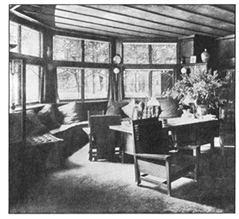
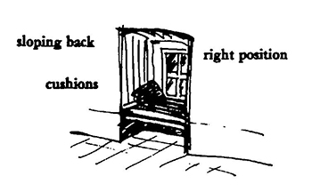

<section class="pattern-plate" aria-labelledby="t-built-in-seats">
<a href="/patterns">A Pattern Language</a> · <a href="/patterns#buildings">Buildings</a> · Pattern 202 · p. 924 · *
<h1 class="pattern-title" id="t-built-in-seats">Built-In Seats</h1><figure class="pattern-figure pl-figure"></figure><nav class="pattern-links" aria-label="Connections"><h2>Links to</h2><ul><li><a href="/patterns/entrance-room">130 Entrance Room</a></li><li><a href="/patterns/sequence-of-sitting-spaces">142 Sequence Of Sitting Spaces</a></li><li><a href="/patterns/alcoves">179 Alcoves</a></li><li><a href="/patterns/window-place">180 Window Place</a></li><li><a href="/patterns/thick-walls">197 Thick Walls</a></li><li><a href="/patterns/thickening-the-outer-walls">211 Thickening The Outer Walls</a></li></ul><h2>Linked from</h2><ul><li><a href="/patterns/entrance-room">130 Entrance Room</a></li><li><a href="/patterns/alcoves">179 Alcoves</a></li><li><a href="/patterns/window-place">180 Window Place</a></li><li><a href="/patterns/eating-atmosphere">182 Eating Atmosphere</a></li><li><a href="/patterns/corner-doors">196 Corner Doors</a></li><li><a href="/patterns/thick-walls">197 Thick Walls</a></li><li><a href="/patterns/thickening-the-outer-walls">211 Thickening The Outer Walls</a></li><li><a href="/patterns/radiant-heat">230 Radiant Heat</a></li><li><a href="/patterns/different-chairs">251 Different Chairs</a></li></ul></nav></section><article class="pattern-text" aria-label="The text of Built-In Seats">
925… throughout the building—<a class="pl-ref" href="/patterns/sequence-of-sitting-spaces">SEQUENCE OF SITTING SPACES (142)</a>—there are alcoves, entrances, corners, and windows where it is natural to make built-in seats—<a class="pl-ref" href="/patterns/entrance-room">ENTRANCE ROOM (130)</a>, <a class="pl-ref" href="/patterns/alcoves">ALCOVES (179)</a>, <a class="pl-ref" href="/patterns/window-place">WINDOW PLACE (180)</a>. This pattern helps complete them.

◆ ◆ ◆

<strong>Built-in seats are great Everybody loves them. They make a building feel comfortable and luxurious. But most often they do not actually work. They are placed wrong, or too narrow, or the back does not slope, or the view is wrong, or the seat is too hard. This pattern tells you what to do to make a built-in seat that really works.</strong>

Why do built-in seats so often not work properly? The reasons are simple and fairly easy to correct. But the problems are critical. If the seats are wrongly made, they just will not be used, and they will be a waste of space, a waste of money, and a wasted golden opportunity. What are the critical considerations?

Position: It is natural to put the built-in seat into an unobtrusive corner—that is where it melts most easily into the structure and the wall. But, as a result, it is often out of the way. If you want to build a seat, ask yourself where you would place a sofa or a comfortable armchair—and build the seat <em>there,</em> not tucked into some hopeless corner.

Width and comfort: Built-in seats are often too hard, too narrow, and too stiff-backed. No one wants to sit on a shelf, especially not for any length of time. Make the seat as wide as a really comfortable chair (at least 18 inches), with a back that slopes gently (not upright), and put a warm soft cushion on it and on the back, so that it is really comfortable.

View: Most people want to look at something when they sit—either at other people or a view. Built-in seats often place you so that you are facing away from the view or <em>away</em> from the other people in the room. Place the seat so that a person sitting down is looking at something interesting.

926Therefore:

<strong>Before you build the seat, get hold of an old arm chair or a sofa, and put it into the position where you intend to build a seat. Move it until you really like it. Leave it there for a few days. See if you enjoy sitting in it. Move it if you don’t. When you have got it into a position which you like, and where you often find yourself sitting, you know it is a good position. Now build a seat that is just as wide, and just as well padded—and your built-in seat will work.</strong>

<figure class="pl-figure"></figure>
◆ ◆ ◆

Once you decide where to put the seat, make it part of the <a class="pl-ref" href="/patterns/thick-walls">THICK WALLS (197)</a>, so that it is a part of the structure, not just an addition—<a class="pl-ref" href="/patterns/thickening-the-outer-walls">THICKENING THE OUTER WALL (211)</a>….
</article>

Christopher Alexander, Sara Ishikawa and Murray Silverstein, with Max Jacobson, Ingrid Fiksdahl-King and Shlomo Angel, <cite>A Pattern Language</cite> (Oxford University Press, 1977), pattern 202, pp. 924–926. Text and illustrations from the <a href="https://github.com/natureoforder/sources">Nature of Order sources</a> reading edition, transcribed from the 1977 printing; report errors on <a href="https://github.com/natureoforder/alexander-wiki/issues">GitHub</a>.

<a href="/patterns/waist-high-shelf">← 201 Waist-High Shelf</a> · <a href="/patterns">All 253 patterns</a> · <a href="/patterns/child-caves">203 Child Caves →</a>

