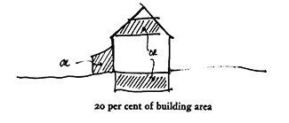

<section class="pattern-plate" aria-labelledby="t-bulk-storage">
<a href="/patterns">A Pattern Language</a> · <a href="/patterns#buildings">Buildings</a> · Pattern 145 · p. 687
<h1 class="pattern-title" id="t-bulk-storage">Bulk Storage</h1><nav class="pattern-links" aria-label="Connections"><h2>Links to</h2><ul><li><a href="/patterns/house-for-a-small-family">76 House For A Small Family</a></li><li><a href="/patterns/self-governing-workshops-and-offices">80 Self-Governing Workshops And Offices</a></li><li><a href="/patterns/individually-owned-shops">87 Individually Owned Shops</a></li><li><a href="/patterns/building-complex">95 Building Complex</a></li><li><a href="/patterns/sheltering-roof">117 Sheltering Roof</a></li><li><a href="/patterns/flexible-office-space">146 Flexible Office Space</a></li><li><a href="/patterns/communal-eating">147 Communal Eating</a></li><li><a href="/patterns/small-work-groups">148 Small Work Groups</a></li><li><a href="/patterns/reception-welcomes-you">149 Reception Welcomes You</a></li><li><a href="/patterns/small-meeting-rooms">151 Small Meeting Rooms</a></li><li><a href="/patterns/half-private-office">152 Half-Private Office</a></li><li><a href="/patterns/rooms-to-rent">153 Rooms To Rent</a></li><li><a href="/patterns/north-face">162 North Face</a></li><li><a href="/patterns/terraced-slope">169 Terraced Slope</a></li><li><a href="/patterns/ground-floor-slab">215 Ground Floor Slab</a></li></ul><h2>Linked from</h2><ul><li><a href="/patterns/sheltering-roof">117 Sheltering Roof</a></li><li><a href="/patterns/tapestry-of-light-and-dark">135 Tapestry Of Light And Dark</a></li><li><a href="/patterns/north-face">162 North Face</a></li><li><a href="/patterns/greenhouse">175 Greenhouse</a></li><li><a href="/patterns/ceiling-height-variety">190 Ceiling Height Variety</a></li><li><a href="/patterns/open-shelves">200 Open Shelves</a></li></ul></nav></section><article class="pattern-text" aria-label="The text of Bulk Storage">
… this pattern helps to complete any <a class="pl-ref" href="/patterns/house-for-a-small-family">HOUSE FOR A SMALL FAMILY (76)</a>, <a class="pl-ref" href="/patterns/self-governing-workshops-and-offices">SELF-GOVERNING WORKSHOPS AND OFFICES (80)</a>, and <a class="pl-ref" href="/patterns/individually-owned-shops">INDIVIDUALLY OWNED SHOPS (87)</a>. More generally, it is needed to fill out every <a class="pl-ref" href="/patterns/building-complex">BUILDING COMPLEX (95)</a>.

◆ ◆ ◆

<strong>In houses and workplaces there is always some need for bulk storage space; a {dace for things like suitcases, old furniture, old files, boxes—all those things which you are not ready to throw away, and yet not using everyday.</strong>

Some old buildings provide for this kind of storage automatically, with their attics, cellars, and sheds. But very often this kind of storage space is overlooked. We find it neglected, for example, in carefully designed buildings, where the designer is watching the square foot costs closely and cannot justify an extra room that is not “living space.”

In our experience, however, bulk storage space is terribly important; and when it is not provided, it usually means that some other space becomes the receptacle for all the bulky, marginal things that people need to store.

How much bulk storage should be provided? Certainly there should not be too much of it. That only invites us to keep old things that we have long since finished with. But some bulk storage is essential. Any household or workshop or cluster will have old furniture to store until it can be fixed, old tires, books, chests, tools that are only occasionally used; and the more selfsufficient the household is, the more space it needs. In the extreme case, it is even necessary to have space for storing building materials! The amount needed is never less than 10 per cent of the built area—sometimes as high as 50 per cent—and normally 15 to 20 per cent.

688Therefore:

<strong>Do not leave bulk storage till last or forget it. Include a volume for bulk storage in the building—its floor area at least 15 to 20 per cent of the whole building area—not less. Place this storage somewhere in the building where it costs less than other rooms—because, of course, it doesn’t need a finish.</strong>

<figure class="pl-figure"></figure>
◆ ◆ ◆

Put the storage in the apex of the roof if the roof has a steep pitch—<a class="pl-ref" href="/patterns/sheltering-roof">SHELTERING ROOF (117)</a>; if there is a sloping site, put it in a basement—<a class="pl-ref" href="/patterns/terraced-slope">TERRACED SLOPE (169)</a>, <a class="pl-ref" href="/patterns/ground-floor-slab">GROUND FLOOR SLAB (215)</a>; otherwise, put it in a shed which can perhaps be made into a cottage later—-<a class="pl-ref" href="/patterns/rooms-to-rent">ROOMS TO RENT (153)</a>. No matter whether it is an attic, cellar, or shed, it is usually good advice to follow <a class="pl-ref" href="/patterns/north-face">NORTH FACE (162)</a> and situate bulk storage to the north of the building, leaving the sunny spaces for rooms and gardens….

689<strong><em>then the same for offices, workshops, and, public buildings</em>.</strong>

<a class="pl-ref" href="/patterns/flexible-office-space">146. FLEXIBLE OFFICE SPACE</a>

<a class="pl-ref" href="/patterns/communal-eating">147. COMMUNAL EATING</a>

<a class="pl-ref" href="/patterns/small-work-groups">148. SMALL WORK GROUPS</a>

<a class="pl-ref" href="/patterns/reception-welcomes-you">149. RECEPTION WELCOMES YOU</a>

150.     A PLACE TO WATT

<a class="pl-ref" href="/patterns/small-meeting-rooms">151. SMALL MEETING ROOMS</a>

<a class="pl-ref" href="/patterns/half-private-office">152. HALF-PRIVATE OFFICE</a>
</article>

Christopher Alexander, Sara Ishikawa and Murray Silverstein, with Max Jacobson, Ingrid Fiksdahl-King and Shlomo Angel, <cite>A Pattern Language</cite> (Oxford University Press, 1977), pattern 145, pp. 687–689. Text and illustrations from the <a href="https://github.com/natureoforder/sources">Nature of Order sources</a> reading edition, transcribed from the 1977 printing; report errors on <a href="https://github.com/natureoforder/alexander-wiki/issues">GitHub</a>.

<a href="/patterns/bathing-room">← 144 Bathing Room</a> · <a href="/patterns">All 253 patterns</a> · <a href="/patterns/flexible-office-space">146 Flexible Office Space →</a>

