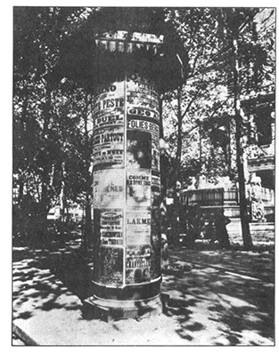
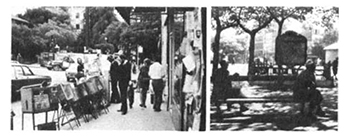
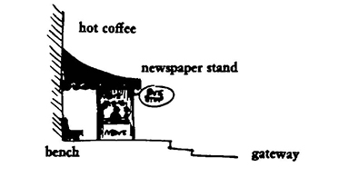

<section class="pattern-plate" aria-labelledby="t-bus-stop">
<a href="/patterns">A Pattern Language</a> · <a href="/patterns#towns">Towns</a> · Pattern 92 · p. 451 · *
<h1 class="pattern-title" id="t-bus-stop">Bus Stop</h1><figure class="pattern-figure pl-figure"></figure><nav class="pattern-links" aria-label="Connections"><h2>Links to</h2><ul><li><a href="/patterns/mini-buses">20 Mini-Buses</a></li><li><a href="/patterns/main-gateways">53 Main Gateways</a></li><li><a href="/patterns/public-outdoor-room">69 Public Outdoor Room</a></li><li><a href="/patterns/food-stands">93 Food Stands</a></li><li><a href="/patterns/path-shape">121 Path Shape</a></li><li><a href="/patterns/a-place-to-wait">150 A Place To Wait</a></li><li><a href="/patterns/seat-spots">241 Seat Spots</a></li></ul><h2>Linked from</h2><ul><li><a href="/patterns/mini-buses">20 Mini-Buses</a></li><li><a href="/patterns/interchange">34 Interchange</a></li><li><a href="/patterns/road-crossing">54 Road Crossing</a></li><li><a href="/patterns/childrens-home">86 Children’s Home</a></li><li><a href="/patterns/food-stands">93 Food Stands</a></li><li><a href="/patterns/activity-pockets">124 Activity Pockets</a></li></ul></nav></section><article class="pattern-text" aria-label="The text of Bus Stop">
452… within a town whose public transportation is based on <a class="pl-ref" href="/patterns/mini-buses">MINIBUSES (20)</a>, genuinely able to serve people, almost door to door, for a low price, and very fast, there need to be bus stops within a few hundred feet of every house and workplace. This pattern gives the form of the bus stops.

◆ ◆ ◆

<strong>Bus stops must be easy to recognize, and pleasant, with enough activity around them to make people comfortable and safe.</strong>

Bus stops are often dreary because they are set down independently, with very little thought given to the experience of waiting there, to the relationship between the bus stop and its surroundings. They are places to stand idly, perhaps anxiously, waiting for the bus, always watching for the bus. It is a shabby experience; nothing that would encourage people to use public transportation.

The secret lies in the web of relationships that are present in the tiny system around the bus stop. If they knit together, and reinforce each other, adding choice and shape to the experience, the system is a good one: but the relationships that make up such a system are extremely subtle. For example, a system as simple as a traffic light, a curb, and street corner can be enhanced by viewing it as a distinct node of public life: people wait for the light to change, their eyes wander, perhaps they are not in such a hurry. Place a newsstand and a flower wagon at the corner and the experience becomes more coherent.

The curb and the light, the paperstand and the flowers, the awning over the shop on the corner, the change in people’s pockets—all this forms a web of mutually sustaining relationships.

The possibilities for each bus stop to become part of such a web are different—in some cases it will be right to make a system that will draw people into a private reverie—an old tree; another time one that will do the opposite—give shape to the social possibilities—a coffee stand, a canvas roof, a decent place to sit for people who are not waiting for the bus.

453

<figure class="pl-figure"><figcaption><em>Two bus stops</em>.</figcaption></figure>

Therefore:

<strong>Build bus stops so that they form tiny centers of public life. Build them as part of the gateways into neighborhoods, work communities, parts of town. Locate them so that they work together with several other activities, at least a newsstand, maps, outdoor shelter, seats, and in various combinations, comer groceries, smoke shops, coffee bar, tree places, special road crossings, public bathrooms, squares….</strong>

<figure class="pl-figure"></figure>
◆ ◆ ◆

Make a full gateway to the neighborhood next to the bus stop, or place the bus stop where the best gateway is already—<a class="pl-ref" href="/patterns/main-gateways">MAIN GATEWAY (53)</a>; treat the physical arrangement according to the patterns for <a class="pl-ref" href="/patterns/public-outdoor-room">PUBLIC OUTDOOR ROOM (69)</a>, <a class="pl-ref" href="/patterns/path-shape">PATH SHAPE (121)</a>, and <a class="pl-ref" href="/patterns/a-place-to-wait">A PLACE TO WAIT (150)</a>; provide a <a class="pl-ref" href="/patterns/food-stands">FOOD STAND (93)</a>: place the seats according to sun, wind protection, and view—<a class="pl-ref" href="/patterns/seat-spots">SEAT SPOTS (241)</a>….
</article>

Christopher Alexander, Sara Ishikawa and Murray Silverstein, with Max Jacobson, Ingrid Fiksdahl-King and Shlomo Angel, <cite>A Pattern Language</cite> (Oxford University Press, 1977), pattern 92, pp. 451–453. Text and illustrations from the <a href="https://github.com/natureoforder/sources">Nature of Order sources</a> reading edition, transcribed from the 1977 printing; report errors on <a href="https://github.com/natureoforder/alexander-wiki/issues">GitHub</a>.

<a href="/patterns/travelers-inn">← 91 Traveler’s Inn</a> · <a href="/patterns">All 253 patterns</a> · <a href="/patterns/food-stands">93 Food Stands →</a>

