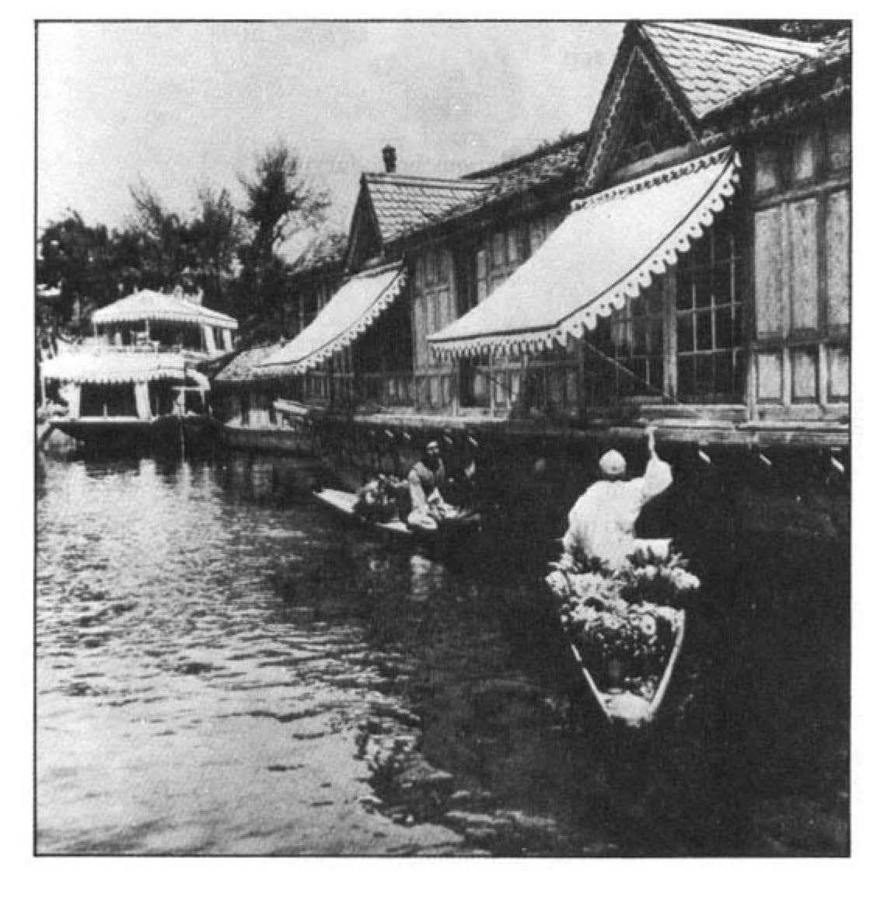
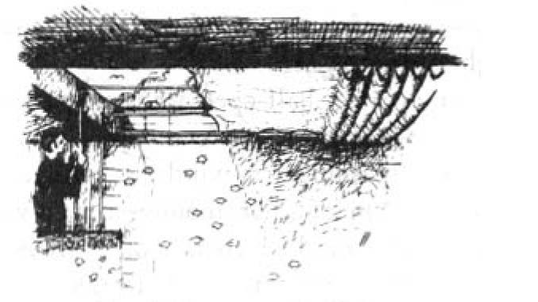
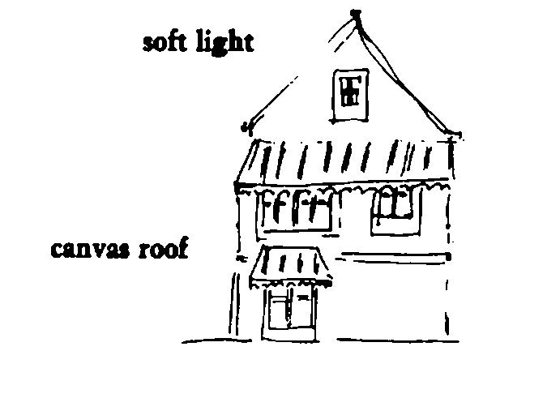

<section class="pattern-plate" aria-labelledby="t-canvas-roofs">
<a href="/patterns">A Pattern Language</a> · <a href="/patterns#construction">Construction</a> · Pattern 244 · p. 1128 · *
<h1 class="pattern-title" id="t-canvas-roofs">Canvas Roofs</h1><figure class="pattern-figure pl-figure"></figure><nav class="pattern-links" aria-label="Connections"><h2>Links to</h2><ul><li><a href="/patterns/small-parking-lots">103 Small Parking Lots</a></li><li><a href="/patterns/roof-garden">118 Roof Garden</a></li><li><a href="/patterns/arcades">119 Arcades</a></li><li><a href="/patterns/private-terrace-on-the-street">140 Private Terrace On The Street</a></li><li><a href="/patterns/outdoor-room">163 Outdoor Room</a></li><li><a href="/patterns/trellised-walk">174 Trellised Walk</a></li><li><a href="/patterns/window-place">180 Window Place</a></li><li><a href="/patterns/filtered-light">238 Filtered Light</a></li><li><a href="/patterns/ornament">249 Ornament</a></li><li><a href="/patterns/warm-colors">250 Warm Colors</a></li></ul><h2>Linked from</h2><ul><li><a href="/patterns/shopping-street">32 Shopping Street</a></li><li><a href="/patterns/road-crossing">54 Road Crossing</a></li><li><a href="/patterns/carnival">58 Carnival</a></li><li><a href="/patterns/street-cafe">88 Street Cafe</a></li><li><a href="/patterns/food-stands">93 Food Stands</a></li><li><a href="/patterns/shielded-parking">97 Shielded Parking</a></li><li><a href="/patterns/roof-garden">118 Roof Garden</a></li><li><a href="/patterns/sunny-place">161 Sunny Place</a></li><li><a href="/patterns/outdoor-room">163 Outdoor Room</a></li><li><a href="/patterns/filtered-light">238 Filtered Light</a></li><li><a href="/patterns/half-inch-trim">240 Half-Inch Trim</a></li><li><a href="/patterns/warm-colors">250 Warm Colors</a></li></ul></nav></section><article class="pattern-text" aria-label="The text of Canvas Roofs">
1129… around every building there are <a class="pl-ref" href="/patterns/roof-garden">ROOF GARDENS (118)</a>, <a class="pl-ref" href="/patterns/arcades">ARCADES (119)</a>, <a class="pl-ref" href="/patterns/private-terrace-on-the-street">PRIVATE TERRACES ON THE STREET (140)</a>, <a class="pl-ref" href="/patterns/outdoor-room">OUTDOOR ROOMS (163)</a>, GALLERY SURROUNDS (l66), <a class="pl-ref" href="/patterns/trellised-walk">TRELLISED WALKS (174)</a>, and <a class="pl-ref" href="/patterns/window-place">WINDOW PLACES (180)</a>, even <a class="pl-ref" href="/patterns/small-parking-lots">SMALL PARKING LOTS (103)</a>, which all become more subtle and more beautiful with canvas roofs and awnings. And the awnings always help to create <a class="pl-ref" href="/patterns/filtered-light">FILTERED LIGHT (238)</a>.

◆ ◆ ◆

<strong>There is a very special beauty about tents and canvas awnings. The canvas has a softness, a suppleness, which is in harmony with wind and light and sun. A house or any building built with some canvas will touch all the elements more nearly than it can when it is made only with hard conventional materials.</strong>

In conventional building, it is easy to think that walls and roofs must either be solid, or missing altogether. But cloth and canvas lie just exactly halfway in between. They are translucent, let a little breeze pass through, and they are very cheap, and easy to roll up and easy to pull down.

We can identify three kinds of places that need these properties:

1 Awnings—sunshades over windows, retractable, and used to filter very bright hot sunlight.

2 Curtains—moveable, half-open walls on outdoor rooms, balconies, and galleries—places that are occupied mainly during the day, but might benefit from extra wind protection.

3 Tent-like roofs on outdoor rooms—a tent which can hold off a drizzle and make outdoor rooms, or trellises, or courtyards habitable in the spring and autumn and at night.

Here is Frank Lloyd Wright describing his use of the canvas roof in the very early structures at Taliesin West:

… the Taliesin Fellowship (is a) desert camp on a great Arizona mesa which the boys, together with myself, are now building to work and live in during the winter-time. Many of the building units have canvas tops carried by red-wood framing resting on massive 1130stone walls made by placing the flat desert stones into wood boxes and throwing in stones and concrete behind them. Most of the canvas frames may be opened or kept closed…. The canvas overhead being translucent, there is a very beautiful light to live and work in; I have experienced nothing like it elsewhere except in Japan somewhat, in their houses with sliding paper walls or “shoji.” (<em>The Future of Architecture</em>, London: The Architectural Press, 1955, pp. 255–56.)

Another example: In Italy, the canvas awning is used quite commonly as a simple awning over south and west windows. The canvas is often a bright and beautiful orange, giving color to the street and a warm glow to the interior rooms.

As a final example, we report on our own use of this pattern in the housing project in Lima. We roofed interior patios with movable canvas material. In hot weather the covers are rolled back, and a breeze blows through the house. In cold weather, the canvas is rolled out, sealing the house, and the patio is still useful. In Lima, there is a winter dew which normally makes patio floors damp and cold for eight months in the year. The cover on the patios keeps them dry and warm and triples their useful life. They eliminate the need for glass windows almost entirely. The windows which look into patios give light to rooms and may be curtained for visual control—but since the cold and damp are kept out by the patio canvas there need be no glass in the windows and no expensive moving parts.

<figure class="pl-figure"><figcaption><em>Our patio covers in Peru</em>.</figcaption></figure>

Therefore:

<strong>Build canvas roofs and walls and awnings wherever there are spaces which need softer light or partial shade in summer, 1131or partial protection from mist and dew in autumn and winter. Build them to fold away, with ropes or wires to pull them, so that they can easily be opened.</strong>

<figure class="pl-figure"></figure>
◆ ◆ ◆

Use the canvas awnings, especially, to filter light over those windows which face west and south and glare because they face the sky—<a class="pl-ref" href="/patterns/filtered-light">FILTERED LIGHT (238)</a>. Colored canvas will add special life—<a class="pl-ref" href="/patterns/ornament">ORNAMENT (249)</a>, <a class="pl-ref" href="/patterns/warm-colors">WARM COLORS (250)</a>….
</article>

Christopher Alexander, Sara Ishikawa and Murray Silverstein, with Max Jacobson, Ingrid Fiksdahl-King and Shlomo Angel, <cite>A Pattern Language</cite> (Oxford University Press, 1977), pattern 244, pp. 1128–1131. Text and illustrations from the <a href="https://github.com/natureoforder/sources">Nature of Order sources</a> reading edition, transcribed from the 1977 printing; report errors on <a href="https://github.com/natureoforder/alexander-wiki/issues">GitHub</a>.

<a href="/patterns/sitting-wall">← 243 Sitting Wall</a> · <a href="/patterns">All 253 patterns</a> · <a href="/patterns/raised-flowers">245 Raised Flowers →</a>

