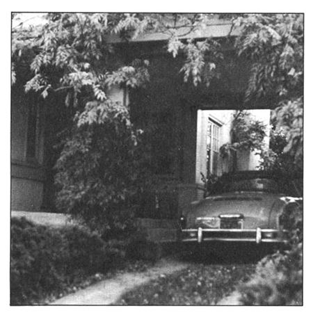
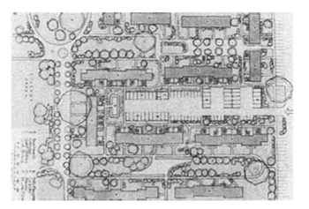
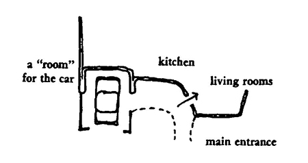

<section class="pattern-plate" aria-labelledby="t-car-connection">
<a href="/patterns">A Pattern Language</a> · <a href="/patterns#buildings">Buildings</a> · Pattern 113 · p. 553
<h1 class="pattern-title" id="t-car-connection">Car Connection</h1><figure class="pattern-figure pl-figure"></figure><nav class="pattern-links" aria-label="Connections"><h2>Links to</h2><ul><li><a href="/patterns/main-entrance">110 Main Entrance</a></li><li><a href="/patterns/entrance-transition">112 Entrance Transition</a></li><li><a href="/patterns/arcades">119 Arcades</a></li><li><a href="/patterns/intimacy-gradient">127 Intimacy Gradient</a></li><li><a href="/patterns/common-areas-at-the-heart">129 Common Areas At The Heart</a></li><li><a href="/patterns/north-face">162 North Face</a></li><li><a href="/patterns/outdoor-room">163 Outdoor Room</a></li><li><a href="/patterns/structure-follows-social-spaces">205 Structure Follows Social Spaces</a></li><li><a href="/patterns/raised-flowers">245 Raised Flowers</a></li></ul><h2>Linked from</h2><ul><li><a href="/patterns/looped-local-roads">49 Looped Local Roads</a></li><li><a href="/patterns/long-thin-house">109 Long Thin House</a></li><li><a href="/patterns/main-entrance">110 Main Entrance</a></li><li><a href="/patterns/entrance-room">130 Entrance Room</a></li><li><a href="/patterns/north-face">162 North Face</a></li></ul></nav></section><article class="pattern-text" aria-label="The text of Car Connection">
554… once you have the entrance of the building fixed and its transition clear—;<a class="pl-ref" href="/patterns/main-entrance">MAIN ENTRANCE (110)</a>, <a class="pl-ref" href="/patterns/entrance-transition">ENTRANCE TRANSITION (112)</a>—it is necessary to work out how a person can approach the building by car. Of course, in a pedestrian precinct this will not apply; but generally the car itself must have a housing somewhere near the building; and when this is so, its place and character are critical.

◆ ◆ ◆

<strong>The process of arriving in a house, and leaving it, is fundamental to our daily lives; and very often it involves a car. But the place where cars connect to houses, far from being important and beautiful, is often off to one side and neglected.</strong>

This neglect can wreck havoc with the circulation in the house, especially in those houses with the traditional “front door and back door” relationship. Both family and visitors tend, more and more, to come and go by car. Since people always try to use the door nearest the car (see Vere Hole, et al., “Studies of 800 Houses in Conventional and Radbum Layouts,” Building Research Station, Garston, Herts, England, 1966), the entrance nearest the parking spot always becomes the “main” entrance, even if it was not planned that way.

<figure class="pl-figure"><figcaption><em>The car entrance becomes the main entrance—regardless of the plan</em>.</figcaption></figure>

555If this entrance is a “back” door, then the back of the house becomes less a sanctuary for the family and perhaps the housewife feels uncomfortable about guests traipsing through. On the other hand, if this entrance is a formal “front” door, it is not really appropriate for family and good friends. In Radburn, the back doors face the parking lot, and the front doors face a pedestrian green. For families with can, the back door, being on the car side, dominates exit and entry, yet visitors are “supposed” to come to the front door.

In order to ensure that both the kitchen and formal living room are conveniently located with respect to can and that each space maintains its integrity in terms of use and privacy, there must be one and only one primary entrance into the house, and the kitchen and living room must be both directly accessible from this entrance. We do not mean that a house needs to have only one entrance. There is no reason why a house cannot have several entrances—indeed there are good reasons why it probably should have more than one. Secondary entrances, like patio and garden doors and teenager’s private entrances, are very important. But they should never be placed so that they are in between the main entrance and the natural place to arrive by car—otherwise, they will compete with the main entrance and, again, confuse the way the house plan works.

Finally, it is essential to make something of the space which connects the house and the car, to make it a positive space—a space which supports the experience of coming and going. Essentially this means making a room out of the place for the car, the path from the car door to the house, and the front door. It may be achieved with columns, low walls, the edge of the house, plants, a trellised walk, a place to sit. This is the place we call the car connection (i 13). A proper car connection is a place where people can walk together, lean, say goodbye; perhaps it is integrated with the structure and form of the house.

An ancient inn, built in the days of coach and horses, has a layout which treats the coach as a fundamental part of the environment and makes the connection between the two a significant part of the inn—so much so that it gives the inn its character. Airports, boathouses, stables, railway stations, all do the same. But for some reason, even though the car is so important to the 556way of life in a modern house, the place where car and house meet is almost never treated seriously as a beautiful and significant place in its own right.

Therefore:

<strong>Place the parking place for the car and the main entrance, in such a relation to each other, that the shortest route from the parked car into the house, both to the kitchen and to the living rooms, is always through the main entrance. Make the parking place for the car into an actual room which makes a positive and graceful place where the car stands, not just a gap in the terrain.</strong>

<figure class="pl-figure"></figure>
◆ ◆ ◆

Place both kitchen and main common living room just inside the main entrance—<a class="pl-ref" href="/patterns/intimacy-gradient">INTIMACY GRADIENT (127)</a>, <a class="pl-ref" href="/patterns/common-areas-at-the-heart">COMMON AREAS AT THE HEART (129)</a>; treat the place for the car as if it were an actual outdoor room—<a class="pl-ref" href="/patterns/outdoor-room">OUTDOOR ROOM (163)</a>. If it is enclosed, build the enclosure according to <a class="pl-ref" href="/patterns/structure-follows-social-spaces">STRUCTURE FOLLOWS SOCIAL SPACES (205)</a>; and make the path between this room and the front door a beautiful path, preferably the same as the one used by people who come on foot—<a class="pl-ref" href="/patterns/entrance-transition">ENTRANCE TRANSITION (112)</a>, <a class="pl-ref" href="/patterns/arcades">ARCADES (119)</a>, PATHS AND GOALS (L20), <a class="pl-ref" href="/patterns/raised-flowers">RAISED FLOWERS (245)</a>. If you can, put the car connection on the north face of the building—<a class="pl-ref" href="/patterns/north-face">NORTH FACE (162)</a>….
</article>

Christopher Alexander, Sara Ishikawa and Murray Silverstein, with Max Jacobson, Ingrid Fiksdahl-King and Shlomo Angel, <cite>A Pattern Language</cite> (Oxford University Press, 1977), pattern 113, pp. 553–556. Text and illustrations from the <a href="https://github.com/natureoforder/sources">Nature of Order sources</a> reading edition, transcribed from the 1977 printing; report errors on <a href="https://github.com/natureoforder/alexander-wiki/issues">GitHub</a>.

<a href="/patterns/entrance-transition">← 112 Entrance Transition</a> · <a href="/patterns">All 253 patterns</a> · <a href="/patterns/hierarchy-of-open-space">114 Hierarchy Of Open Space →</a>

