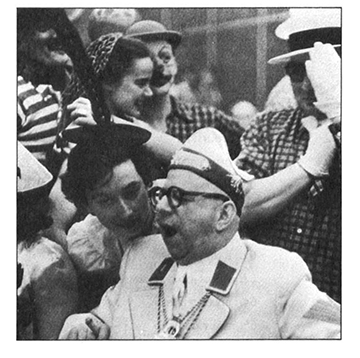
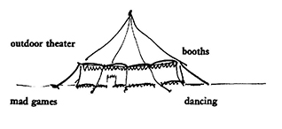

<section class="pattern-plate" aria-labelledby="t-carnival">
<a href="/patterns">A Pattern Language</a> · <a href="/patterns#towns">Towns</a> · Pattern 58 · p. 298
<h1 class="pattern-title" id="t-carnival">Carnival</h1><figure class="pattern-figure pl-figure"></figure><nav class="pattern-links" aria-label="Connections"><h2>Links to</h2><ul><li><a href="/patterns/night-life">33 Night Life</a></li><li><a href="/patterns/dancing-in-the-street">63 Dancing In The Street</a></li><li><a href="/patterns/public-outdoor-room">69 Public Outdoor Room</a></li><li><a href="/patterns/food-stands">93 Food Stands</a></li><li><a href="/patterns/pedestrian-street">100 Pedestrian Street</a></li><li><a href="/patterns/canvas-roofs">244 Canvas Roofs</a></li></ul><h2>Linked from</h2><ul><li><a href="/patterns/magic-of-the-city">10 Magic Of The City</a></li><li><a href="/patterns/promenade">31 Promenade</a></li><li><a href="/patterns/night-life">33 Night Life</a></li><li><a href="/patterns/children-in-the-city">57 Children In The City</a></li><li><a href="/patterns/dancing-in-the-street">63 Dancing In The Street</a></li></ul></nav></section><article class="pattern-text" aria-label="The text of Carnival">
299… once in a while, in a subculture which is particularly open to it, a promenade may break into a wilder rhythm—promenade (31), <a class="pl-ref" href="/patterns/night-life">night life (33)</a>—and perhaps every promenade may have a touch of this.

◆ ◆ ◆

<strong>Just as an individual person dreams fantastic happenings to release the inner forces which cannot be encompassed by ordinary events, so too a city needs its dreams.</strong>

Under normal circumstances, in today’s world the entertainments which are available are either healthy and harmless—going to the movies, watching TV, cycling, playing tennis, taking helicopter rides, going for walks, watching football—or downright sick and socially destructive—shooting heroin, driving recklessly, group violence.

But man has a great need for mad, subconscious processes to come into play, without unleashing them to such an extent that they become socially destructive. There is, in short, a need for socially sanctioned activities which are the social, outward equivalents of dreaming.

In primitive societies this kind of process was provided by the rites, witch doctors, shamans. In Western civilization during the last three or four hundred years, the closest available source of this outward acknowledgment of underground life has been the circus, fairs, and carnivals. In the middle ages, the market place itself had a good deal of this kind of atmosphere.

Today, on the whole, this kind of experience is gone. The circuses and the carnivals are drying up. But the need persists. In the Bay Area, the annual Renaissance Fair goes a little way to meet the need—but it is much too bland. We imagine something more along the following lines: street theater, clowns, mad games in the streets and squares and houses; during certain weeks, people may live in the carnival; simple food and shelter are free; day and night people mixing; actors who mingle with the crowd and involve you, willy nilly, in processes whose end cannot be 300foreseen; fighting—two men with bags on a slippery log, in front of hundreds; Fellini—clowns, death, crazy people, brought into mesh.

Remember the hunchbacked dwarf in <em>Shif of Fools</em>, the only reasonable person on the ship, who says “Everyone has a problem; but I have the good fortune to wear mine on my back, where everyone can see it.”

Therefore:

<strong>Set aside some part of the town as a carnival—mad sideshows, tournaments, acts, displays, competitions, dancing, music, street theater, clowns, transvestites, freak events, which allow people to reveal their madness; weave a wide pedestrian street through this area; run booths along the street, narrow alleys; at one end an outdoor theater; perhaps connect the theater stage directly to the carnival street, so the two spill into and feed one another.</strong>

<figure class="pl-figure"></figure>
◆ ◆ ◆

Dancing in the street, food stands, an outdoor room or two, a square where the theater is, and tents and canvas will all help to make it even livelier—small public squares (61), <a class="pl-ref" href="/patterns/dancing-in-the-street">dancing in the street (63)</a>, <a class="pl-ref" href="/patterns/public-outdoor-room">PUBLIC OUTDOOR ROOM (69)</a>, <a class="pl-ref" href="/patterns/food-stands">FOOD STANDS (93)</a>, <a class="pl-ref" href="/patterns/pedestrian-street">PEDESTRIAN STREET (100)</a>, <a class="pl-ref" href="/patterns/canvas-roofs">CANVAS ROOFS (244)</a>….
</article>

Christopher Alexander, Sara Ishikawa and Murray Silverstein, with Max Jacobson, Ingrid Fiksdahl-King and Shlomo Angel, <cite>A Pattern Language</cite> (Oxford University Press, 1977), pattern 58, pp. 298–300. Text and illustrations from the <a href="https://github.com/natureoforder/sources">Nature of Order sources</a> reading edition, transcribed from the 1977 printing; report errors on <a href="https://github.com/natureoforder/alexander-wiki/issues">GitHub</a>.

<a href="/patterns/children-in-the-city">← 57 Children In The City</a> · <a href="/patterns">All 253 patterns</a> · <a href="/patterns/quiet-backs">59 Quiet Backs →</a>

