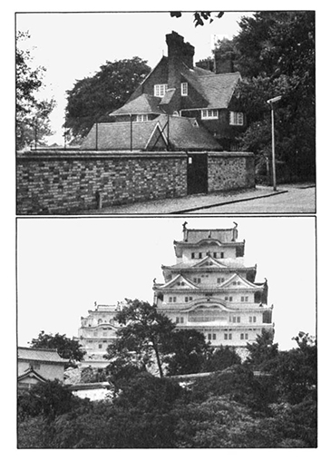
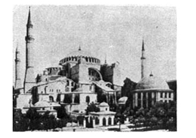
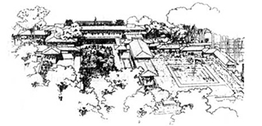
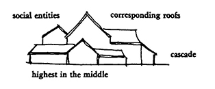

<section class="pattern-plate" aria-labelledby="t-cascade-of-roofs">
<a href="/patterns">A Pattern Language</a> · <a href="/patterns#buildings">Buildings</a> · Pattern 116 · p. 565 · *
<h1 class="pattern-title" id="t-cascade-of-roofs">Cascade Of Roofs</h1><figure class="pattern-figure pl-figure"></figure><nav class="pattern-links" aria-label="Connections"><h2>Links to</h2><ul><li><a href="/patterns/building-complex">95 Building Complex</a></li><li><a href="/patterns/number-of-stories">96 Number Of Stories</a></li><li><a href="/patterns/main-building">99 Main Building</a></li><li><a href="/patterns/wings-of-light">107 Wings Of Light</a></li><li><a href="/patterns/sheltering-roof">117 Sheltering Roof</a></li><li><a href="/patterns/roof-garden">118 Roof Garden</a></li><li><a href="/patterns/ceiling-height-variety">190 Ceiling Height Variety</a></li><li><a href="/patterns/structure-follows-social-spaces">205 Structure Follows Social Spaces</a></li><li><a href="/patterns/roof-layout">209 Roof Layout</a></li></ul><h2>Linked from</h2><ul><li><a href="/patterns/number-of-stories">96 Number Of Stories</a></li><li><a href="/patterns/main-building">99 Main Building</a></li><li><a href="/patterns/wings-of-light">107 Wings Of Light</a></li><li><a href="/patterns/long-thin-house">109 Long Thin House</a></li><li><a href="/patterns/sheltering-roof">117 Sheltering Roof</a></li><li><a href="/patterns/roof-garden">118 Roof Garden</a></li><li><a href="/patterns/arcades">119 Arcades</a></li><li><a href="/patterns/common-areas-at-the-heart">129 Common Areas At The Heart</a></li><li><a href="/patterns/light-on-two-sides-of-every-room">159 Light On Two Sides Of Every Room</a></li><li><a href="/patterns/roof-layout">209 Roof Layout</a></li><li><a href="/patterns/thickening-the-outer-walls">211 Thickening The Outer Walls</a></li></ul></nav></section><article class="pattern-text" aria-label="The text of Cascade Of Roofs">
566… this pattern helps complete the <a class="pl-ref" href="/patterns/building-complex">BUILDING COMPLEX (95)</a>, <a class="pl-ref" href="/patterns/number-of-stories">NUMBER OF STORIES (96)</a>, <a class="pl-ref" href="/patterns/main-building">MAIN BUILDING (99)</a>, and <a class="pl-ref" href="/patterns/wings-of-light">WINGS OF LIGHT (107)</a>, and it can also be used to help create these patterns. If you are designing a building from scratch, these larger patterns have already helped you to decide how high your buildings are; and they have given you a rough layout, in wings, with an idea of what spaces there are going to be in each floor of the wings. Now we come to the stage where it is necessary to visualize the building as a volume and, therefore, above all else, as a system of roofs.

◆ ◆ ◆

<strong>Few buildings will be structurally and socially intact, unless the floors step down toward the ends of wings, and unless the roof, accordingly, forms a cascade.</strong>

This is a strange pattern. Several problems, from entirely different spheres, point in the same direction; but there is no obvious common bond which binds these different problems to one another—we have not succeeded in seizing the single kernel which forms the pivot of the pattern.

Let us observe, first, that many beautiful buildings have the form of a cascade: a tumbling arrangement of wings and lower wings and smaller rooms and sheds, often with a single highest center. Hagia Sophia, the Norwegian stave churches, and Palladio’s villas are imposing and magnificent examples. Simple houses, small informal building complexes, and even clusters of mud huts are more modest ones.

<figure class="pl-figure"><figcaption><em>Hagia Sophia</em></figcaption></figure>

567What is it that makes the cascading character of these buildings so sound and so appropriate?

First of all, there is a social meaning in this form. The largest gathering places with the highest ceilings are in the middle because they are the social centers of activities; smaller groups of people, individual rooms, and alcoves fall naturally around the edges.

Second, there is a structural meaning in the form. Buildings tend to be of materials that are strong in compression; compressive strength is cheaper then tensile strength or strength in bending. Any building which stands in pure compression will tend toward the overall outline of an inverted catenary—roof layout (209). When a building does take this form, each outlying space acts to buttress the higher spaces. The building is stable in just the same way that a pile of earth, which has assumed the line of least resistance, is also stable.

And third, there is a practical consideration. We shall explain that <a class="pl-ref" href="/patterns/roof-garden">ROOF GARDENS (118)</a>, wherever they occur, should not be over the top floor, but always on the same level as the rooms they serve. This means, naturally, that the building tends to get lower toward the edges since the roof gardens step down from the top toward the outer edge of the ground floor.

Why do these three apparently different problems lead to the same pattern? We don’t know. But we suspect that there is some deeper essence behind the apparent coincidence. We leave the pattern intact in the hope that someone else will understand its meaning.

<figure class="pl-figure"><figcaption><em>A sketch of Frank Lloyd Wright’s</em>.</figcaption></figure>

568Finally, a note on the application of the pattern. One must take care, in laying out large buildings, to make the cascade compatible with <a class="pl-ref" href="/patterns/wings-of-light">WINGS OF LIGHT (107)</a>. If you conceive of the cascade as pyramidal and the building is large, the middle section of the building will be cut off from daylight. Instead, the proper synthesis of cascades and wings of light will generate a building that tumbles down along relatively narrow wings, the wings turning corners and becoming lower where they will.

Therefore:

<strong>Visualize the whole building, or building complex, as a system of roofs.</strong>

<strong>Place the largest, highest, and widest roofs over those parts of the building which are most significant: when you come to lay the roofs out in detail, you will be able to make all lesser roofs cascade off these large roofs and form a stable self-buttressing system, which is congruent with the hierarchy of social spaces underneath the roofs.</strong>

<figure class="pl-figure"></figure>
◆ ◆ ◆

Make the roofs a combination of steeply pitched or domed, and flat shapes—<a class="pl-ref" href="/patterns/sheltering-roof">SHELTERING ROOF (117)</a>, <a class="pl-ref" href="/patterns/roof-garden">ROOF GARDEN (118)</a>. Prepare to place small rooms at the outside and ends of wings, and large rooms in the middle—<a class="pl-ref" href="/patterns/ceiling-height-variety">CEILING HEIGHT VARIETY (190)</a>. Later, once the plan of the building is more exactly defined, you can lay out the roofs exactly to fit the cascade to individual rooms; and at that stage the cascade will begin to have a structural effect of great importance—<a class="pl-ref" href="/patterns/structure-follows-social-spaces">STRUCTURE FOLLOWS SOCIAL SPACES (205)</a>, <a class="pl-ref" href="/patterns/roof-layout">ROOF LAYOUT (209)</a>….
</article>

Christopher Alexander, Sara Ishikawa and Murray Silverstein, with Max Jacobson, Ingrid Fiksdahl-King and Shlomo Angel, <cite>A Pattern Language</cite> (Oxford University Press, 1977), pattern 116, pp. 565–568. Text and illustrations from the <a href="https://github.com/natureoforder/sources">Nature of Order sources</a> reading edition, transcribed from the 1977 printing; report errors on <a href="https://github.com/natureoforder/alexander-wiki/issues">GitHub</a>.

<a href="/patterns/courtyards-which-live">← 115 Courtyards Which Live</a> · <a href="/patterns">All 253 patterns</a> · <a href="/patterns/sheltering-roof">117 Sheltering Roof →</a>

