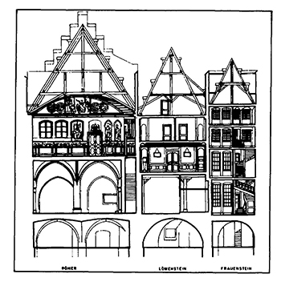
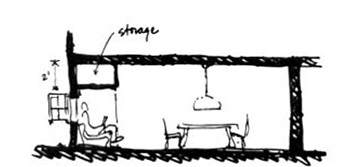
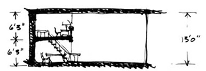
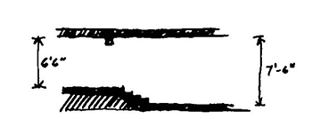
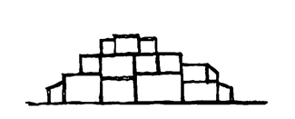

<section class="pattern-plate" aria-labelledby="t-ceiling-height-variety">
<a href="/patterns">A Pattern Language</a> · <a href="/patterns#buildings">Buildings</a> · Pattern 190 · p. 876 · **
<h1 class="pattern-title" id="t-ceiling-height-variety">Ceiling Height Variety</h1><figure class="pattern-figure pl-figure"></figure><nav class="pattern-links" aria-label="Connections"><h2>Links to</h2><ul><li><a href="/patterns/bulk-storage">145 Bulk Storage</a></li><li><a href="/patterns/structure-follows-social-spaces">205 Structure Follows Social Spaces</a></li><li><a href="/patterns/final-column-distribution">213 Final Column Distribution</a></li><li><a href="/patterns/floor-ceiling-vaults">219 Floor-Ceiling Vaults</a></li></ul><h2>Linked from</h2><ul><li><a href="/patterns/beer-hall">90 Beer Hall</a></li><li><a href="/patterns/building-thoroughfare">101 Building Thoroughfare</a></li><li><a href="/patterns/cascade-of-roofs">116 Cascade Of Roofs</a></li><li><a href="/patterns/arcades">119 Arcades</a></li><li><a href="/patterns/flexible-office-space">146 Flexible Office Space</a></li><li><a href="/patterns/alcoves">179 Alcoves</a></li><li><a href="/patterns/marriage-bed">187 Marriage Bed</a></li><li><a href="/patterns/bed-alcove">188 Bed Alcove</a></li><li><a href="/patterns/dressing-rooms">189 Dressing Rooms</a></li><li><a href="/patterns/the-shape-of-indoor-space">191 The Shape Of Indoor Space</a></li><li><a href="/patterns/windows-overlooking-life">192 Windows Overlooking Life</a></li><li><a href="/patterns/thick-walls">197 Thick Walls</a></li><li><a href="/patterns/secret-place">204 Secret Place</a></li><li><a href="/patterns/efficient-structure">206 Efficient Structure</a></li><li><a href="/patterns/roof-layout">209 Roof Layout</a></li><li><a href="/patterns/floor-and-ceiling-layout">210 Floor And Ceiling Layout</a></li><li><a href="/patterns/final-column-distribution">213 Final Column Distribution</a></li><li><a href="/patterns/floor-ceiling-vaults">219 Floor-Ceiling Vaults</a></li></ul></nav></section><article class="pattern-text" aria-label="The text of Ceiling Height Variety">
877… this pattern helps to form the rooms. It therefore helps to complete all the patterns which define rooms, or arcades, or balconies, or outdoor rooms or minor rooms: in short, just about all of the last ioo patterns. If you hare been imagining these spaces while you walk about on the actual site, then all these spaces will already be three-dimensional in your mind: they will be volumes of space, not merely areas on plan. Now, with this pattern, which determines ceiling heights, the next pattern which determines the exact shape of each room, and the remaining patterns in the language, we fill out this three dimensional conception of the building.

◆ ◆ ◆

<strong>A building in which the ceiling heights are all the same is virtually incapable of making people comfortable.</strong>

In some fashion, low ceilings make for intimacy, high ceilings for formality. In older buildings which allowed the ceiling heights to vary, this was almost taken for granted. However, in buildings which are governed by standard components, it is very hard to make the ceiling height vary from room to room, so it tends to be forgotten. And people are willing to let it go, because they have forgotten what an important psychological reason there is for making the heights vary.

We have presented three different theories over the years in our attempts to explain the significance of ceiling height variety, and we shall present the evolution of all three theories here, because it puts the matter in perspective and will perhaps allow you to formulate the pattern most coherently for yourself.

<em>Theory one</em>. The ceiling height should be related to the length and breadth of the room, because the problem is one of proportion, and people feel comfortable or uncomfortable according to the room’s proportions.

Many efforts have been made to establish rules which will make sure that rooms are “well proportioned.” Thus, for instance, Palladio laid down three rules of proportion: all of them shared 878the feature that the height of a room should be intermediate between its length and its breadth.

In traditional Japanese architecture, this idea is captured by a simple rule of thumb. The ceiling height of a room is 6 feet 3 inches +(3.7 X the number of tatami in the room) inches. This creates a direct relationship between floor area and ceiling height. A very small room (3 mats) has a ceiling height of 7 feet 2 inches. A large room (12 mats) has a ceiling height of 9 feet 11 inches. (See Heinrich Engle, <em>The Japanese House</em>, Rutland Vermont: Charles E. Tuttle Company, 1964, pp. 68–71.)

However sound this approach may seem in certain cases, it is clearly not a completely valid geometric principle. There are many rooms with extremely low ceilings, especially in cottages and informal houses, which are extremely pleasant—even though they violate Palladio’s principle and the Japanese rule of thumb utterly.

<em>Theory two</em>. The ceiling height is related to the <em>social distance</em> between people in the room, and is therefore directly related to their relative intimacy or nonintimacy.

This theory makes it clear what is wrong with badly proportioned rooms, and gives the beginning of a functional basis for establishing the right height for different spaces. The problem hinges on the question of appropriate social distance. It is known that in various kinds of social situations there are appropriate and inappropriate distances between people. (See Edward Hall, <em>The Silent Language</em>, New York: Doubleday, 1959, pp. 163–64; and Robert Sommer, “The Distance for Comfortable Conversation,” <em>Sociometry</em>, 25, 1962, pp. 111–16.) Now, the ceiling height in a room has a bearing on social distance in two ways:

A. The height of a ceiling appears to affect the <em>apparent distance</em> of sound sources from a hearer. Thus, under a low ceiling sound sources seem nearer than they really are; under a high ceiling they seem further than they really are.

Since the sound is an important cue in the perception of distance between people (voice, footstep, rustle, and so on), this means that the ceiling height will alter the apparent distance between people. Under a high ceiling people seem further apart than they actually are.

879On the basis of this effect, it is clear that intimate situations require very low ceilings, less intimate situations require higher ceilings, formal places require high ceilings, and the most public situations require the highest ceilings: for example, the canopy over the double bed, a fireside nook, high-ceilinged formal reception room, Grand Central Station.

B. Through the medium of three-dimensional “bubbles”. We know that each social situation has a certain horizontal dimension or diameter. We may think of this as a kind of membrane or bubble which encloses the situation. It is likely that this bubble needs a vertical component—equal in height to its diameter. If so, the height of the ceiling should, for comfort, be equal to the dominant social distance in the room. Since people in Grand Central are strangers, and have an effective social distance of as much as 100 feet, this would explain why the ceiling has to be very high; similarly, in an intimate nook, or over a double bed, where the social distance is no more than five or six feet, the ceiling has to be very low.

<em>Theory three</em>. Although both of the previous theories contain valuable insights, they must be at least slightly wrong because they assume that the absolute ceiling height in any one room has a critical functional effect. In fact, the <em>absolute</em> ceiling height does not matter as much as one would expect from theories one and two.

For example, the most intimate room in an igloo may be no more than five feet high; yet in a very hot climate even the most intimate rooms may be nine feet high. This makes it clear that the absolute height of rooms is governed by other factors too—climate and culture. Obviously, then, no theory which prescribes an absolute height for any given social situation, or room size, can be correct. What then, is going on? Why do ceiling heights vary? What functional effect does their variation have?

We have been led, finally, to the conclusion that it is the <em>variation itself</em> which matters, not merely the absolute height in any given room. For if a building contains rooms with several different ceiling heights in it and the height has an effect on social relationships (for the reasons given), then the mere fact that the ceiling heights vary, allows people to move from high 880rooms to low rooms, and vice versa, according to the degree of intimacy they seek—because they know that everyone correlates intimacy with ceiling height.

According to this theory, the effect of the ceiling height is not direct; there is instead a complex interaction between people and space, in which people read the different ceiling heights in a building as messages, and take up positions according to these messages. They are comfortable or uncomfortable according to whether they can take part in this process, and can then feel secure in the knowledge that they have chosen a place of appropriate intimacy.

Finally, some special notes are required on the implementation of this pattern. In a one story structure there is no problem; the ceiling heights may vary freely. In buildings with several stories however, it is not so clear cut. The floors of the upper stories must be more or less flat; and this obviously creates problems as you try to vary the ceiling heights underneath. Here are some notes which may help you to solve this problem:

1. Build storage between floors and ceilings—at least two feet deep—where you want to lower ceiling heights.

<figure class="pl-figure"><figcaption><em>Storage over a lovi ceiling</em>.</figcaption></figure>

2. Put two alcoves over each other. If each is 6 feet 3 inches, this gives a main ceiling of 13 feet, which is good for very public spaces.

<figure class="pl-figure"><figcaption><em>Stacked alcoves</em>.</figcaption></figure>

881

<ol start="3" type="1">
<li>Raise the floor level with steps, instead of lowering the ceiling.</li>
</ol>
<figure class="pl-figure"><figcaption><em>The floor does it</em>.</figcaption></figure>

4. It is very important to have some rooms with ceilings as low as 7 feet or 7 feet 6 inches—these are very beautiful.

5. Except in one-story buildings, the low ceilinged rooms will make most sense on upper stories; indeed, the average ceiling height will probably get lower and lower with successive stories—the most public rooms, for the largest gatherings, are typically on the ground, and rooms get progressively more intimate the further they are from the ground.

<figure class="pl-figure"><figcaption><em>Lower ceilings upstairs</em>.</figcaption></figure>

Therefore:

<strong>Vary the ceiling heights continuously throughout the building, especially between rooms which open into each other, so that the relative intimacy of different spaces can be felt. In particular, make ceilings high in rooms which are public or meant for large gatherings (10 to 12 feet), lower in rooms for smaller gatherings (7 to 9 feet), and very low in rooms or alcoves for one or two people (6 to 7 feet).</strong>

882

<figure class="pl-figure"><figcaption><em>complete range of ceiling heights</em></figcaption></figure>

◆ ◆ ◆

The construction of floor vaults will create variations in ceiling height almost automatically since the vault starts about 6 feet 6 inches high and rises a further distance which is one-fifth of the room diameter—<a class="pl-ref" href="/patterns/floor-ceiling-vaults">FLOOR-CEILING VAULTS (219)</a>. Where ceiling height varies within one story, put storage in the spaces between the different heights—<a class="pl-ref" href="/patterns/bulk-storage">BULK STORACE (145)</a>. Get the shape of individual rooms under any given ceiling height from THE SHAPE OF INDOOR SPACE (l9l) and <a class="pl-ref" href="/patterns/structure-follows-social-spaces">STRUCTURE FOLLOWS SOCIAL SPACES (205)</a>; and vary ceiling heights from story to story—the highest ceilings on the ground floor and the lowest on the top floor—see the table in <a class="pl-ref" href="/patterns/final-column-distribution">FINAL COLUMN DISTRIBUTION (213)</a>….
</article>

Christopher Alexander, Sara Ishikawa and Murray Silverstein, with Max Jacobson, Ingrid Fiksdahl-King and Shlomo Angel, <cite>A Pattern Language</cite> (Oxford University Press, 1977), pattern 190, pp. 876–882. Text and illustrations from the <a href="https://github.com/natureoforder/sources">Nature of Order sources</a> reading edition, transcribed from the 1977 printing; report errors on <a href="https://github.com/natureoforder/alexander-wiki/issues">GitHub</a>.

<a href="/patterns/dressing-rooms">← 189 Dressing Rooms</a> · <a href="/patterns">All 253 patterns</a> · <a href="/patterns/the-shape-of-indoor-space">191 The Shape Of Indoor Space →</a>

