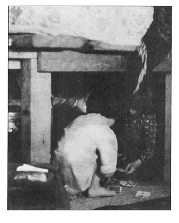
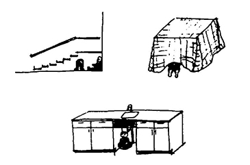
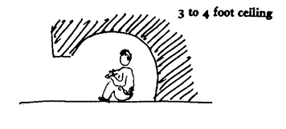

<section class="pattern-plate" aria-labelledby="t-child-caves">
<a href="/patterns">A Pattern Language</a> · <a href="/patterns#buildings">Buildings</a> · Pattern 203 · p. 927
<h1 class="pattern-title" id="t-child-caves">Child Caves</h1><figure class="pattern-figure pl-figure"></figure><nav class="pattern-links" aria-label="Connections"><h2>Links to</h2><ul><li><a href="/patterns/childrens-home">86 Children’s Home</a></li><li><a href="/patterns/childrens-realm">137 Children’s Realm</a></li><li><a href="/patterns/thick-walls">197 Thick Walls</a></li><li><a href="/patterns/thickening-the-outer-walls">211 Thickening The Outer Walls</a></li><li><a href="/patterns/low-doorway">224 Low Doorway</a></li></ul><h2>Linked from</h2><ul><li><a href="/patterns/adventure-playground">73 Adventure Playground</a></li><li><a href="/patterns/bed-cluster">143 Bed Cluster</a></li><li><a href="/patterns/staircase-volume">195 Staircase Volume</a></li><li><a href="/patterns/corner-doors">196 Corner Doors</a></li><li><a href="/patterns/thick-walls">197 Thick Walls</a></li><li><a href="/patterns/thickening-the-outer-walls">211 Thickening The Outer Walls</a></li><li><a href="/patterns/stair-vault">228 Stair Vault</a></li></ul></nav></section><article class="pattern-text" aria-label="The text of Child Caves">
928… the places specially devoted to children’s play—adventure PLAYCROUND (73), <a class="pl-ref" href="/patterns/childrens-home">CHILDREN’S HOME (86)</a>, <a class="pl-ref" href="/patterns/childrens-realm">CHILDREN’S REALM (137)</a>—and <a class="pl-ref" href="/patterns/thick-walls">THICK WALLS (197)</a>—can be embellished with a special detail.

◆ ◆ ◆

<strong>Children love to be in tiny, cave-like places.</strong>

In the course of their play, young children seek out cave-like spaces to get into and under—old crates, under tables, in tents, etc. (For evidence see L. E. White, “The Outdoor Play of Children Living in Flats,” <em>Living in Towns</em>, Leo Kuper, ed., London, 1953, pp. 235–64..)

<figure class="pl-figure"></figure>
They try to make special places for themselves and for their friends—most of the world about them is “adult space” and they are trying to carve out a place that is kid size.

When children are playing in such a “cave”—each child takes up about 5 square feet; furthermore, children like to do this in groups, so the caves should be large enough to accommodate this: these sorts of groups range in size from three to five—so 15 to 25 square feet, plus about 15 square feet for games and circulation, gives a rough maximum size for caves.

Therefore:

929<strong>Wherever children play, around the house, in the neighborhood, in schools, nuke small “caves” for them. Tuck these caves away in natural left over spaces, under stairs, under kitchen counters. Keep the ceiling heights low—2 feet 6 inches to 4 feet—and the entrance tiny.</strong>

<figure class="pl-figure"></figure>
◆ ◆ ◆

Build the caves right into the fabric of the walls—<a class="pl-ref" href="/patterns/thickening-the-outer-walls">THICKENING THE OUTER WALLS (211)</a>. Make the doors very tiny to match the caves—an extreme version of <a class="pl-ref" href="/patterns/low-doorway">LOW DOORWAY (224)</a>….
</article>

Christopher Alexander, Sara Ishikawa and Murray Silverstein, with Max Jacobson, Ingrid Fiksdahl-King and Shlomo Angel, <cite>A Pattern Language</cite> (Oxford University Press, 1977), pattern 203, pp. 927–929. Text and illustrations from the <a href="https://github.com/natureoforder/sources">Nature of Order sources</a> reading edition, transcribed from the 1977 printing; report errors on <a href="https://github.com/natureoforder/alexander-wiki/issues">GitHub</a>.

<a href="/patterns/built-in-seats">← 202 Built-In Seats</a> · <a href="/patterns">All 253 patterns</a> · <a href="/patterns/secret-place">204 Secret Place →</a>

